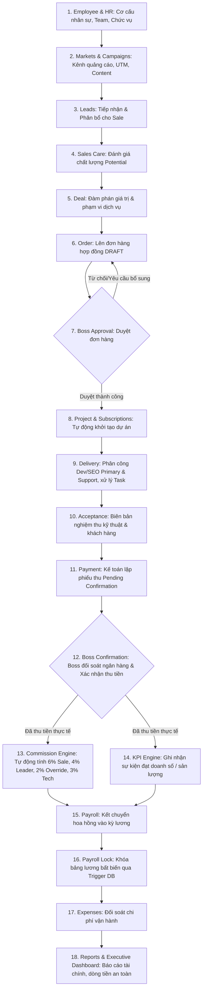
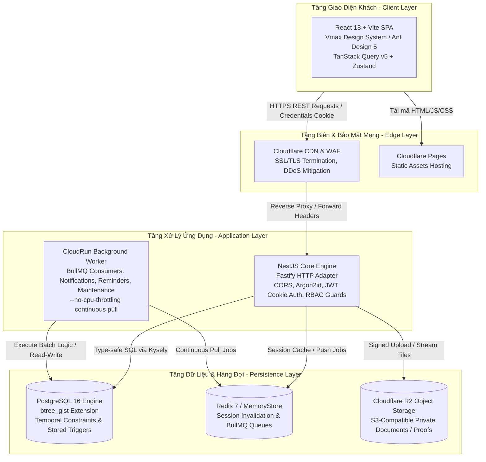
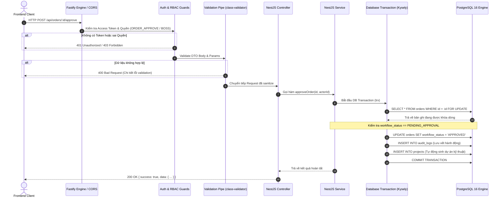
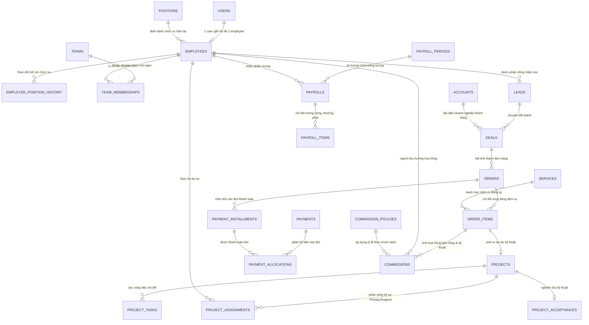
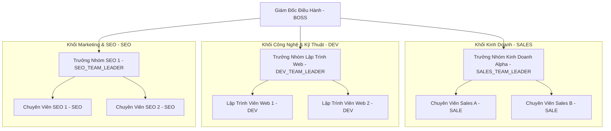

# TÀI LIỆU KIẾN THỨC TOÀN BỘ DỰ ÁN CRM MASTER DATA & ENTERPRISE WORKFLOW
## SỔ TAY ÔN TẬP VÀ HƯỚNG DẪN BẢO VỆ ĐỒ ÁN TỐT NGHIỆP

> **Dành cho:** Developer / Sinh viên ôn luyện, nắm vững toàn diện kiến trúc, nghiệp vụ, CSDL, bảo mật và quy trình vận hành thực tế của dự án CRM.  
> **Phiên bản Hệ Thống:** `1.0.0` (Monorepo: Fastify API + Vite React Web)  
> **UAT Frozen Baseline:** `uat-v1.0.0` (Commit baseline: `758cced`, Latest Commit: `06eb712`)  
> **Nguyên tắc tài liệu:** Bám sát mã nguồn thực tế (Code, Schema DDL, Migrations, Test Suites, Runbooks). Không giả định, không đưa bí mật/mật khẩu thực vào tài liệu, ghi chú minh bạch các điểm còn mở (**OPEN GAP**).

---

## MỤC LỤC TỔNG THỂ

1. [TỔNG QUAN DỰ ÁN](#1-tổng-quan-dự-án)
2. [KIẾN TRÚC HỆ THỐNG](#2-kiến-trúc-hệ-thống)
3. [CẤU TRÚC SOURCE CODE (MONOREPO)](#3-cấu-trúc-source-code-monorepo)
4. [FRONTEND ARCHITECTURE](#4-frontend-architecture)
5. [BACKEND ARCHITECTURE](#5-backend-architecture)
6. [CƠ SỞ DỮ LIỆU & SCHEMA POSTGRESQL](#6-cơ-sở-dữ-liệu--schema-postgresql)
7. [RBAC & HỆ THỐNG BẢO MẬT ĐA LỚP](#7-rbac--hệ-thống-bảo-mật-đa-lớp)
8. [CƠ CẤU TỔ CHỨC & QUẢN TRỊ NHÂN SỰ](#8-cơ-cấu-tổ-chức--quản-trị-nhân-sự)
9. [FROZEN BUSINESS RULES (QUY TẮC NGHIỆP VỤ BẤT BIẾN)](#9-frozen-business-rules-quy-tắc-nghiệp-vụ-bất-biến)
10. [BÁO CÁO, KPI & KỲ LƯƠNG (PAYROLL)](#10-báo-cáo-kpi--kỳ-lương-payroll)
11. [HÀNG ĐỢI XỬ LÝ NỀN (REDIS & BULLMQ) VÀ THÔNG BÁO](#11-hàng-đợi-xử-lý-nền-redis--bullmq-và-thông-báo)
12. [LƯU TRỮ VÀ XỬ LÝ FILE (STORAGE ENGINE)](#12-lưu-trữ-và-xử-lý-file-storage-engine)
13. [QUẢN TRỊ TÀI CHÍNH & PHÂN TÍCH SCHEMA GAP](#13-quản-trị-tài-chính--phân-tích-schema-gap)
14. [TRIẾT LÝ VÀ TIÊU CHUẨN UX/UI](#14-triết-lý-và-tiêu-chuẩn-uxui)
15. [CHIẾN LƯỢC KIỂM THỬ TOÀN DIỆN (TESTING STRATEGY)](#15-chiến-lược-kiểm-thử-toàn-diện-testing-strategy)
16. [QUY TRÌNH KIỂM THỬ CHẤP NHẬN NGƯỜI DÙNG (HUMAN UAT)](#16-quy-trình-kiểm-thử-chấp-nhận-người-dùng-human-uat)
17. [MÔ HÌNH TRIỂN KHAI & HẠ TẦNG (DEPLOYMENT)](#17-mô-hình-triển-khai--hạ-tầng-deployment)
18. [SAO LƯU, PHỤC HỒI & CƠ CHẾ RESET UAT AN TOÀN](#18-sao-lưu-phục-hồi--cơ-chế-reset-uat-an-toàn)
19. [SỔ TAY XỬ LÝ SỰ CỐ (TROUBLESHOOTING RUNBOOK)](#19-sổ-tay-xử-lý-sự-cố-troubleshooting-runbook)
20. [CÁC QUYẾT ĐỊNH THIẾT KẾ KIẾN TRÚC QUAN TRỌNG (ADR)](#20-các-quyết-định-thiết-kế-kiến-trúc-quan-trọng-adr)
21. [BỘ 50 CÂU HỎI VẤN ĐÁP BẢO VỆ ĐỒ ÁN & CÂU HỎI HỘI ĐỒNG HỎI XOÁY](#21-bộ-50-câu-hỏi-vấn-đáp-bảo-vệ-đồ-án--câu-hỏi-hội-đồng-hỏi-xoáy)
22. [KỊCH BẢN BẢO VỆ ĐỒ ÁN (5 PHÚT & FLOW 10-20 PHÚT)](#22-kịch-bản-bảo-vệ-đồ-án-5-phút--flow-10-20-phút)
23. [DANH MỤC CÁC KHOẢNG TRỐNG KỸ THUẬT & OPEN GAPS TOÀN DIỆN](#23-danh-mục-các-khoảng-trống-kỹ-thuật--open-gaps-toàn-diện)
24. [BẢNG TRẠNG THÁI HIỆN TẠI CỦA DỰ ÁN (PROJECT STATUS)](#24-bảng-trạng-thái-hiện-tại-của-dự-án-project-status)
25. [BẢNG TRA CỨU NHANH & LỘ TRÌNH ÔN THI BẢO VỆ (1 - 3 - 7 NGÀY)](#25-bảng-tra-cứu-nhanh--lộ-trình-ôn-thi-bảo-vệ-1---3---7-ngày)

---

## 1. TỔNG QUAN DỰ ÁN

### 1.1 Tên hệ thống và bài toán doanh nghiệp
* **Tên hệ thống:** CRM Master Data & Enterprise Workflow System (Hệ thống Quản trị Quan hệ Khách hàng, Dữ liệu Chủ và Luồng nghiệp vụ Vận hành Khép kín).
* **Bối cảnh doanh nghiệp:** Các công ty dịch vụ phần mềm, giải pháp số và marketing trực tuyến (Agency / Tech Solutions) thường đối mặt với tình trạng phân mảnh thông tin nghiêm trọng:
  - Lead từ Facebook Ads / Google Ads lưu trên Google Sheets rải rác.
  - Hợp đồng và đơn hàng duyệt miệng qua Zalo hoặc email, dễ thất thoát chiết khấu.
  - Dev/SEO triển khai nhưng không gắn chặt với phạm vi thanh toán của khách.
  - Kế toán xác nhận thu tiền nhưng không biết nhân viên Sale nào chốt để trích hoa hồng.
  - Tính hoa hồng (Commission) và lương (Payroll) cuối tháng thường xuyên tranh chấp do không tái hiện được trạng thái nhân sự tại đúng thời điểm nghiệm thu.
* **Mục tiêu của dự án:** Xây dựng một **Single Source of Truth** (Nguồn chân lý duy nhất) kết nối khép kín từ lúc phát sinh dữ liệu tiếp thị (Market/Channel/Campaign/Lead) $\rightarrow$ Bán hàng (Deal/Order) $\rightarrow$ Phê duyệt điều hành (Boss Approval) $\rightarrow$ Bàn giao kỹ thuật (Project/Task/Acceptance) $\rightarrow$ Thu tiền (Payment Confirmation) $\rightarrow$ Tính thưởng tự động (Commission/KPI) $\rightarrow$ Khóa sổ bảng lương (Locked Payroll Period).

### 1.2 Đối tượng sử dụng và phạm vi vai trò
Hệ thống được thiết kế phục vụ **9 nhóm vai trò nghiệp vụ (Roles)** cụ thể với **12 tài khoản UAT** được thiết lập chuẩn hóa:
1. **BOSS (Giám Đốc Điều Hành):** Toàn quyền kiểm soát chiến lược; nắm giữ độc quyền phê duyệt đơn hàng, xác nhận tiền thực thu vào tài khoản, duyệt ngân quỹ và khóa bảng lương; quản lý mã PIN bảo mật cấp cao.
2. **ADMIN (Quản Trị Hệ Thống):** Quản trị danh mục hệ thống, cấu hình tham số, phân quyền nhân sự, giám sát log vận hành; không thay thế quyết định tài chính của Boss.
3. **ACCOUNTANT (Kế Toán Doanh Nghiệp):** Khởi tạo phiếu thu tiền từ khách hàng (chờ Boss duyệt), lập hóa đơn, ghi nhận chứng từ chi phí vận hành, đối soát công nợ.
4. **SALES_TEAM_LEADER (Trưởng Nhóm Kinh Doanh):** Quản lý thành viên team Sale, phân bổ Lead, theo dõi doanh số chốt đơn của cả nhóm, hưởng hoa hồng cá nhân và hoa hồng quản lý nhóm.
5. **SALE (Chuyên Viên Kinh Doanh):** Tiếp nhận Lead, liên hệ tư vấn, chuyển hóa thành Deal, lên đơn hàng hợp đồng (DRAFT) gửi duyệt, chăm sóc khách hàng.
6. **DEV_TEAM_LEADER (Trưởng Nhóm Kỹ Thuật Lập Trình):** Tiếp nhận dịch vụ đã duyệt, phân công kỹ sư chính (PRIMARY) và hỗ trợ (SUPPORT), quản trị task và milestone kỹ thuật.
7. **DEV (Kỹ Sư Lập Trình):** Thực thi công việc kỹ thuật được giao, cập nhật tiến độ task, bàn giao tài liệu kỹ thuật để phục vụ nghiệm thu.
8. **SEO_TEAM_LEADER (Trưởng Nhóm SEO / Content):** Phân bổ hạn ngạch bài viết SEO cho thành viên theo kỳ dịch vụ, duyệt nội dung và xuất bản bài viết.
9. **SEO (Chuyên Viên SEO / Content):** Viết bài chuẩn SEO theo yêu cầu của kỳ dịch vụ (Subscription/Service Period), nộp bài chờ nghiệm thu.

### 1.3 Business Flow Khép Kín (End-to-End Enterprise Flow)



#### Chi tiết 18 bước nghiệp vụ:
1. **HR & Team:** Tổ chức nhân sự theo phòng ban (Sales, Dev, SEO), gán chức vụ và thiết lập lịch sử lương cơ bản.
2. **Marketing & Acquisition:** Cấu hình nền tảng (Facebook, Google, TikTok), kênh tiếp thị và bài viết Content thu hút khách.
3. **Leads:** Thu thập Lead, hệ thống hỗ trợ lọc thông minh theo tên/mã nhân viên Sale phụ trách để giao việc.
4. **Sales Care:** Sale gọi điện tư vấn, ghi lại nhật ký cuộc gọi/gặp mặt (`sales_activities`), thẩm định `POTENTIAL` hoặc `NOT_POTENTIAL`.
5. **Deal Negotiation:** Nâng cấp Lead tiềm năng thành Deal, chốt tổng giá trị hợp đồng và phương án thanh toán trả góp theo đợt.
6. **Order Draft:** Tạo đơn hàng ở trạng thái `DRAFT`, nhập từng dòng dịch vụ (`order_items`), tải lên hợp đồng pháp lý đính kèm.
7. **Boss Order Review:** Boss thẩm định đơn hàng. Nếu có chiết khấu cao vượt thẩm quyền hoặc thiếu hồ sơ, Boss yêu cầu giải trình (`NEED_MORE_INFO`) hoặc từ chối (`REJECTED`). Khi duyệt (`APPROVED`), đơn hàng kích hoạt sinh Project kỹ thuật.
8. **Project Initiation:** Hệ thống tự động ánh xạ các `order_items` đủ điều kiện sang bảng `projects` kỹ thuật hoặc `subscriptions` định kỳ.
9. **Project Delivery:** Team Leader (Dev/SEO) phân công nhân sự: tối đa 2 kỹ sư chính (`PRIMARY`) và các nhân sự phụ trợ (`SUPPORT`). Thành viên cập nhật Task và Milestone.
10. **Customer Acceptance:** Khi dự án hoàn thành, ghi nhận biên bản nghiệm thu (`project_acceptances`) có chữ ký xác nhận của khách hàng và tài liệu minh chứng.
11. **Payment Initiation:** Kế toán đối soát chứng từ ủy nhiệm chi của khách, tạo bản ghi `payments` ở trạng thái `PENDING_CONFIRMATION` (tuyệt đối chưa ghi nhận doanh số).
12. **Boss Cash Confirmation:** Độc quyền Boss kiểm tra tài khoản ngân hàng doanh nghiệp và xác nhận `CONFIRMED`. Tại thời điểm này, tiền mới chính thức được ghi nhận là dòng tiền vào.
13. **Commission Calculation:** Hệ thống tự động kích hoạt tính toán hoa hồng dựa trên các chính sách bất biến: hoa hồng bán hàng cho Sale, hoa hồng chốt của Leader, hoa hồng quản lý nhóm (Team Override) và hoa hồng bàn giao kỹ thuật cho Dev/SEO.
14. **KPI Evaluation:** Tự động đối soát định mức KPI tháng, ghi nhận các sự kiện đạt doanh thu hoặc số bài viết xuất bản.
15. **Payroll Preparation:** Kế toán tạo kỳ lương tháng, tập hợp lương cứng, hoa hồng đã duyệt và các khoản thưởng KPI.
16. **Payroll Lock:** Boss phê duyệt và khóa kỳ lương (`LOCKED`). Trigger CSDL tự động kích hoạt chế độ cấm chỉnh sửa hay xóa dữ liệu lương.
17. **Expense Management:** Kế toán và nhân sự đề xuất các chi phí vận hành (thuê server, marketing, văn phòng phẩm); Boss phê duyệt chi.
18. **Executive Reports:** Bảng điều khiển quản trị hiển thị các chỉ số tài chính an toàn: Thực thu, Công nợ, Chi phí, Dòng tiền sổ cái (minh bạch các vùng dữ liệu chưa có).

---

## 2. KIẾN TRÚC HỆ THỐNG

### 2.1 Sơ đồ kiến trúc tổng thể (Mermaid Architecture Diagram)



### 2.2 Vai trò chi tiết của từng thành phần
* **Frontend (React + Vite):** Chịu trách nhiệm hiển thị giao diện người dùng đơn trang (SPA), quản lý trạng thái client qua Zustand và đồng bộ dữ liệu server bằng TanStack Query. Tuân thủ triết lý: hiển thị danh xưng nghiệp vụ (tên nhân viên, mã nhân viên, chức vụ), che giấu các ID kỹ thuật nội bộ khỏi tầm mắt người dùng.
* **Backend (NestJS + Fastify):** Đóng vai trò hạt nhân trung tâm xử lý nghiệp vụ, điều hướng request thông qua Controller, thực thi logic và transaction qua Service, áp đặt kiểm soát quyền bằng Guards (`BossOnlyGuard`, `PermissionsGuard`), và quản lý phiên đăng nhập an toàn. Sử dụng Fastify thay thế Express giúp tăng thông lượng xử lý I/O và tối ưu bộ nhớ.
* **Database (PostgreSQL 16):** Là nguồn chân lý tối cao của hệ thống. Không chỉ lưu trữ dữ liệu, CSDL trực tiếp thực thi các ràng buộc bảo vệ toàn vẹn: khóa ngoại `FOREIGN KEY`, kiểm tra logic `CHECK`, loại trừ khoảng thời gian giao nhau `EXCLUDE USING gist`, và các thủ tục hàm trigger chặn đứng thao tác chỉnh sửa trái phép khi kỳ lương bị khóa (`LOCKED`).
* **Redis 7 (In-Memory Data Store):** Đảm nhiệm 3 trọng trách:
  1. Quản lý phiên làm việc (`session:*`): Lưu trữ token làm mới (Refresh Token) kèm cơ chế thu hồi tức thì khi đăng xuất hoặc đổi mật khẩu.
  2. Lưu trữ phiên xác thực mã PIN của Boss (`boss_pin_session:*`): Cho phép thực hiện các tác vụ nhạy cảm trong thời hạn ngắn mà không phải nhập lại PIN liên tục.
  3. Hạ tầng trung chuyển cho BullMQ: Hàng đợi công việc bất đồng bộ.
* **BullMQ:** Hệ thống điều phối hàng đợi tác vụ nền, chịu trách nhiệm gửi thông báo hàng loạt, quét công nợ quá hạn và chạy tác vụ bảo trì định kỳ mà không làm nghẽn luồng xử lý HTTP request chính của người dùng.
* **Cơ chế giao tiếp REST API & Phân định Socket.IO:**
  - Nghiệp vụ truy vấn và biến đổi dữ liệu (CRUD, Workflows, Approvals) sử dụng **REST API chuẩn** kèm DTO validation nghiêm ngặt.
  - Dự án hiện tại **không phụ thuộc bắt buộc vào Socket.IO cho luồng nghiệp vụ cốt lõi**. Các thông báo real-time được tối ưu qua cơ chế Refetch của TanStack Query và hàng đợi BullMQ. Kiến trúc này giúp hệ thống duy trì tính Stateless (không trạng thái), dễ dàng scale-out trên môi trường Serverless mà không gặp vấn đề sticky-session của WebSocket.

### 2.3 Lý do lựa chọn kiến trúc: Trả lời câu hỏi phản biện bảo vệ đồ án

#### Tại sao dùng Modular Monolith mà không chọn Microservices?
1. **Bản chất nghiệp vụ:** Nghiệp vụ CRM đòi hỏi tính nhất quán tài chính nghiêm ngặt (Strict ACID Consistency). Ví dụ: Khi Boss duyệt một khoản thanh toán (`confirmPayment`), hệ thống phải đồng thời cập nhật trạng thái phiếu thu, tính lại công nợ đơn hàng, kiểm tra điều kiện giải phóng bàn giao, và ghi nhận hoa hồng. Trong Modular Monolith, luồng này chạy trọn vẹn trong **một PostgreSQL Database Transaction duy nhất**. Nếu dùng Microservices, ta phải áp dụng mô hình phân tán Saga hoặc Two-Phase Commit (2PC), phức tạp và chi phí vận hành hạ tầng vượt quá quy mô doanh nghiệp vừa và nhỏ.
2. **Tổ chức mã nguồn:** Dự án chia tách rõ ràng thành hơn 20 module độc lập trong thư mục `apps/api/src/modules/` (mỗi module có Controller, Service, DTO riêng). Điều này đảm bảo tính đóng gói cao (High Cohesion, Low Coupling), dễ dàng chia tách thành microservice riêng trong tương lai nếu một module cụ thể (như Notification hay Reporting) cần tài nguyên mở rộng đột biến.

#### Tại sao dùng Kysely thay vì Prisma hoặc TypeORM?
1. **Kiểm soát câu truy vấn SQL:** Prisma sinh câu lệnh SQL ngầm, gặp nhiều vấn đề với câu truy vấn phức tạp nhiều tầng JOIN, GROUP BY hoặc xử lý kiểu dữ liệu nâng cao như khoảng thời gian `TSTZRANGE` và toán tử `&&`.
2. **Hiệu năng & Trọng lượng:** Prisma sử dụng một binary Query Engine nặng nề bằng Rust, làm tăng thời gian khởi động (Cold Start) khi chạy trên môi trường Container Serverless (Cloud Run). Kysely là một thư viện TypeScript thuần túy, nhẹ, biên dịch câu lệnh trực tiếp thành chuỗi SQL chuẩn.
3. **Type-safety bám sát schema:** Kysely cho phép viết SQL tự nhiên nhưng vẫn đảm bảo kiểm tra kiểu tĩnh (compile-time type safety) bám sát schema CSDL.

#### Tại sao dùng PostgreSQL thay vì MongoDB hay Firebase?
1. **Quan hệ dữ liệu phức tạp:** CRM có hơn 60 bảng liên kết chặt chẽ qua hàng trăm khóa ngoại. Mô hình NoSQL Document của MongoDB sẽ dẫn đến tình trạng nhân bản dữ liệu (data duplication) hoặc phải thực hiện hàng loạt thao tác `$lookup` tốn kém và không có ràng buộc toàn vẹn ở tầng storage.
2. **Toán tử Temporal & Exclusion Constraint:** PostgreSQL sở hữu extension `btree_gist`, cho phép ngăn chặn nhân viên giữ 2 team cùng lúc hoặc ghi nhận trùng kỳ lương bằng câu lệnh khai báo tầng CSDL. MongoDB hoàn toàn không có tính năng này ở cấp độ engine.

---

## 3. CẤU TRÚC SOURCE CODE (MONOREPO)

Dự án sử dụng mô hình Monorepo quản lý qua `pnpm workspaces`:

```
du-an-cuoi-khoa-f8/
├── apps/
│   ├── api/                     # Backend NestJS + Fastify Application
│   │   ├── src/
│   │   │   ├── config/          # Cấu hình môi trường (JWT, Database, Port, CORS)
│   │   │   ├── database/        # Kysely Service & Database Connection Pool
│   │   │   ├── modules/         # Các module nghiệp vụ chính (20+ modules)
│   │   │   │   ├── auth/        # Xác thực, Argon2id, Refresh Token, Boss PIN
│   │   │   │   ├── rbac/        # Guards, Phân quyền, Role-Permission Mapping
│   │   │   │   ├── employees/   # Hồ sơ nhân sự, Điều chuyển, Bổ nhiệm chức vụ
│   │   │   │   ├── teams/       # Cơ cấu đội ngũ, Quản lý Team Leader
│   │   │   │   ├── leads/       # Quản trị Lead, Phân bổ Sale thông minh
│   │   │   │   ├── deals/       # Đàm phán cơ hội, Chốt Deal Won/Lost
│   │   │   │   ├── orders/      # Đơn hàng, Phê duyệt, Chiết khấu, Đổi yêu cầu
│   │   │   │   ├── projects/    # Phân công dự án (Primary/Support), Task, Nghiệm thu
│   │   │   │   ├── payments/    # Tạo phiếu thu, Boss xác nhận tiền về
│   │   │   │   ├── commissions/ # Động cơ tính hoa hồng 4 lớp (Sale, Leader, Tech)
│   │   │   │   ├── kpi/         # Động cơ đánh giá chỉ số hiệu suất
│   │   │   │   ├── payroll/     # Bảng tính lương, Điều chỉnh, Khóa kỳ lương
│   │   │   │   ├── expenses/    # Quản trị chi phí vận hành doanh nghiệp
│   │   │   │   ├── finance/     # Tổng hợp thực thu, công nợ và sổ cái dòng tiền
│   │   │   │   ├── queue/       # BullMQ Workers (Notification, Reminder, Maintenance)
│   │   │   │   ├── storage/     # Quản lý upload chứng từ (Local / Cloudflare R2)
│   │   │   │   └── organization-chart/ # Cây sơ đồ tổ chức phòng ban thực tế
│   │   │   ├── main.ts          # Entry point chính của API Server (HTTP Fastify)
│   │   │   └── worker.main.ts   # Entry point chuyên biệt cho Cloud Run Worker Pool
│   │   └── test/                # Unit test & Integration test specs
│   └── web/                     # Frontend Single Page Application (SPA)
│       ├── src/
│       │   ├── api/             # HTTP Client wrappers (fetchWithAuth, Typed API functions)
│       │   ├── components/      # UI Components dùng chung (Modals, Tables, Forms)
│       │   ├── layout/          # MainLayout (Sidebar, Navigation Header, User Profile)
│       │   ├── pages/           # Màn hình chức năng (Dashboard, Orders, Payments, HR...)
│       │   ├── store/           # Zustand Stores (authStore, global UI state)
│       │   ├── styles/          # Vmax Design System CSS tokens & component rules
│       │   ├── utils/           # Helper format tiền tệ VND, ngày tháng, sanitize input
│       │   └── App.tsx          # Khai báo Client Routing & Phân tầng bảo vệ RoleRoute
├── database/                    # Tài nguyên CSDL cốt lõi
│   ├── crm_order_schema.sql     # DDL Schema V4.2 chuẩn toàn bộ 68 bảng & ràng buộc
│   ├── crm_seed.sql             # Bộ dữ liệu mẫu nền tảng (9 roles, 75 permissions, catalog)
│   ├── migrations/              # Các bản cập nhật CSDL tăng tiến (Incremental Migrations)
│   ├── runtime_constraint_test.sql # Bộ test kiểm chứng ràng buộc toàn vẹn CSDL
│   └── backups/                 # Nơi lưu trữ các snapshot sao lưu nhị phân (.dump)
├── docs/                        # Tài liệu kiến trúc, ERD, Runbooks vận hành
├── scripts/                     # Shell scripts tự động hóa vận hành Staging/UAT
│   ├── uat-backup.sh            # Script chụp snapshot CSDL nhị phân an toàn
│   ├── uat-reset.sh             # Script khôi phục sạch môi trường Staging 1-Click
│   └── uat-restore.sh           # Script nạp lại một bản snapshot dump cụ thể
├── packages/                    # Thư viện chia sẻ nội bộ (Shared Types, Config Constants)
└── package.json                 # Định nghĩa workspace commands & root dependencies
```

---

## 4. FRONTEND ARCHITECTURE

### 4.1 Ngăn xếp công nghệ Client
* **React 18 & TypeScript:** Đảm bảo tính chặt chẽ về dữ liệu, giảm thiểu tối đa lỗi `undefined` hoặc sai cấu trúc dữ liệu từ API.
* **Vite:** Công cụ đóng gói hiện đại, thời gian khởi động môi trường dev tính bằng mili-giây, hỗ trợ Hot Module Replacement (HMR).
* **Ant Design 5 (AntD):** Thư viện thành phần doanh nghiệp, được tùy biến toàn diện giao diện thông qua bộ thiết kế **Vmax Design System** (Màu chủ đạo `#0C6B37` - Xanh ngọc lục bảo doanh nghiệp, bo tròn góc thẻ `borderRadiusLG: 16`, chuẩn hóa chiều cao điều khiển `controlHeight: 42`).
* **TanStack Query v5 (React Query):** Quản lý cache server-state, tự động hóa cơ chế hủy request khi chuyển trang, điều phối refetching và giữ đồng bộ dữ liệu giữa các tab mà không cần tải lại toàn bộ trang.
* **Zustand:** Quản lý client-state nhẹ (lưu thông tin phiên đăng nhập `user`, danh sách quyền `permissions`, vai trò `roles`), tránh hiện tượng re-render dư thừa.

### 4.2 Luồng dịch chuyển của một tương tác người dùng (Lifecycle of a Request)

```
[Người dùng click button "Phân công Lead"]
         │
         ▼
[React Component: LeadAssignModal.tsx]
  - Thu thập input từ form AntD (searchable Select chọn nhân viên Sale)
  - Validate tính hợp lệ dữ liệu (bắt buộc chọn Sale, ghi chú lý do)
         │
         ▼
[React Query Mutation / API Function: assignLeadApi()]
  - Đóng gói payload: { toSaleId, reason }
         │
         ▼
[fetchWithAuth Wrapper (apps/web/src/api/auth.ts)]
  - Đính kèm Access Token vào Header: `Authorization: Bearer <token>`
  - Đính kèm Credentials Cookie (chứa refresh token HttpOnly)
  - Xử lý chặn tự động nếu token hết hạn (tự gọi endpoint refresh ngầm)
         │
         ▼
[Gửi HTTPS Request qua Mạng tới Backend Fastify API]
         │
         ▼
[Backend xử lý: Guard -> ValidationPipe -> Service Transaction -> Database Commit]
         │
         ▼
[Backend trả về JSON Response: { success: true, data: { ... } }]
         │
         ▼
[fetchWithAuth kiểm tra HTTP Status 200/201]
         │
         ▼
[TanStack Query onSuccess Handler]
  - Invalidate cache query liên quan: ['leads', leadId], ['leads-list']
  - Kích hoạt notification thông báo thành công (AntD message.success)
  - Đóng Modal
         │
         ▼
[UI tự động cập nhật lại thông tin mới nhất trên giao diện]
```

### 4.3 Phân tầng bảo vệ tuyến đường (Frontend Route Protection & RBAC)
Hệ thống sử dụng hai lớp vỏ bọc định tuyến lồng nhau:
1. **`ProtectedRoute`:** Kiểm tra người dùng đã đăng nhập hay chưa (thông qua `isAuthenticated` trong `authStore`). Nếu chưa đăng nhập hoặc token không hợp lệ, chuyển hướng ngay về `/login`.
2. **`RoleRoute`:** Kiểm tra danh sách vai trò (`user.roles`).
   - Cung cấp cơ chế mở rộng cho Ban Giám Đốc: Mặc định vai trò `BOSS` và `ADMIN` được tự động cấp quyền truy cập vào các màn hình nghiệp vụ thông thường mà không cần khai báo lặp lại.
   - Hỗ trợ chế độ bảo vệ nghiêm ngặt (`strict = true`): Chỉ duy nhất vai trò được chỉ định mới được vào. Ví dụ: Trang Quản trị Tài khoản Nhân sự (`/employee-accounts`) và Sơ đồ tổ chức (`/organization-chart`) được cấu hình `strict allowedRoles={['BOSS']}`, ngăn chặn hoàn toàn cả Admin lẫn các phòng ban khác xem dữ liệu mật của Boss.

### 4.4 Các tiêu chuẩn UX/UI được áp dụng
* **Trạng thái bảng (Table UX):** Các bảng danh sách hỗ trợ phân trang phía máy chủ (`server-side pagination`), lọc theo điều kiện và sắp xếp theo ngày tạo giảm dần.
* **Trạng thái rỗng (Empty States):** Không để bảng trắng trơn gây hoang mang; luôn hiển thị component rỗng kèm nút kêu gọi hành động (Call To Action - CTA) như "Chưa có đơn hàng nào - Nhấn vào đây để tạo đơn mới".
* **Tìm kiếm có gợi ý (Searchable Select):** Không bắt người dùng nhập mã ID dạng số (như `sale_id: 12`). Tất cả các trường liên kết đều sử dụng Select cho phép gõ tìm kiếm theo tên hoặc mã nhân viên (`full_name (employee_code)`).

---

## 5. BACKEND ARCHITECTURE

### 5.1 NestJS Core Engine & Fastify Adapter
* **Tại sao dùng Fastify thay vì Express?**
  Fastify có kiến trúc hướng sự kiện hiệu năng cao, giảm 40-60% độ trễ (latency) của router và tối ưu việc serialize JSON so với Express. Trong các bài kiểm tra áp lực (Stress Test) và kiểm thử hiệu năng Phase Q (`phase-q-perf.spec.ts`), Fastify duy trì thời gian phản hồi API trung bình dưới 50ms đối với các tác vụ truy vấn nghiệp vụ phức tạp.
* **Cơ chế Pipeline của một HTTP Request:**



### 5.2 Xử lý Transaction và chống tranh chấp dữ liệu (Concurrency Control)
* **Kỹ thuật khóa dòng bi quan (`SELECT ... FOR UPDATE`):**
  Khi xử lý các hành động trạng thái nhạy cảm (như duyệt đơn hàng, xác nhận thu tiền, tăng giáng chức), Service luôn áp dụng `forUpdate()` trong Kysely transaction. Điều này ngăn chặn tình huống hai người dùng cùng bấm nút duyệt một lúc (Race Condition), đảm bảo yêu cầu thứ hai sẽ bị từ chối do trạng thái đơn hàng đã đổi khác `PENDING_APPROVAL`.
* **Sắp xếp thứ tự khóa để chống Deadlock (Lock Ordering):**
  Trong chức năng phân bổ tiền vào nhiều đợt thanh toán (`confirmPayment`), hệ thống sắp xếp các `installment_id` theo thứ tự tăng dần (`ASC`) trước khi gọi `FOR UPDATE`. Kỹ thuật này triệt tiêu khả năng xảy ra hiện tượng kẹt khóa chéo (Deadlock) giữa các luồng giao dịch đồng thời.

### 5.3 4 Ví dụ API thực tế trong mã nguồn
1. **API Phê duyệt đơn hàng (`POST /api/orders/:id/approve`):**
   - *Bảo vệ:* `@UseGuards(JwtAuthGuard, BossOnlyGuard)`
   - *Logic:* Khóa bản ghi đơn hàng, chuyển trạng thái từ `PENDING_APPROVAL` sang `APPROVED`, tự động sinh bản ghi `projects` cho từng `order_item` dịch vụ, ghi nhật ký `audit_logs`, gửi thông báo cho Sale phụ trách.
2. **API Xác nhận tiền về thực tế (`POST /api/payments/:id/confirm`):**
   - *Bảo vệ:* `@UseGuards(JwtAuthGuard, BossOnlyGuard)`
   - *Logic:* Khóa thanh toán, xác nhận tiền đã vào tài khoản, cập nhật đợt thanh toán (`payment_installments`), cập nhật trạng thái đơn hàng thành `PARTIALLY_PAID` hoặc `FULLY_PAID`, kích hoạt động cơ tính hoa hồng cho nhân viên.
3. **API Bổ nhiệm / Tăng / Giáng chức (`POST /api/employees/:id/change-position`):**
   - *Bảo vệ:* `@UseGuards(JwtAuthGuard, BossOnlyGuard)`
   - *Logic:* Đóng khoảng thời gian hiệu lực cũ trong `employee_position_history`, mở khoảng thời gian mới, cập nhật chức vụ hiện tại, tự động điều chỉnh quyền trưởng nhóm trong `team_memberships` nếu chức danh thay đổi.
4. **API Phân công Lead cho Sale (`POST /api/leads/:id/assign`):**
   - *Bảo vệ:* `@UseGuards(JwtAuthGuard, PermissionsGuard)` kèm `@RequirePermissions('LEAD_ASSIGN')`
   - *Logic:* Kiểm tra quyền hạn của người giao việc (Team Leader chỉ được giao cho nhân viên trong nhóm của mình, Boss/Admin được giao toàn quyền), lưu vết vào `lead_assignment_history`.

---

## 6. CƠ SỞ DỮ LIỆU & SCHEMA POSTGRESQL

Hệ thống sở hữu CSDL quan hệ chuẩn mực gồm **68 bảng nghiệp vụ**, phân bổ trên 16 module logic.

### 6.1 Sơ đồ mối quan hệ thực thể cốt lõi (Core Entity Relationship Diagram)



### 6.2 Phân tích các bảng theo nhóm chức năng

#### 1. Nhóm Nhân sự, Tài khoản & Tổ chức (HR & Identity)
* `users`: Lưu trữ thông tin đăng nhập (`username`, `email`, `password_hash` mã hóa bằng Argon2id, `status` ACTIVE/DISABLED).
* `positions`: Danh mục chức vụ chuẩn (`BOSS`, `ADMIN`, `ACCOUNTANT`, `SALES_TEAM_LEADER`, `SALE`, `DEV_TEAM_LEADER`, `DEV`, `SEO_TEAM_LEADER`, `SEO`).
* `employees`: Hồ sơ nhân sự thực tế (`employee_code`, `full_name`, `phone`, `hire_date`, `position_id`). Liên kết 0..1 <-> 0..1 với `users` (nhân viên có thể chưa được cấp tài khoản phần mềm).
* `employee_position_history`: Lưu vết lịch sử bổ nhiệm chức vụ theo thời gian `effective_range` (`TSTZRANGE`).
* `salary_history`: Lưu vết lịch sử biến động lương cơ bản theo thời gian.
* `teams`: Đội ngũ nghiệp vụ thuộc các phòng ban (`SALES`, `DEV`, `SEO`).
* `team_memberships`: Thành viên thuộc nhóm theo thời gian, định danh vai trò trưởng nhóm `is_leader`.

#### 2. Nhóm Tiếp thị, Khách hàng & Cơ hội (Acquisition, Leads, Deals)
* `platforms`, `channels`, `campaigns`: Cấu hình nền tảng quảng cáo và nguồn gốc thu hút Lead (UTM source, medium, campaign).
* `leads`: Khách hàng tiềm năng (`full_name`, `phone`, `email`, `status` NEW/CONTACTED/QUALIFIED/CONVERTED/LOST, `assigned_sale_id`).
* `lead_assignment_history`: Lưu nhật ký điều chuyển Lead giữa các nhân viên kinh doanh.
* `accounts`, `contacts`: Thông tin pháp nhân doanh nghiệp khách hàng và người liên hệ đại diện.
* `deals`: Cơ hội bán hàng được nâng cấp từ Lead (`deal_value`, `stage` DISCOVERY/PROPOSAL/NEGOTIATION/WON/LOST).

#### 3. Nhóm Đơn hàng & Dịch vụ (Orders & Order Items)
* `services`: Danh mục sản phẩm/dịch vụ kinh doanh (Thiết kế Web, App Mobile, Dịch vụ SEO, Hạ tầng Cloud).
* `orders`: Đơn hàng hợp đồng (`order_code`, `account_id`, `total_amount`, `workflow_status` DRAFT/PENDING_APPROVAL/APPROVED/REJECTED/CANCELLED).
* `order_items`: Từng dịch vụ trong đơn hàng (`net_service_value`, `delivery_status`, `payment_status`).
* `discount_requests`: Đề xuất giảm giá/chiết khấu đơn hàng vượt quá thẩm quyền của Sale, bắt buộc Boss duyệt.

#### 4. Nhóm Triển khai Dự án & Nghiệm thu (Projects & Delivery)
* `projects`: Dự án kỹ thuật (`project_name`, `status` ASSIGNED/IN_PROGRESS/UNDER_REVIEW/COMPLETED, `materialized_progress_percent`).
* `project_assignments`: Phân công kỹ sư (`assignment_type` PRIMARY/SUPPORT, `is_active`, `assigned_at`, `unassigned_at`).
* `project_milestones`, `project_tasks`: Các mốc tiến độ quan trọng và chi tiết đầu việc kỹ thuật.
* `project_acceptances`: Biên bản nghiệm thu kỹ thuật và sự hài lòng của khách hàng (`accepted_at`, `evidence_document_url`).

#### 5. Nhóm Thanh toán, Hoa hồng & Lương (Financials & Payroll)
* `payment_installments`: Các đợt thanh toán chia nhỏ của đơn hàng kèm ngày đến hạn (`due_date`).
* `payments`: Phiếu ghi nhận tiền thu (`gross_cash_amount`, `status` PENDING_CONFIRMATION/CONFIRMED/REJECTED, `confirmed_by_employee_id`).
* `payment_allocations`: Chi tiết số tiền thực thu được gán vào từng đợt thanh toán của dịch vụ nào.
* `commission_policies`: Chính sách hoa hồng doanh nghiệp (tỷ lệ %, chức danh áp dụng, số lượng người tham gia).
* `commissions`: Bản ghi tính hoa hồng bất biến (`commission_base`, `rate_snapshot`, `calculated_amount`, `status` UNEARNED/RELEASED/CALCULATED/APPROVED/IN_PAYROLL/PAID).
* `payroll_periods`: Kỳ tính lương tháng (`start_date`, `end_date`, `status` DRAFT/PROCESSING/APPROVED/LOCKED).
* `payrolls`: Phiếu lương của từng nhân viên trong kỳ.
* `payroll_items`: Chi tiết cấu thành thu nhập (Lương cơ bản, Hoa hồng bán hàng, Thưởng KPI, Phụ cấp, Khấu trừ).
* `expenses`: Chi phí vận hành doanh nghiệp (`expense_category_id`, `amount`, `is_approved`).

#### 6. Nhóm Hỗ trợ & Giám sát (Cross-cutting & Audit)
* `notifications`: Thông báo hệ thống có đánh dấu `idempotency_key` chống trùng lặp.
* `audit_logs`: Nhật ký kiểm toán các thao tác thêm/sửa/xóa nhạy cảm (lưu vết `payload_before_sanitized` và `payload_after_sanitized`).
* `dynamic_options`: Lưu trữ các tùy chọn gợi ý nhập liệu động theo cơ chế tự học hỏi tần suất sử dụng.

### 6.3 Các ràng buộc CSDL độc đáo (Constraints & Triggers)

#### 1. Ràng buộc loại trừ khoảng thời gian (Temporal Exclusion Constraints via btree_gist)
* **Chống trùng lặp chức vụ (`no_overlapping_position_history`):** Một nhân viên không thể giữ hai chức vụ khác nhau tại cùng một thời điểm.
* **Chống trùng lặp thành viên nhóm (`no_overlapping_team_membership`):** Một nhân viên không thể trực thuộc hai nhóm kinh doanh cùng lúc.
* **Chống trùng lặp trưởng nhóm (`no_overlapping_team_leader`):** Tại một thời điểm, một nhóm **chỉ được phép có duy nhất một trưởng nhóm** (`WHERE is_leader = TRUE`).

```sql
CONSTRAINT no_overlapping_team_leader EXCLUDE USING gist (
    team_id WITH =,
    effective_range WITH &&
) WHERE (is_leader = TRUE);
```

#### 2. Trigger bảo vệ kỳ lương bị khóa (`fn_check_payroll_locked`)
Khi `payroll_periods` chuyển sang trạng thái `LOCKED`, cơ chế trigger tự động chặn mọi thao tác `INSERT`, `UPDATE`, `DELETE` trên 3 bảng: `payrolls`, `payroll_items`, `payroll_adjustments`. Dữ liệu lương lịch sử trở nên bất biến.

---

## 7. RBAC & HỆ THỐNG BẢO MẬT ĐA LỚP

### 7.1 Ma trận Phân quyền & Phạm vi Dữ liệu của 9 Vai trò (Role-Permission Matrix)

| VAI TRÒ (ROLE) | QUYỀN HẠN CỐT LÕI (PERMISSIONS) | PHẠM VI DỮ LIỆU (DATA SCOPE) | HÀNH ĐỘNG ĐẶC THÙ (EXCLUSIVE ACTIONS) |
| :--- | :--- | :--- | :--- |
| **BOSS** | Toàn bộ 75 quyền hệ thống | Toàn cầu (Global) - Toàn công ty | Xác nhận tiền về tài khoản (`PAYMENT_CONFIRM`), Duyệt đơn hàng, Duyệt chiết khấu, Khóa kỳ lương (`PAYROLL_LOCK`), Quản lý tài khoản và PIN bảo mật cấp cao. |
| **ADMIN** | Quản trị kỹ thuật, phân quyền, xem báo cáo, cấu hình tham số | Toàn cầu (Global) về mặt quản trị kỹ thuật | Không có quyền xác nhận tiền thay Boss; Được tạo tài khoản, gán quyền, xem audit log toàn hệ thống. |
| **ACCOUNTANT** | `PAYMENT_CREATE`, `EXPENSE_CREATE`, `INVOICE_CREATE`, `PAYROLL_CALCULATE` | Toàn bộ dữ liệu kế toán và tài chính | Khởi tạo giao dịch thu tiền khách hàng (ở mức Chờ duyệt), lập bảng lương nháp, nhập chi phí. |
| **SALES_TEAM_LEADER**| `LEAD_ASSIGN`, `DEAL_CLOSE`, `ORDER_CREATE`, `TEAM_READ`, `REPORT_SALES_READ` | Toàn bộ dữ liệu của các thành viên trong nhóm kinh doanh (Team Scope) | Phân công Lead cho thành viên trong team; Xem báo cáo doanh số và hoa hồng của cả nhóm; Hưởng hoa hồng quản lý 2%. |
| **SALE** | `LEAD_READ`, `LEAD_UPDATE`, `DEAL_CREATE`, `ORDER_CREATE` | Chỉ dữ liệu do cá nhân mình phụ trách (Personal Scope) | Tiếp nhận Lead được giao, chuyển thành Deal, lên đơn hàng DRAFT. Bị chặn xem Lead của Sale khác. |
| **DEV_TEAM_LEADER** | `PROJECT_ASSIGN`, `PROJECT_TASK_UPDATE`, `REPORT_PROJECT_READ` | Toàn bộ dự án thuộc nhóm kỹ thuật của mình (Team Scope) | Phân bổ kỹ sư chính (Primary) và hỗ trợ (Support) vào dự án phần mềm; Cập nhật tiến độ dự án. |
| **DEV** | `PROJECT_READ`, `PROJECT_TASK_UPDATE` | Chỉ các dự án/task được phân công (Assigned Scope) | Báo cáo tiến độ đầu việc kỹ thuật cá nhân; Xem tài liệu dự án mình tham gia. |
| **SEO_TEAM_LEADER** | `SEO_ARTICLE_REVIEW`, `SEO_ARTICLE_PUBLISH`, `PROJECT_READ` | Toàn bộ dự án và bài viết của team SEO (Team Scope) | Thẩm định chất lượng bài viết chuẩn SEO, duyệt xuất bản bài viết để tính sản lượng KPI. |
| **SEO** | `SEO_ARTICLE_CREATE`, `SEO_ARTICLE_UPDATE`, `SEO_ARTICLE_SUBMIT` | Chỉ các bài viết cá nhân được giao (Assigned Scope) | Soạn thảo nội dung bài viết, nộp bài chờ trưởng nhóm duyệt. |

### 7.2 Các cơ chế bảo mật nâng cao

#### 1. Mã hóa mật khẩu bằng Argon2id
Thay vì sử dụng bcrypt, hệ thống sử dụng thuật toán **Argon2id** (thuật toán đoạt giải cuộc thi Password Hashing Competition quốc tế) với cơ chế chống tấn công kênh kề và kháng tấn công bằng bộ nhớ chuyên dụng (ASIC/GPU).

#### 2. Cơ chế xoay vòng Refresh Token & Lưu trữ Session trên Redis
* **Access Token:** Có thời hạn sống ngắn (**15 phút**), chứa thông tin danh tính và danh sách quyền, gửi kèm qua HTTP Authorization Header.
* **Refresh Token:** Có thời hạn sống **7 ngày**, được lưu trữ trong **Cookie HttpOnly, SameSite=Lax** (trình duyệt tự gửi, JavaScript phía client không thể đọc được $\rightarrow$ Triệt tiêu nguy cơ đánh cắp token qua lỗ hổng XSS).
* **Token Rotation (Xoay vòng token):** Mỗi lần gọi API refresh, Refresh Token cũ lập tức bị hủy bỏ trong Redis và một cặp token mới được sinh ra. Nếu một Refresh Token cũ bị kẻ gian dùng lại, hệ thống nhận diện đây là hành vi chiếm quyền và lập tức hủy bỏ toàn bộ phiên làm việc của người dùng đó (Reuse Detection).

#### 3. Mã PIN bảo mật 6 số của Boss (Boss Security PIN)
* Để thực hiện các hành vi nhạy cảm (xem/đổi mật khẩu của nhân viên khác, mở khóa tài khoản bị đình chỉ), Boss bắt buộc phải xác thực thêm một mã PIN bảo mật 6 chữ số.
* Mã PIN được băm bằng Argon2id lưu trong bảng `boss_security_config`. Nếu nhập sai quá 5 lần liên tiếp, tài khoản Boss bị khóa tạm thời trong 15 phút.
* Sau khi nhập đúng, Redis cấp một phiên xác thực PIN tạm thời trong 10 phút (`boss_pin_session:*`) để Boss thao tác thuận tiện.

#### 4. Phòng chống lỗi bảo mật IDOR (Insecure Direct Object References)
Mọi câu lệnh truy vấn chi tiết dữ liệu (như xem Lead, xem Đơn hàng, xem Báo cáo) đều không tin tưởng mù quáng vào ID truyền từ client. Tầng Service luôn bổ sung mệnh đề lọc quyền dữ liệu:
- Nếu là `SALE`: Bắt buộc thêm `WHERE assigned_sale_id = :currentEmployeeId`.
- Nếu là `SALES_TEAM_LEADER`: Bắt buộc thêm `WHERE assigned_sale_id IN (:teamMemberIds)`.
- Chỉ có `BOSS` hoặc `ADMIN` mới được bỏ qua mệnh đề giới hạn này.

---

## 8. CƠ CẤU TỔ CHỨC & QUẢN TRỊ NHÂN SỰ

### 8.1 Sơ đồ phân cấp nhân sự doanh nghiệp (Mermaid Hierarchy Diagram)



### 8.2 Nguyên tắc luân chuyển nhóm và phân công dự án
1. **Tính bất biến của lịch sử điều chuyển (Temporal Team Membership):**
   Khi một nhân viên chuyển từ Team Alpha sang Team Beta, hệ thống không cập nhật đè lên bản ghi cũ:
   - Đóng khoảng thời gian của bản ghi cũ: `effective_range = [ngay_vao, ngay_hien_tai)`.
   - Tạo bản ghi mới: `effective_range = [ngay_hien_tai, vô_cực)`.
   - *Ý nghĩa:* Giúp kế toán và kiểm toán đối soát chính xác doanh số trong quá khứ thuộc về trưởng nhóm nào mà không bị sai lệch lịch sử.
2. **Quy tắc phân công dự án: Kỹ sư chính (PRIMARY) và Hỗ trợ (SUPPORT):**
   - **Tối đa 2 kỹ sư PRIMARY:** Một dự án phần mềm chỉ cho phép tối đa 2 nhân sự giữ vai trò kỹ sư chính cùng một thời điểm. Đây là quy tắc bất biến nhằm tránh phân tán trách nhiệm giải trình chất lượng.
   - **Nhân sự SUPPORT:** Không giới hạn số lượng, hỗ trợ các phần việc nhỏ. Nhân sự Support **không được hưởng hoa hồng nghiệm thu kỹ thuật** (tỷ lệ 0%).
3. **Quy tắc luân chuyển liên phòng ban (Cross-Department Rule):**
   - Nhân viên trực thuộc một nhóm trong cùng một phòng ban tương ứng với chức danh chuyên môn (Sale thuộc phòng Sales, Dev thuộc phòng Dev).
   - [OPEN GAP]: Quy tắc kiêm nhiệm tạm thời giữa các phòng ban (ví dụ Dev kiêm nhiệm hỗ trợ tư vấn giải pháp kỹ thuật cho phòng Sales) hiện **chưa có cơ chế chính thức trong CSDL**, đang được ghi nhận là một khoảng trống cần bổ sung chính sách.

---

## 9. FROZEN BUSINESS RULES (QUY TẮC NGHIỆP VỤ BẤT BIẾN)

### 9.1 Bảng quy định tỷ lệ hoa hồng (Commission Frozen Rules)

| LOẠI HOA HỒNG | ĐỐI TƯỢNG THỤ HƯỞNG | TỶ LỆ (%) | ĐIỀU KIỆN KÍCH HOẠT & CƠ SỞ TÍNH |
| :--- | :--- | :---: | :--- |
| **Sale Direct Commission** | Chuyên viên Sale trực tiếp chốt | **6%** | Tính trên `net_service_value` của dịch vụ. Kích hoạt chuyển sang `RELEASED` khi đơn hàng đã thanh toán đủ (`FULLY_PAID`) và dịch vụ đã nghiệm thu (`COMPLETED`). |
| **Leader Personal Closing**| Trưởng nhóm Sales tự mình chốt | **4%** | Áp dụng khi đơn hàng do chính `SALES_TEAM_LEADER` đứng tên người chốt (`closing_sale_id`). |
| **Sales Team Override** | Trưởng nhóm Sales hưởng trên nhóm| **2%** | Tính trên **số tiền thực thu thực tế** (`CONFIRMED` payments) từ các hợp đồng do nhân viên Sale cấp dưới trong nhóm chốt. Kích hoạt ngay khi tiền vào tài khoản công ty. |
| **Dev / SEO Team Override**| Trưởng nhóm Dev hoặc SEO | **0%** | Trưởng nhóm kỹ thuật và SEO **không hưởng hoa hồng phần trăm doanh thu** mà hưởng theo lương trách nhiệm và định mức thưởng KPI hoàn thành dự án. |
| **Technical Delivery (1 Dev)**| 1 Kỹ sư chính (PRIMARY) | **3%** | Tính trên `net_service_value`. Kích hoạt sang `CALCULATED` khi khách hàng ký biên bản nghiệm thu (`project_acceptances`). |
| **Technical Delivery (2 Dev)**| 2 Kỹ sư chính (PRIMARY) | **2% mỗi người**<br/>(Tổng 4%) | Khi dự án có 2 kỹ sư chính tham gia từ đầu đến lúc nghiệm thu, mỗi kỹ sư hưởng 2%. |
| **Support Technical Delivery**| Nhân viên hỗ trợ (SUPPORT) | **0%** | Không nhận hoa hồng theo hợp đồng. |

### 9.2 Vòng đời đơn hàng (Order State Machine)

```
[DRAFT] (Sale tạo đơn nháp)
   │
   ▼ (Gửi duyệt: submitOrder)
[PENDING_APPROVAL] (Chờ Boss duyệt)
   ├───────────────────────────────┬───────────────────────────────┐
   │ (Boss duyệt: approveOrder)    │ (Boss từ chối: rejectOrder)   │ (Yêu cầu giải trình: requestMoreInfo)
   ▼                               ▼                               ▼
[APPROVED]                     [REJECTED]                 [NEED_MORE_INFO]
   │                                                               │ (Sale nộp lại: resubmitOrder)
   ▼                                                               └───────► [PENDING_APPROVAL]
(Sinh Project Kỹ Thuật)
   │
   ▼ (Khi có sự cố pháp lý: cancelOrder)
[CANCELLED]
```

### 9.3 Quy tắc thu tiền và mở khóa triển khai (Payment & Unlocking)
* **Kế toán tạo phiếu thu $\rightarrow$ Chưa có hiệu lực pháp lý:** Phiếu thu mang trạng thái `PENDING_CONFIRMATION`. Tuyệt đối không thay đổi trạng thái công nợ, không ghi nhận doanh số và không mở khóa kỹ thuật.
* **Boss xác nhận tiền $\rightarrow$ Kích hoạt chuỗi xử lý:**
  1. Trạng thái phiếu thu đổi sang `CONFIRMED`.
  2. Số tiền được tự động phân bổ vào các đợt thanh toán (`payment_allocations`).
  3. Nếu số tiền thanh toán đáp ứng đủ điều kiện phụ thuộc (Dependency Rule), dịch vụ chuyển trạng thái từ `PENDING` sang `READY_FOR_ASSIGNMENT`.
  4. Trưởng nhóm Dev/SEO nhận được quyền gán kỹ sư vào triển khai.

---

## 10. BÁO CÁO, KPI & KỲ LƯƠNG (PAYROLL)

### 10.1 Báo cáo công việc hàng ngày & hàng tuần (Daily & Weekly Reports)
* **Báo cáo ngày (`daily_reports` & `daily_report_items`):**
  - Mỗi nhân viên cuối ngày nộp báo cáo chi tiết: việc đã hoàn thành trong ngày, việc dự kiến ngày mai, các khó khăn/vướng mắc (blockers).
  - Phân quyền xem báo cáo:
    - *Nhân viên:* Chỉ xem được lịch sử báo cáo của chính mình.
    - *Trưởng nhóm:* Xem và phản hồi (feedback) báo cáo của các thành viên trong nhóm mình quản lý.
    - *Boss & Admin:* Xem báo cáo toàn công ty, lọc theo ngày và theo phòng ban.
* **Báo cáo tuần (`weekly_reports`):**
  - Trưởng nhóm tổng hợp tiến độ của cả team vào chiều thứ Sáu, đối soát tỷ lệ hoàn thành mục tiêu tuần gửi lên Ban Giám Đốc.

### 10.2 Động cơ đánh giá hiệu suất (KPI Engine)
* Hệ thống theo dõi định mức theo chức danh:
  - *Sale:* Doanh số hợp đồng chốt được trong tháng, số cuộc gọi tư vấn thành công.
  - *Dev:* Tỷ lệ task hoàn thành đúng hạn (On-time Delivery Rate), không có lỗi nghiêm trọng (Zero Critical Bugs).
  - *SEO:* Số lượng bài viết chuẩn SEO được xuất bản và nghiệm thu trong kỳ.
* Kết quả KPI được chia thành các bậc (Tiers: Đạt / Vượt định mức), tự động chuyển đổi thành tiền thưởng KPI trong kỳ tính lương.

### 10.3 Quy trình tính lương & Cơ chế khóa kỳ lương bất biến (Payroll Lifecycle)

```
[1. Kế toán mở kỳ lương mới: Tháng MM/YYYY] (Status: DRAFT)
                   │
                   ▼
[2. Tính toán lương tự động: calculatePayroll()]
  - Kéo lương cơ bản từ bảng salary_history tại thời điểm tính
  - Kéo toàn bộ hoa hồng ở trạng thái APPROVED đưa vào bảng lương
  - Kéo thưởng KPI từ kết quả đánh giá kỳ
  - Kế toán nhập các khoản phụ cấp hoặc phạt đi muộn (payroll_adjustments)
                   │
                   ▼
[3. Trình duyệt bảng lương lên Giám Đốc] (Status: PROCESSING)
                   │
                   ▼
[4. Boss thẩm định và phê duyệt] (Status: APPROVED)
                   │
                   ▼
[5. Boss thực hiện chốt khóa: lockPayrollPeriod()] (Status: LOCKED)
                   │
                   ▼
[PostgreSQL Triggers tự động kích hoạt chế độ BẤT BIẾN]
  - Cấm mọi hành vi INSERT / UPDATE / DELETE trên bảng lương
  - Cấm sửa đổi thông tin chi tiết của kỳ lương
  - Các khoản hoa hồng liên quan tự động chuyển trạng thái sang IN_PAYROLL / PAID
```

---

## 11. HÀNG ĐỢI XỬ LÝ NỀN (REDIS & BULLMQ) VÀ THÔNG BÁO

### 11.1 Hạ tầng hàng đợi bất đồng bộ
* **Tại sao cần hàng đợi nền?**
  Khi Boss duyệt một khoản thanh toán hoặc phê duyệt đơn hàng, hệ thống cần gửi thông báo cho nhiều người (Sale, Trưởng nhóm, Kế toán, Khách hàng) và kiểm tra quét lại công nợ. Nếu xử lý đồng bộ ngay trong luồng HTTP, request sẽ bị chậm (tốn hàng giây) và nếu quá trình gửi email/thông báo gặp lỗi mạng, toàn bộ giao dịch phê duyệt có nguy cơ bị thất bại theo.
* **Các Worker chuyên biệt:**
  1. `NotificationWorker` (Queue `crm-notifications`): Tiêu thụ các tác vụ gửi thông báo trong ứng dụng và gửi email, độ đồng thời (concurrency) = 5.
  2. `ReminderWorker` (Queue `crm-reminders`): Quét và nhắc nhở các đợt thanh toán sắp đến hạn (7 ngày trước hạn) hoặc quá hạn thanh toán.
  3. `MaintenanceWorker` (Queue `crm-maintenance`): Dọn dẹp cache Redis hết hạn, kiểm tra tính toàn vẹn hệ thống định kỳ.

### 11.2 Cơ chế chống trùng lặp thông báo (Notification Idempotency)
* Khi server bị khởi động lại đột ngột hoặc worker thực hiện cơ chế thử lại (Retry) sau sự cố gián đoạn mạng, một công việc có thể bị tiêu thụ nhiều lần.
* **Giải pháp tầng CSDL:** Bảng `notifications` được trang bị cột `idempotency_key` kèm chỉ mục duy nhất có điều kiện (`UNIQUE INDEX uq_notifications_idempotency_key WHERE idempotency_key IS NOT NULL`).
* Ví dụ key: `ORDER_APPROVED-ord_123-emp_45`. Nếu worker cố gắng ghi bản ghi thứ hai có cùng key, PostgreSQL sẽ tự động từ chối bản ghi trùng lặp, đảm bảo người dùng không nhận thông báo lặp lại cho cùng một sự kiện.

### 11.3 Phân tích khoảng trống Transactional Outbox (OPEN GAP)
* **Hiện trạng trong code:** Lệnh đưa job vào hàng đợi BullMQ (`queueService.addJob()`) được gọi ngay sau khi transaction CSDL commit.
* **Rủi ro tiềm ẩn (Dual-Write Problem):** Nếu CSDL commit thành công nhưng đúng thời điểm đó kết nối mạng tới Redis bị đứt, job không thể đẩy vào BullMQ $\rightarrow$ Dữ liệu đơn hàng đã duyệt nhưng thông báo bị mất.
* **Giải pháp chuẩn hóa (Mô hình Outbox Pattern tương lai):** Tạo bảng `outbox_events` trong PostgreSQL. Việc ghi dữ liệu nghiệp vụ và ghi sự kiện outbox diễn ra trong cùng 1 transaction DB. Một worker riêng biệt sẽ đọc từ bảng outbox đẩy sang Redis và đánh dấu đã xử lý. Hiện tại dự án **chưa triển khai Outbox Pattern** và đây là một **OPEN GAP** đã được ghi nhận.

---

## 12. LƯU TRỮ VÀ XỬ LÝ FILE (STORAGE ENGINE)

### 12.1 Kiến trúc đa tầng lưu trữ (Storage Driver Architecture)
Hệ thống sử dụng mẫu thiết kế trừu tượng hóa (Provider Pattern) thông qua `StorageService`:
* **Môi trường Phát triển & Staging nội bộ (`LocalStorageProvider`):** Lưu trữ tệp tin trực tiếp trên ổ đĩa máy chủ cục bộ hoặc volume Docker (`storage/uploads/`).
* **Môi trường Production (`R2StorageProvider`):** Kết nối với dịch vụ **Cloudflare R2** (giao thức tương thích chuẩn Amazon S3).
  - *Quy tắc an toàn sống còn:* Nếu `NODE_ENV=production`, `StorageService` kích hoạt cơ chế Fail-Fast, lập tức ném lỗi nghiêm trọng và dừng ứng dụng nếu phát hiện chưa cấu hình credentials R2 hoặc cố tình dùng Local Storage.

### 12.2 Kiểm soát an toàn tệp tải lên (Multi-layer File Validation)
Để hạn chế nguy cơ tin tặc tải lên mã độc thực thi (như file `.php`, `.sh`, `.exe` ngụy trang thành file ảnh):
1. **Kiểm tra dung lượng:** Giới hạn tối đa 10MB cho mỗi tệp tin.
2. **Kiểm tra phần mở rộng (Extension Allowlist):** Chỉ chấp nhận các định dạng tài liệu và hình ảnh hợp lệ: `.pdf`, `.png`, `.jpg`, `.jpeg`, `.webp`.
3. **Làm sạch tên tệp (Filename Sanitization):** Loại bỏ toàn bộ ký tự đặc biệt, dấu cách và đường dẫn tương đối (chống lỗi Path Traversal). Ví dụ: `../../malicious file.pdf` $\rightarrow$ `document_malicious_file.pdf`.
4. **Kiểm tra chữ ký nhị phân thực tế (Magic Bytes Verification):**
   Không tin tưởng phần mở rộng do người dùng khai báo; hệ thống trực tiếp đọc những byte đầu tiên của bộ đệm (Buffer):
   - File PDF bắt buộc phải bắt đầu bằng 4 byte: `%PDF-` (`0x25 0x50 0x44 0x46`).
   - File PNG bắt buộc phải bắt đầu bằng: `0x89 0x50 0x4E 0x47`.
   - File JPEG bắt buộc phải bắt đầu bằng: `0xFF 0xD8 0xFF`.
   - Nếu đổi tên `shell.php` thành `proof.pdf`, hệ thống sẽ phát hiện Magic Bytes không khớp và từ chối tải lên ngay lập tức.

---

## 13. QUẢN TRỊ TÀI CHÍNH & PHÂN TÍCH SCHEMA GAP

### 13.1 Các chỉ số tài chính an toàn đã đóng băng (Safe-Frozen Metrics)
Trên màn hình Tổng quan Tài chính (`/finance/overview`), hệ thống áp dụng nguyên tắc thận trọng kế toán:
1. **Tiền đã thực thu trong kỳ (Confirmed Cash In):** Chỉ tính tổng các phiếu thu mang trạng thái `CONFIRMED` do chính Boss xác nhận. Tuyệt đối không tính các khoản thanh toán chờ duyệt (`PENDING_CONFIRMATION`).
2. **Công nợ phải thu (Receivables):** Tổng giá trị các dịch vụ đã duyệt (`APPROVED`) trừ đi số tiền thực tế đã thu.
3. **Công nợ quá hạn (Overdue Receivables):** Tổng tiền của các đợt thanh toán có ngày đến hạn (`due_date`) nhỏ hơn ngày hiện tại nhưng chưa được thanh toán đủ.
4. **Thanh toán chờ xác nhận (Pending Payments):** Tổng số tiền khách hàng báo đã chuyển nhưng Boss chưa đối soát sao kê ngân hàng.
5. **Chi phí đã duyệt chi (Approved Expenses):** Tổng các khoản chi phí vận hành đã được Boss phê duyệt chính thức.
6. **Chi phí chờ duyệt (Pending Expenses):** Các khoản chi phí do kế toán hoặc nhân sự đề xuất, chưa được Boss xuất quỹ.

### 13.2 Giải thích vì sao: Current Cash Balance = UNKNOWN & Net Cash Flow = NOT AVAILABLE
* **Câu hỏi sinh viên thường bị chất vấn:** *"Tại sao hệ thống CRM đã có thu, có chi mà trên màn hình Dashboard lại để Số dư ngân quỹ hiện tại là UNKNOWN và Dòng tiền ròng là NOT AVAILABLE thay vì lấy Tổng Thu trừ Tổng Chi?"*
* **Câu trả lời chuẩn mực nghiệp vụ:**
  - **Thiếu cấu hình số dư đầu kỳ (Opening Balance):** Doanh nghiệp khi bắt đầu sử dụng phần mềm luôn có một số dư tiền mặt hoặc tiền gửi ngân hàng ban đầu. Hệ thống hiện tại chưa có bảng lưu trữ số dư đầu kỳ. Nếu lấy Thu trừ Chi để ra số dư quỹ sẽ phản ánh sai lệch thực trạng tài chính (thậm chí ra số âm giả tạo).
  - **Thiếu sổ cái chi tiền thực tế (Cash Disbursement Ledger):** Một khoản chi phí khi được duyệt (`is_approved = true`) chỉ thể hiện sự đồng ý về mặt chủ trương. Trong thực tế, kế toán có thể chưa chuyển khoản, hoặc chuyển khoản từ nhiều tài khoản ngân hàng khác nhau. Schema CSDL hiện tại **chưa có các trường `paid_at`, `paid_by`, `payment_method_out`** trong bảng `expenses`.
  - Do đó, theo nguyên tắc **Bảo thủ An toàn trong Kế toán (Prudence Principle)**, hệ thống hiển thị `UNKNOWN` kèm cảnh báo Schema Gap, không tự tiện hiển thị con số 0 hoặc phép tính cộng trừ chưa đủ căn cứ.

---

## 14. TRIẾT LÝ VÀ TIÊU CHUẨN UX/UI

### 14.1 Nguyên tắc bất biến số 1: "Người dùng nhìn tên và nghiệp vụ, hệ thống tự xử lý ID phía sau"
* Trong các màn hình của hệ thống, người dùng **không phải nhập hoặc nhìn thấy các mã ID kỹ thuật nội bộ** (như `employee_id: 42`, `service_id: 103`).
* Tất cả các trường nhập liệu liên kết đều cung cấp hộp chọn tìm kiếm (`Searchable Select`):
  - Người dùng gõ tên nhân viên hoặc mã nhân viên: `Vương Đức Tiến (EMP-001)`.
  - Dưới dropdown hiển thị avatar, chức vụ và tên nhóm trực thuộc.
  - Phía sau hậu trường, giao diện tự động trích xuất mã ID tương ứng để gửi lên API.

### 14.2 Bộ quy chuẩn định dạng giao diện
* **Tiền tệ Việt Nam:** Chuẩn hóa hiển thị định dạng VND có dấu phân cách hàng nghìn bằng dấu chấm và ký hiệu `₫` ở cuối: `125.000.000 ₫` (Sử dụng `Intl.NumberFormat('vi-VN')`).
* **Thời gian chuẩn:**
  - Định dạng ngày: `dd/MM/yyyy` (Ví dụ: `15/09/2026`).
  - Định dạng ngày giờ: `dd/MM/yyyy HH:mm` (Ví dụ: `15/09/2026 14:30`).
* **Việt hóa Enum kỹ thuật:** Không hiển thị các chuỗi enum tiếng Anh thô ra giao diện:
  - `PENDING_APPROVAL` $\rightarrow$ Thẻ Tag màu cam: `Chờ duyệt`.
  - `APPROVED` $\rightarrow$ Thẻ Tag màu xanh lá: `Đã duyệt`.
  - `REJECTED` $\rightarrow$ Thẻ Tag màu đỏ: `Từ chối`.
  - `CONFIRMED` $\rightarrow$ Thẻ Tag màu xanh ngọc: `Đã xác nhận tiền`.
* **Cảnh báo hành động nguy hiểm:** Các thao tác hủy đơn hàng, từ chối thanh toán hoặc giáng chức nhân viên bắt buộc phải hiển thị Modal cảnh báo có nền màu cảnh báo, yêu cầu người dùng xác nhận và bắt buộc nhập lý do bằng văn bản.

---

## 15. CHIẾN LƯỢC KIỂM THỬ TOÀN DIỆN (TESTING STRATEGY)

Dự án thiết lập một hệ thống kiểm thử đa tầng tự động hóa bảo vệ các quy tắc nghiệp vụ:

### 15.1 Bảng tổng hợp các Test Suite chính trong hệ sinh thái

| TÊN TEST SUITE | ĐƯỜNG DẪN TỆP TIN | MỤC ĐÍCH & NGHIỆP VỤ BẢO VỆ |
| :--- | :--- | :--- |
| **UAT Automated Baseline** | `apps/api/src/modules/e2e/phase-s-uat.spec.ts` | Kiểm thử chấp nhận tự động các kịch bản chính cho 9 vai trò theo baseline `uat-v1.0.0`. |
| **Database Constraints** | `database/runtime_constraint_test.sql` | Kiểm chứng trực tiếp trên PostgreSQL các ràng buộc loại trừ thời gian (`btree_gist`), chống trùng lặp trưởng nhóm và chống trùng lịch sử lương. |
| **Payroll Triggers** | `database/runtime_payroll_trigger_test.sql` | Kiểm chứng hàm trigger CSDL ném lỗi khi cố ý sửa đổi dữ liệu trong kỳ lương đã bị khóa (`LOCKED`). |
| **Commission Integration**| `apps/api/src/modules/commissions/commission-integration.spec.ts`| Kiểm chứng công thức tính hoa hồng 6% Sale, 4% Leader, 2% Override và tỷ lệ kỹ thuật 3% (1 Dev), 2% mỗi người (2 Dev). |
| **Order Workflow Test** | `apps/api/src/modules/orders/order-integration.spec.ts` | Bảo vệ cỗ máy trạng thái đơn hàng (DRAFT $\rightarrow$ PENDING $\rightarrow$ APPROVED $\rightarrow$ CANCELLED). |
| **Payment Confirmation** | `apps/api/src/modules/payments/payment-integration.spec.ts` | Kiểm tra độc quyền xác nhận tiền của Boss và cơ chế chống xác nhận 2 lần (Double-confirmation protection). |
| **Concurrency & Deadlock** | `apps/api/src/modules/e2e/phase-q-concurrency.spec.ts` | Bắn đồng thời 20 requests xác nhận thanh toán và phân công dự án để kiểm tra khóa bi quan `FOR UPDATE` và chống Deadlock. |
| **Security & IDOR Test** | `apps/api/src/modules/e2e/phase-q-security.spec.ts` | Giả lập nhân viên Sale cố tình truy cập hoặc sửa Lead của Sale khác để xác nhận API trả về lỗi `403 Forbidden`. |
| **Negative Input Test** | `apps/api/src/modules/e2e/phase-q-negative.spec.ts` | Kiểm tra việc nạp dữ liệu sai: số tiền âm, file upload sai magic bytes, chuỗi XSS. |
| **Performance Stress Test**| `apps/api/src/modules/e2e/phase-q-perf.spec.ts` | Đo đạc thông lượng phản hồi API dưới tải cao, đảm bảo thời gian phản hồi trung bình < 100ms. |

---

## 16. QUY TRÌNH KIỂM THỬ CHẤP NHẬN NGƯỜI DÙNG (HUMAN UAT)

### 16.1 Baseline kiểm thử UAT (`uat-v1.0.0`)
* Nhằm phục vụ việc nghiệm thu và bảo vệ đồ án khách quan, hệ thống đã đóng băng một phiên bản chuẩn hóa tại Git Tag: **`uat-v1.0.0`** (Commit `758cced`).
* Đi kèm baseline là bộ tài liệu:
  - `UAT_CHECKLIST.md`: Danh mục 45 kịch bản thao tác thực tế phân bổ cho 12 tài khoản thuộc 9 vai trò.
  - `UAT_RESET_GUIDE.md`: Quy trình sao lưu và khôi phục môi trường Staging sạch sẽ.
  - `UAT_ISSUE_TEMPLATE.md`: Mẫu chuẩn báo cáo sự cố phát sinh.

### 16.2 Vòng đời xử lý lỗi UAT (Defect Lifecycle)

```
[Mở lỗi: OPEN]
      │
      ▼
[Tái hiện & Xác định nguyên nhân gốc rễ: REPRODUCED]
      │
      ▼
[Áp dụng bản vá tối thiểu: IN_PROGRESS]
      │
      ▼
[Chạy kiểm thử hồi quy tự động pass: RESOLVED]
      │
      ▼
[Tester kiểm tra thực tế trên giao diện & Đóng: CLOSED]
```

### 16.3 Tiêu chuẩn phân loại mức độ nghiêm trọng (Severity)
1. **CRITICAL (Khẩn cấp / Chặn toàn bộ):** Hệ thống sập, lỗi 500 trắng màn hình, mất dữ liệu, rò rỉ phân quyền chéo, không thể đăng nhập hoặc quy trình cốt lõi (Lead $\rightarrow$ Order $\rightarrow$ Payment) bị tắc nghẽn hoàn toàn. SLA xử lý: < 2 giờ.
2. **HIGH (Nghiêm trọng):** Nghiệp vụ chính bị sai lệch (tính sai tiền hoa hồng, form bắt nhập UUID thay vì tên người dùng, lộ lỗi ràng buộc FK thô của CSDL). SLA xử lý: < 6 giờ.
3. **MEDIUM (Trung bình):** Luồng nghiệp vụ vẫn hoàn thành nhưng thao tác khó khăn (format tiền hiển thị sai quy chuẩn Việt Nam, thiếu modal cảnh báo nguy hiểm, vỡ giao diện trên laptop 1366x768). SLA xử lý: < 24 giờ.
4. **LOW (Nhẹ / Tinh chỉnh UI):** Sai sót nhỏ về chính tả câu chữ tiếng Việt, khoảng cách padding chưa đều. Xử lý trước khi bàn giao chính thức.

---

## 17. MÔ HÌNH TRIỂN KHAI & HẠ TẦNG (DEPLOYMENT)

### 17.1 Hiện trạng triển khai thực tế so với kế hoạch
> [!IMPORTANT]
> **Tính trung thực học thuật:** Cần phân định rõ ràng giữa hạ tầng đã triển khai hoạt động thực tế và thiết kế kiến trúc mục tiêu:
> - **Đã triển khai thực tế:** Toàn bộ mã nguồn chạy trên Docker Compose nội bộ (`crm_postgres`, `crm_redis`), vượt qua 35 test suites tích hợp, hỗ trợ public ra mạng ngoài thông qua Cloudflare Tunnel để demo đa thiết bị.
> - **Mô hình mục tiêu Production (Cloud Run + Cloud SQL + Memorystore + R2):** Đã được đóng gói trong file cấu hình CI/CD GitHub Actions (`.github/workflows/ci.yml`, `cd.yml`) và Runbook vận hành (`docs/production-runbook.md`), sẵn sàng triển khai khi có tài nguyên GCP/Cloudflare chính thức.

### 17.2 Mô hình Cloud Run Background Worker (Yêu cầu kỹ thuật cốt lõi)
* Khi triển khai Background Worker trên Google Cloud Run, một lỗi phổ biến của lập trình viên là để cấu hình mặc định (chỉ cấp CPU khi có HTTP Request đến).
* Hậu quả: Khi không có người dùng bấm web, CPU của worker bị đóng băng $\rightarrow$ BullMQ worker ngừng kéo jobs từ Redis, thông báo và lịch nhắc nợ bị nghẽn!
* **Giải pháp chuẩn hóa trong `cd.yml`:**
  - Bật cờ **`--no-cpu-throttling`** (hoặc `--cpu-allocation=always`): Đảm bảo CPU luôn được cấp phát liên tục 100% cho container.
  - Bật cờ **`--min-instances=1`**: Luôn duy trì ít nhất 1 container worker thường trực kết nối với Redis.

---

## 18. SAO LƯU, PHỤC HỒI & CƠ CHẾ RESET UAT AN TOÀN

Hệ thống cung cấp bộ ba script shell được bọc lót cơ chế bảo vệ nghiêm ngặt trong thư mục `scripts/`:

### 18.1 Các nguyên tắc an toàn bất biến (Safety Invariants)
1. **Positive Allowlist Check:** Chỉ cho phép thao tác trên các database được định nghĩa rõ ràng: `crm_db`, `crm_db_staging`, `crm_db_staging_fresh`. Mọi tên DB khác đều bị từ chối.
2. **Hard Production Block:** Nếu phát hiện `NODE_ENV=production` hoặc tên DB chứa cụm từ `prod`/`production`, scripts dừng lại với mã lỗi thoát.
3. **Safety Snapshot Before Destruction:** Script reset (`uat-reset.sh`) **bắt buộc phải thực hiện sao lưu CSDL thành công** trước khi chạy lệnh xóa. Nếu việc backup gặp lỗi, quá trình reset bị hủy bỏ ngay để bảo vệ dữ liệu.
4. **Cam kết Zero Orphan:** Sau khi reset và nạp lại seed, script tự động thực thi câu lệnh SQL kiểm tra:
   ```sql
   SELECT COUNT(*) FROM users u 
   LEFT JOIN employees e ON e.user_id = u.id 
   WHERE e.id IS NULL AND u.username != 'admin';
   ```
   Nếu kết quả phát hiện tài khoản mồ côi (user không có employee gắn kèm) $> 0$, script lập tức báo lỗi.

### 18.2 Bộ 3 công cụ vận hành:
* `./scripts/uat-backup.sh`: Xuất snapshot nhị phân PostgreSQL (`-Fc`) an toàn (sử dụng `docker exec -i`, không dùng cờ `-t` để tránh hỏng dữ liệu nhị phân do chuyển đổi ký tự xuống dòng CRLF trên Windows/Linux).
* `./scripts/uat-reset.sh`: Xóa sạch CSDL, chạy lại schema, áp dụng tuần tự các file migration, nạp dữ liệu mẫu seed, khởi tạo 12 tài khoản nghiệp vụ và làm sạch các namespace cache trên Redis (`bull:crm-*`, `session:*`).
* `./scripts/uat-restore.sh <file.dump>`: Khôi phục lại đúng trạng thái dữ liệu từ một bản sao lưu cụ thể trong thư mục `database/backups/`.

---

## 19. SỔ TAY XỬ LÝ SỰ CỐ (TROUBLESHOOTING RUNBOOK)

| HIỆN TƯỢNG LỖI | NGUYÊN NHÂN THƯỜNG GẶP | CÁCH KIỂM TRA | BIỆN PHÁP XỬ LÝ |
| :--- | :--- | :--- | :--- |
| **API không khởi động được (Crash on start)** | Thiếu biến môi trường bắt buộc hoặc cấu hình port bị chiếm dụng. | Xem log console: `pnpm --filter api dev`. Kiểm tra cổng: `lsof -i :3000`. | Kiểm tra file `.env`, đảm bảo có đủ `JWT_ACCESS_SECRET`, `DATABASE_URL`. Đổi port nếu bị trùng. |
| **Lỗi kết nối CSDL (Connection Refused)** | Container PostgreSQL chưa chạy hoặc sai mật khẩu/tên DB. | Chạy `docker ps` xem trạng thái `crm_postgres`. Thử ping port 5432. | Chạy `docker compose up -d postgres`. Kiểm tra `DATABASE_URL` trong `.env`. |
| **Lỗi kết nối Redis (ECONNREFUSED)** | Container Redis bị tắt hoặc cấu hình sai `REDIS_HOST`. | Kiểm tra container: `docker ps \| grep crm_redis`. Kiểm tra ping: `docker exec -it crm_redis redis-cli ping`. | Khởi động lại Redis: `docker compose up -d redis`. |
| **Lỗi 401 Unauthorized liên tục** | Access token hết hạn hoặc Cookie refresh token bị chặn do khác domain / chưa bật credentials. | Mở DevTools Network $\rightarrow$ Xem Request Headers xem có gửi kèm Cookie `crm_refresh_token` không. | Đảm bảo frontend cấu hình `credentials: 'include'` trong fetch và backend bật `credentials: true` trong CORS. |
| **Lỗi 403 Forbidden khi thao tác** | Tài khoản không có đủ quyền trong danh sách `user.permissions` hoặc bị chặn bởi Guard chuyên biệt. | Kiểm tra payload của JWT trong tab Application hoặc gọi API `/api/auth/me`. | Đăng nhập đúng tài khoản có vai trò tương ứng (ví dụ duyệt thanh toán bắt buộc phải là `BOSS`). |
| **Lỗi CORS khi gọi qua Tunnel** | Tên miền tunnel (ví dụ `.trycloudflare.com`) chưa được khai báo trong danh sách cho phép của backend. | Xem log backend: Lỗi `Not allowed by CORS`. | Cập nhật hàm cấu hình CORS trong `apps/api/src/main.ts` cho phép origin dạng wildcard hoặc domain động. |
| **Lỗi 413 Payload Too Large khi upload file** | Kích thước file vượt quá cấu hình tối đa của Fastify hoặc giới hạn của Nginx/Cloudflare. | Xem mã phản hồi HTTP và dung lượng file đính kèm. | Nén file hoặc nâng giá trị `MAX_UPLOAD_SIZE_MB` trong `.env` và cấu hình `bodyLimit` của Fastify. |
| **Hàng đợi BullMQ không chạy jobs** | Worker chưa được khởi động hoặc Redis namespace bị lệch. | Kiểm tra tiến trình worker hoặc log của `NotificationWorker`. | Đảm bảo chạy lệnh khởi động song song cả API và Worker (`pnpm --filter api dev`). |
| **Giao diện không cập nhật sau khi thao tác** | Chưa kích hoạt cơ chế Invalidate Query của TanStack Query sau khi gọi mutation thành công. | Xem tab Network: Có thấy request refetch query danh sách được bắn ra sau mutation không. | Bổ sung `queryClient.invalidateQueries({ queryKey: [...] })` vào khối `onSuccess` của mutation. |
| **Lỗi xung đột Exclusion Constraint khi phân công** | Nhân viên đang giữ chức vụ hoặc thuộc nhóm khác trong cùng khoảng thời gian giao nhau. | Xem log lỗi CSDL: `conflicting key value violates exclusion constraint`. | Đóng khoảng thời gian cũ của nhân viên trước khi gán vào vị trí hoặc nhóm mới. |

---

## 20. CÁC QUYẾT ĐỊNH THIẾT KẾ KIẾN TRÚC QUAN TRỌNG (ADR)

### ADR-01: Tại sao chọn Kysely thay vì ORM truyền thống?
* **Bối cảnh:** Dự án có nhiều truy vấn tài chính phức tạp, tính toán hoa hồng dựa trên các bảng nối nhiều chiều và ràng buộc khoảng thời gian của PostgreSQL (`TSTZRANGE`).
* **Đánh giá:** Các ORM cấp cao như TypeORM hay Hibernate thường tạo ra các câu lệnh SQL cồng kềnh, khó tối ưu chỉ số index và dễ sinh lỗi N+1 Query. Prisma lại phụ thuộc vào engine Rust bên ngoài gây chậm trễ khởi động serverless.
* **Quyết định:** Sử dụng **Kysely** - Trình dựng câu truy vấn SQL Type-safe hướng dữ liệu. Giúp nhà phát triển kiểm soát câu truy vấn SQL thuần túy trong khi vẫn được trình biên dịch TypeScript bảo vệ từng tên cột và kiểu dữ liệu.

### ADR-02: Tại sao chọn lưu trữ Refresh Token trong Cookie HttpOnly thay vì LocalStorage?
* **Bối cảnh:** Cần cơ chế duy trì phiên đăng nhập lâu dài nhưng phải đảm bảo an toàn thông tin doanh nghiệp.
* **Đánh giá:** Nếu lưu token trong `localStorage`, bất kỳ một đoạn script mã độc nào lọt vào hệ thống qua lỗ hổng XSS (hoặc từ thư viện npm bên thứ ba bị cài mã độc) đều có thể đọc trộm và gửi token về máy chủ tin tặc.
* **Quyết định:** Lưu Access Token trong bộ nhớ ngắn hạn của ứng dụng và lưu Refresh Token trong **Cookie có gắn cờ HttpOnly, SameSite=Lax, Secure**. Trình duyệt hoàn toàn ngăn chặn mã JavaScript truy cập vào cookie này.

### ADR-03: Tại sao tách riêng Worker Process thay vì chạy chung trong tiến trình API?
* **Bối cảnh:** Các tác vụ xuất báo cáo Excel nặng, xử lý ảnh chứng từ và gửi email hàng loạt có thể tiêu tốn đột biến tài nguyên CPU.
* **Đánh giá:** Nếu chạy chung trong một tiến trình Node.js duy nhất, Event Loop của API sẽ bị nghẽn (Block), dẫn đến việc các request HTTP đăng nhập hay duyệt đơn của người dùng bị đơ gián đoạn.
* **Quyết định:** Tách thành 2 entrypoint độc lập: `main.ts` (chỉ phục vụ HTTP API) và `worker.main.ts` (chỉ tiêu thụ hàng đợi BullMQ). Khi chịu tải lớn, ta có thể mở rộng (scale) riêng số lượng container worker mà không làm tốn chi phí của container API.

---

## 21. BỘ 50 CÂU HỎI VẤN ĐÁP BẢO VỆ ĐỒ ÁN & CÂU HỎI HỘI ĐỒNG HỎI XOÁY

### 21.1 50 Câu hỏi vấn đáp tiêu chuẩn chia theo 11 nhóm chuyên đề

#### Nhóm A: Tổng quan & Nghiệp vụ cốt lõi (Questions 1 - 5)
1. **Câu hỏi:** Điểm khác biệt lớn nhất giữa CRM này và các CRM thương mại thông thường (như HubSpot, Salesforce) là gì?  
   *Trả lời ngắn:* CRM này là luồng vận hành khép kín nối từ Marketing $\rightarrow$ Bán hàng $\rightarrow$ Triển khai kỹ thuật $\rightarrow$ Nghiệm thu $\rightarrow$ Tính hoa hồng đa tầng $\rightarrow$ Khóa sổ lương. Mọi dữ liệu tài chính và hoa hồng được liên kết tự động trong một CSDL duy nhất.  
   *Giải thích sâu:* Các CRM thương mại thường chỉ dừng lại ở khâu Deal/Order và đòi hỏi phần mềm kế toán khác qua trung gian. CRM này là Single Source of Truth tự động trích xuất hoa hồng cho Sale và Kỹ thuật ngay khi tiền vào tài khoản và biên bản nghiệm thu được ký duyệt.
2. **Câu hỏi:** Tại sao đơn hàng phải qua bước phê duyệt của Boss mới sinh ra Dự án?  
   *Trả lời ngắn:* Nhằm kiểm soát rủi ro pháp lý, thẩm định điều khoản thanh toán và tỷ lệ chiết khấu trước khi doanh nghiệp đầu tư nguồn lực nhân sự kỹ thuật. Nếu Sale tự ý tạo đơn mà không duyệt, công ty dễ đối mặt với rủi ro khách bùng tiền hoặc bán lỗ.  
   *Giải thích sâu:* Trong code `OrdersService.approveOrder()`, chỉ khi trạng thái đổi sang `APPROVED`, hệ thống mới kích hoạt transaction sinh bản ghi tương ứng trong bảng `projects`.
3. **Câu hỏi:** Khi khách hàng thanh toán từng đợt, hệ thống xử lý thế nào?  
   *Trả lời ngắn:* Đơn hàng được chia thành nhiều đợt (`payment_installments`). Mỗi lần thu tiền, số tiền được phân bổ chính xác vào từng đợt thông qua bảng `payment_allocations`.  
   *Giải thích sâu:* Dựa trên số tiền phân bổ, hệ thống cập nhật trạng thái đợt thanh toán và mở khóa dần các dịch vụ phụ thuộc nếu có cấu hình điều kiện tiên quyết.
4. **Câu hỏi:** Quy trình một Lead trở thành Khách hàng chính thức diễn ra như thế nào?  
   *Trả lời ngắn:* Lead $\rightarrow$ Qualified $\rightarrow$ Deal $\rightarrow$ Won $\rightarrow$ Order Approved $\rightarrow$ Account & Contact chính thức.  
   *Giải thích sâu:* Khi Lead được thẩm định tiềm năng, Sale tạo Deal đàm phán. Khi chốt Deal Won và lên Order được Boss phê duyệt, doanh nghiệp của khách hàng được chính thức lưu vào danh mục Quản trị khách hàng (`accounts`).
5. **Câu hỏi:** Nếu khách hàng yêu cầu thay đổi tính năng khi dự án đang chạy thì xử lý ra sao?  
   *Trả lời ngắn:* Thông qua quy trình Yêu cầu thay đổi (`change_requests`).  
   *Giải thích sâu:* Hệ thống không cho phép sửa trực tiếp đơn hàng đã duyệt. Mọi phát sinh phải tạo Change Request, nếu tăng giá trị phải được Boss duyệt bổ sung.

#### Nhóm B: Kiến trúc hệ thống & Công nghệ (Questions 6 - 10)
6. **Câu hỏi:** Tại sao em chọn Fastify thay vì Express cho NestJS?  
   *Trả lời ngắn:* Fastify có hiệu năng xử lý JSON và thông lượng I/O cao hơn đáng kể, tối ưu hóa bộ nhớ cho môi trường container. Nó giúp giảm thiểu độ trễ phản hồi trong các bài kiểm tra áp lực.  
   *Giải thích sâu:* Fastify biên dịch trước schema JSON serialization, giảm thiểu chi phí chuyển đổi object của V8 Engine trong Node.js.
7. **Câu hỏi:** Tại sao em dùng Kysely mà không dùng Prisma?  
   *Trả lời ngắn:* Kysely nhẹ, không có binary ngoài, type-safe thuần túy và hỗ trợ các kiểu dữ liệu nâng cao của PostgreSQL như `TSTZRANGE` và `btree_gist`.  
   *Giải thích sâu:* Prisma gặp khó khăn trong việc thực thi các câu truy vấn khóa bi quan `FOR UPDATE` và các biểu thức thời gian phức tạp vốn là hạt nhân của hệ thống này.
8. **Câu hỏi:** Kiến trúc Modular Monolith có ưu điểm gì so với Microservices trong đồ án này?  
   *Trả lời ngắn:* Giúp duy trì giao dịch toàn vẹn ACID trong cùng một CSDL, đơn giản hóa hạ tầng triển khai và tránh lỗi phân tán dữ liệu.  
   *Giải thích sâu:* Nghiệp vụ tài chính đòi hỏi duyệt tiền và tính hoa hồng phải thành công đồng thời trong một transaction, điều mà Microservices rất khó làm nếu không dùng Saga phức tạp.
9. **Câu hỏi:** Hệ thống xử lý thế nào nếu API server bị mất kết nối Redis?  
   *Trả lời ngắn:* Ứng dụng ném cảnh báo trong health-check, các tác vụ nền tạm thời đình trệ, nhưng các truy vấn nghiệp vụ đọc CSDL cơ bản vẫn được phục vụ.  
   *Giải thích sâu:* Module Redis được cấu hình reconnect tự động với chiến lược Exponential Backoff để phục hồi ngay khi container Redis sẵn sàng trở lại.
10. **Câu hỏi:** Tại sao cần tách riêng tiến trình Worker (`worker.main.ts`)?  
    *Trả lời ngắn:* Để tránh các tác vụ nền nặng (gửi thông báo, quét nợ) chiếm dụng CPU làm nghẽn luồng xử lý HTTP request của người dùng web.  
    *Giải thích sâu:* Tách tiến trình giúp tối ưu hóa tài nguyên trên Cloud Run: container API co giãn theo lượng request, container Worker duy trì CPU liên tục để kéo việc từ hàng đợi.

#### Nhóm C: Frontend & Trải nghiệm người dùng (Questions 11 - 15)
11. **Câu hỏi:** Lợi ích của việc kết hợp TanStack Query và Zustand trên Frontend là gì?  
    *Trả lời ngắn:* Phân định rõ ràng: TanStack Query quản lý dữ liệu máy chủ (Server State), Zustand quản lý trạng thái giao diện nội bộ (Client State).  
    *Giải thích sâu:* Tránh việc đưa toàn bộ dữ liệu bảng từ API vào Redux store gây phình to bộ nhớ và re-render không cần thiết.
12. **Câu hỏi:** Em giải quyết bài toán hiển thị ID kỹ thuật cho người dùng như thế nào?  
    *Trả lời ngắn:* Áp dụng nguyên tắc "Người dùng nhìn tên và nghiệp vụ, hệ thống tự xử lý ID phía sau". Sử dụng Searchable Select hiển thị `Tên (Mã)`.  
    *Giải thích sâu:* Người dùng chỉ cần gõ tên hoặc phòng ban, frontend tự động map với ID số để gửi payload sạch lên máy chủ.
13. **Câu hỏi:** Cơ chế bảo vệ Route phía Client hoạt động ra sao?  
    *Trả lời ngắn:* Sử dụng `ProtectedRoute` để chặn người chưa đăng nhập và `RoleRoute` để kiểm tra danh sách vai trò hợp lệ.  
    *Giải thích sâu:* `RoleRoute` hỗ trợ chế độ `strict` độc quyền cho Boss để bảo vệ các trang tối mật như Quản trị tài khoản nhân sự và Sơ đồ tổ chức.
14. **Câu hỏi:** Làm thế nào để chống spam click (bấm nút nhiều lần) khi người dùng thực hiện giao dịch tài chính?  
    *Trả lời ngắn:* Khóa trạng thái `loading` trên nút bấm AntD ngay khi submit và vô hiệu hóa nút bấm cho đến khi mutation hoàn tất.  
    *Giải thích sâu:* Kết hợp với cơ chế Idempotency và khóa dòng `FOR UPDATE` ở backend, dù có gửi trùng request cũng không bao giờ bị nhân đôi dữ liệu.
15. **Câu hỏi:** Hệ thống định dạng tiền tệ và ngày tháng thế nào để phù hợp với doanh nghiệp Việt Nam?  
    *Trả lời ngắn:* Tiền tệ format theo chuẩn `vi-VN` với dấu chấm phân cách và ký hiệu `₫`; Ngày tháng hiển thị dạng `dd/MM/yyyy`.  
    *Giải thích sâu:* Định dạng tập trung qua các helper functions trong `src/utils/`, tránh việc mỗi trang tự viết một kiểu gây thiếu đồng nhất.

#### Nhóm D: Backend, API & Xử lý Transaction (Questions 16 - 20)
16. **Câu hỏi:** Vòng đời (Lifecycle) của một request khi đi qua NestJS diễn ra qua những bước nào?  
    *Trả lời ngắn:* Request $\rightarrow$ Middleware (CORS) $\rightarrow$ Guard (Auth/RBAC) $\rightarrow$ Interceptor $\rightarrow$ Pipe (Validation) $\rightarrow$ Controller $\rightarrow$ Service $\rightarrow$ Response.  
    *Giải thích sâu:* Các tầng đảm bảo tính phân tách trách nhiệm: Guard lo bảo mật, Pipe lo chuẩn hóa dữ liệu, Service lo nghiệp vụ.
17. **Câu hỏi:** Kỹ thuật `SELECT ... FOR UPDATE` hoạt động như thế nào trong dự án?  
    *Trả lời ngắn:* Khóa bản ghi đang đọc trong phạm vi transaction, buộc các transaction khác muốn sửa bản ghi đó phải chờ cho đến khi transaction hiện tại commit hoặc rollback.  
    *Giải thích sâu:* Dùng trong các hàm nhạy cảm như `approveOrder`, `confirmPayment` để chống tranh chấp dữ liệu (Race Condition).
18. **Câu hỏi:** Em làm thế nào để chống hiện tượng Deadlock khi phân bổ tiền vào nhiều đợt thanh toán cùng lúc?  
    *Trả lời ngắn:* Sắp xếp danh sách các ID cần khóa theo thứ tự tăng dần (`ASC`) trước khi thực hiện câu lệnh khóa dòng.  
    *Giải thích sâu:* Khi mọi transaction đều tuân thủ thứ tự khóa từ bé đến lớn, chu trình chờ đợi chéo giữa 2 luồng không thể hình thành.
19. **Câu hỏi:** Tại sao lại cần lưu nhật ký kiểm toán trong bảng `audit_logs`?  
    *Trả lời ngắn:* Để phục vụ điều tra truy vết: biết ai đã thực hiện thay đổi, vào thời gian nào, dữ liệu trước và sau khi thay đổi là gì.  
    *Giải thích sâu:* Bảng lưu hai trường JSON đã được làm sạch: `payload_before_sanitized` và `payload_after_sanitized`, loại bỏ mật khẩu và mã PIN.
20. **Câu hỏi:** Cơ chế xử lý lỗi tập trung trên Backend được thiết kế như thế nào?  
    *Trả lời ngắn:* Sử dụng các lớp ngoại lệ chuẩn của NestJS (`NotFoundException`, `BadRequestException`, `ForbiddenException`) kết hợp Exception Filter chuẩn hóa cấu trúc JSON trả về.  
    *Giải thích sâu:* Cấu trúc phản hồi lỗi luôn chứa: `success: false`, `error: { code, message, details }` và nhãn thời gian `timestamp`.

#### Nhóm E: Cơ sở dữ liệu & Ràng buộc toàn vẹn (Questions 21 - 25)
21. **Câu hỏi:** Extension `btree_gist` trong PostgreSQL có tác dụng gì trong dự án?  
    *Trả lời ngắn:* Cho phép tạo các ràng buộc loại trừ (`EXCLUSION CONSTRAINT`) kết hợp giữa toán tử bằng thông thường (`=`) và toán tử giao khoảng thời gian (`&&`).  
    *Giải thích sâu:* Dùng để đảm bảo một nhân viên không bao giờ có 2 khoảng thời gian giữ chức vụ trùng lặp, hoặc một nhóm không có 2 trưởng nhóm cùng một thời điểm.
22. **Câu hỏi:** Tại sao trường `user_id` trong bảng `employees` lại có thuộc tính `NULLABLE` và `UNIQUE`?  
    *Trả lời ngắn:* Thiết lập mối quan hệ 0..1 <-> 0..1: Một nhân viên không bắt buộc phải có tài khoản đăng nhập hệ thống, nhưng nếu có thì mỗi user chỉ gắn với duy nhất 1 hồ sơ nhân sự.  
    *Giải thích sâu:* Nhiều nhân sự thực tế (như nhân viên thử việc, bảo vệ, tạp vụ) vẫn cần hồ sơ để tính lương nhưng công ty không cấp tài khoản CRM.
23. **Câu hỏi:** Kiểu dữ liệu `TSTZRANGE` có lợi thế gì hơn việc lưu 2 cột `start_date` và `end_date` riêng biệt?  
    *Trả lời ngắn:* Hỗ trợ trực tiếp các toán tử hình học/khoảng thời gian như kiểm tra nằm trong (`@>`) hoặc giao nhau (`&&`), tối ưu hóa tốc độ tìm kiếm qua chỉ số GiST.  
    *Giải thích sâu:* Thay vì viết điều kiện `WHERE start <= NOW() AND (end IS NULL OR end >= NOW())`, ta chỉ cần viết `effective_range @> NOW()`, vừa ngắn gọn vừa chạy nhanh hơn.
24. **Câu hỏi:** Trigger `fn_check_payroll_locked` hoạt động thế nào để bảo vệ bảng lương?  
    *Trả lời ngắn:* Trigger tự động kiểm tra trạng thái của `payroll_periods`. Nếu trạng thái là `LOCKED`, nó lập tức tung ngoại lệ ngăn chặn mọi thao tác thêm/sửa/xóa bảng lương.  
    *Giải thích sâu:* Bảo vệ dữ liệu ở cấp độ nhân CSDL. Dù lập trình viên vô tình viết code sai hay DBA truy cập trực tiếp bằng công cụ psql cũng không thể sửa được bảng lương đã khóa.
25. **Câu hỏi:** Bảng `dynamic_options` được thiết kế nhằm mục đích gì?  
    *Trả lời ngắn:* Lưu trữ các tùy chọn gợi ý nhập liệu động theo cơ chế tự học hỏi tần suất sử dụng của người dùng.  
    *Giải thích sâu:* Mỗi lần người dùng nhập một giá trị mới, hệ thống chuẩn hóa chuỗi và tăng trường `usage_count`, giúp tự động đưa các gợi ý phổ biến lên đầu danh sách.

#### Nhóm F: Bảo mật, Xác thực & Phân quyền (Questions 26 - 30)
26. **Câu hỏi:** Tại sao dự án chọn Argon2id thay vì Bcrypt để băm mật khẩu?  
    *Trả lời ngắn:* Vì Argon2id là thuật toán mã hóa hiện đại, có cơ chế cấu hình độ phức tạp bộ nhớ giúp chống lại các cuộc tấn công bẻ khóa bằng chip chuyên dụng ASIC hoặc dàn card đồ họa GPU.  
    *Giải thích sâu:* Bcrypt chỉ tốn CPU nhưng tốn rất ít RAM, kẻ tấn công có thể chạy hàng triệu phép thử mỗi giây trên GPU. Argon2id bắt buộc phải dùng nhiều bộ nhớ RAM, hạn chế khả năng tấn công vét cạn hàng loạt.
27. **Câu hỏi:** Tấn công IDOR là gì và hệ thống của em phòng chống nó bằng cách nào?  
    *Trả lời ngắn:* IDOR là lỗ hổng khi người dùng thay đổi ID trên thanh địa chỉ để xem trộm dữ liệu người khác. Hệ thống phòng chống bằng cách luôn lọc dữ liệu theo quyền sở hữu của người dùng hiện tại ở tầng Service.  
    *Giải thích sâu:* Ngay cả khi Sale A đoán được ID đơn hàng của Sale B, câu lệnh SQL phía backend luôn gắn chặt điều kiện `AND closing_sale_id = :myId`, do đó API sẽ trả về 404 hoặc 403.
28. **Câu hỏi:** Cơ chế thu hồi phiên đăng nhập tức thì (Instant Revocation) được triển khai ra sao?  
    *Trả lời ngắn:* Bằng cách lưu trữ danh sách các session ID hợp lệ trên Redis. Khi đăng xuất hoặc đổi mật khẩu, key session đó trên Redis bị xóa ngay lập tức.  
    *Giải thích sâu:* Dù kẻ gian có giữ Refresh Token trong tay nhưng khi gửi lên server, backend kiểm tra trong Redis không còn session đó thì yêu cầu refresh lập tức bị từ chối.
29. **Câu hỏi:** Tại sao Boss phải có thêm mã PIN 6 số khi thao tác quản trị tài khoản nhân sự?  
    *Trả lời ngắn:* Áp dụng nguyên tắc xác thực hai tầng (Two-step verification / Step-up Authentication) để bảo vệ các hành động nhạy cảm như cấp lại mật khẩu hoặc đổi quyền hạn nhân viên.  
    *Giải thích sâu:* Ngăn ngừa rủi ro khi máy tính của Boss bị người khác sử dụng lúc Boss rời bàn làm việc mà quên khóa màn hình.
30. **Câu hỏi:** Em làm thế nào để đảm bảo không để lộ các thông tin bí mật (Secrets/Credentials) lên GitHub?  
    *Trả lời ngắn:* Đưa file `.env`, file `.dump` vào `.gitignore`, chỉ commit file mẫu `.env.example` với các giá trị giả định.  
    *Giải thích sâu:* Pipeline CI kiểm tra tự động và từ chối build nếu phát hiện chuỗi secret mặc định khi chạy ở chế độ production.

#### Nhóm G: Cơ cấu tổ chức & Luân chuyển nhân sự (Questions 31 - 35)
31. **Câu hỏi:** Khi một nhân viên được chuyển sang nhóm mới, hoa hồng của các đơn hàng cũ tính cho ai?  
    *Trả lời ngắn:* Tính cho Trưởng nhóm của team cũ tại đúng thời điểm tiền được thu về (`confirmed_at`).  
    *Giải thích sâu:* Nhờ cấu trúc lịch sử `team_memberships` dạng khoảng thời gian, hệ thống truy ngược được tại ngày thu tiền, nhân viên đó thuộc team nào và ai đang là trưởng nhóm lúc đó để chi trả 2% override chính xác.
32. **Câu hỏi:** Tại sao hệ thống giới hạn tối đa 2 kỹ sư chính (PRIMARY) cho một dự án?  
    *Trả lời ngắn:* Để gắn chặt trách nhiệm giải trình kỹ thuật và phù hợp với chính sách chia sẻ hoa hồng bàn giao (2% cho mỗi người).  
    *Giải thích sâu:* Nếu có quá nhiều kỹ sư chính, trách nhiệm sẽ bị phân tán, chất lượng khó kiểm soát và tỷ lệ phần trăm hoa hồng bị chia quá nhỏ.
33. **Câu hỏi:** Nhân viên hỗ trợ (SUPPORT) trong dự án có được nhận hoa hồng không?  
    *Trả lời ngắn:* Không, nhân sự Support hưởng tỷ lệ hoa hồng là 0%.  
    *Giải thích sâu:* Nhân sự Support chỉ tham gia giải quyết một số phần việc nhỏ hỗ trợ, thu nhập của họ đến từ lương cứng và đánh giá KPI nội bộ của trưởng nhóm.
34. **Câu hỏi:** Điều gì xảy ra nếu Boss cố tình bổ nhiệm một nhân viên làm trưởng nhóm trong khi nhóm đó đã có trưởng nhóm đang hoạt động?  
    *Trả lời ngắn:* Hệ thống tự động phát hiện và thực hiện hoán đổi an toàn trong transaction: đóng vai trò trưởng nhóm của người cũ và thiết lập quyền trưởng nhóm cho người mới.  
    *Giải thích sâu:* Nếu cố tình insert đè mà không đóng khoảng thời gian cũ, CSDL PostgreSQL sẽ ngay lập tức chặn lại bằng lỗi vi phạm ràng buộc `no_overlapping_team_leader`.
35. **Câu hỏi:** Một người có thể vừa làm Sale vừa làm Dev trong hệ thống được không?  
    *Trả lời ngắn:* Hiện tại hệ thống KHÔNG hỗ trợ việc kiêm nhiệm chéo phòng ban. Đây là một quy tắc nghiệp vụ đang mở (**OPEN GAP**).  
    *Giải thích sâu:* Về mặt thiết kế CSDL, mỗi nhân viên chỉ liên kết với một chức vụ chính (`position_id`) để xác định đúng bảng chính sách hoa hồng áp dụng.

#### Nhóm H: Quy tắc nghiệp vụ & Tài chính (Questions 36 - 40)
36. **Câu hỏi:** Trình bày chi tiết công thức tính hoa hồng bán hàng cho Sale và Trưởng nhóm Sales?  
    *Trả lời ngắn:* Sale trực tiếp chốt hưởng 6%; Trưởng nhóm Sales trực tiếp chốt hưởng 4%; Trưởng nhóm Sales hưởng thêm 2% trên tiền thực thu từ các đơn hàng do thành viên trong nhóm mình chốt.  
    *Giải thích sâu:* Tỷ lệ 2% quản lý tạo động lực cho Trưởng nhóm đào tạo, kèm cặp và hỗ trợ thành viên trong team đóng deal thành công.
37. **Câu hỏi:** Tại sao hoa hồng kỹ thuật chỉ được tính khi có biên bản nghiệm thu (`project_acceptances`)?  
    *Trả lời ngắn:* Để đảm bảo sản phẩm phần mềm đã thực sự đáp ứng đúng cam kết kỹ thuật và khách hàng đã ký nghiệm thu hài lòng trước khi công ty chi trả thưởng.  
    *Giải thích sâu:* Tránh rủi ro bàn giao sản phẩm lỗi, khách hàng khiếu nại đòi hoàn tiền sau khi công ty đã chi trả hoa hồng cho lập trình viên.
38. **Câu hỏi:** Tại sao chỉ số Số dư ngân quỹ (`Current Cash Balance`) lại hiển thị là `UNKNOWN` trên Dashboard?  
    *Trả lời ngắn:* Do hệ thống chưa có bảng cấu hình số dư đầu kỳ (Opening Balance) và bảng sổ cái chi tiền thực tế. Theo nguyên tắc kế toán an toàn, không được phép gán số 0 gây hiểu lầm.  
    *Giải thích sâu:* Đây là một quyết định thiết kế có chủ đích (**Prudence Principle**) để bảo vệ doanh nghiệp khỏi việc đưa ra quyết định sai dựa trên dữ liệu dòng tiền thiếu cơ sở.
39. **Câu hỏi:** Khái niệm "Công nợ quá hạn" trong hệ thống được xác định chính xác theo điều kiện nào?  
    *Trả lời ngắn:* Là tổng số tiền còn thiếu của các đợt thanh toán (`payment_installments`) có ngày đến hạn (`due_date`) nhỏ hơn ngày hiện tại.  
    *Giải thích sâu:* Hệ thống tính toán chi tiết theo từng đợt của đơn hàng chứ không tính cào bằng theo tổng giá trị đơn hàng, giúp nhắc nợ đúng kỳ hạn.
40. **Câu hỏi:** Khi một đơn hàng bị hủy (`CANCELLED`), các khoản hoa hồng đã tính trước đó xử lý thế nào?  
    *Trả lời ngắn:* Hệ thống tự động cập nhật trạng thái các bản ghi hoa hồng liên quan sang `REJECTED` để không đưa vào bảng lương.  
    *Giải thích sâu:* Toàn bộ thao tác hủy được ghi vết rõ ràng trong `audit_logs` kèm lý do hủy của người thực hiện.

#### Nhóm I: Hàng đợi nền Redis & BullMQ (Questions 41 - 45)
41. **Câu hỏi:** BullMQ hoạt động theo cơ chế nào (Push hay Pull)?  
    *Trả lời ngắn:* BullMQ hoạt động theo cơ chế **Pull (kéo việc)** liên tục từ Redis thông qua các lệnh chặn (`BRPOPLPUSH` / Lua scripts).  
    *Giải thích sâu:* Worker liên tục lắng nghe hàng đợi trong Redis, khi có job mới sẽ tự động kéo về xử lý theo hạn ngạch đồng thời (`concurrency`) đã cấu hình.
42. **Câu hỏi:** Cơ chế Idempotency Key trong bảng thông báo giải quyết vấn đề gì?  
    *Trả lời ngắn:* Giải quyết bài toán trùng lặp thông báo khi job bị gửi lại (Retry) hoặc hệ thống gặp sự cố mạng.  
    *Giải thích sâu:* Dựa vào chỉ mục duy nhất trên trường `idempotency_key`, CSDL sẽ từ chối bản ghi trùng lặp, bảo đảm người dùng không nhận thông báo lặp lại.
43. **Câu hỏi:** Nếu một job gửi thông báo bị lỗi kết nối mạng thì BullMQ xử lý ra sao?  
    *Trả lời ngắn:* BullMQ kích hoạt cơ chế thử lại tự động (`attempts: 3`) kèm thời gian giãn cách theo hàm mũ (Exponential Backoff).  
    *Giải thích sâu:* Nếu sau 3 lần thử lại vẫn thất bại, job được đưa vào danh sách `Failed Jobs` để quản trị viên kiểm tra và kích hoạt lại thủ công khi cần.
44. **Câu hỏi:** Sự cố "Dual-Write Problem" giữa PostgreSQL và Redis trong dự án là gì và giải pháp là gì?  
    *Trả lời ngắn:* Là nguy cơ CSDL đã ghi thành công nhưng mạng đứt làm lệnh đẩy job sang Redis thất bại. Giải pháp chuẩn là mô hình **Transactional Outbox Pattern**.  
    *Giải thích sâu:* Hiện tại hệ thống ghi nhận đây là một **OPEN GAP** và đã có phương án thiết kế bảng `outbox_events` cho phiên bản tiếp theo.
45. **Câu hỏi:** Tại sao lệnh dọn dẹp cache Redis trong script `uat-reset.sh` không dùng lệnh `FLUSHALL`?  
    *Trả lời ngắn:* Để tránh xóa nhầm dữ liệu của các ứng dụng khác đang dùng chung cụm Redis. Chỉ xóa các key thuộc namespace của CRM (`bull:crm-*`, `session:*`).  
    *Giải thích sâu:* Đây là tiêu chuẩn an toàn bắt buộc khi vận hành hạ tầng trên môi trường staging hoặc dùng chung Redis Memorystore.

#### Nhóm J: Kiểm thử & Đảm bảo chất lượng (Questions 46 - 48)
46. **Câu hỏi:** Điểm khác nhau giữa Runtime Constraint Test và Unit Test trong dự án là gì?  
    *Trả lời ngắn:* Unit test chạy trên môi trường Node.js giả lập, còn Runtime Constraint Test (`.sql`) chạy trực tiếp trên PostgreSQL thật để thử phá vỡ các ràng buộc CSDL.  
    *Giải thích sâu:* Script SQL trực tiếp thực thi các câu lệnh vi phạm (như insert 2 chức vụ đè lên nhau) để chứng minh CSDL tự động ném lỗi mà không cần phụ thuộc vào mã nguồn backend.
47. **Câu hỏi:** Quy trình tiếp nhận và khắc phục sự cố trong đợt Human UAT diễn ra như thế nào?  
    *Trả lời ngắn:* Ghi nhận lỗi theo mẫu $\rightarrow$ Tái hiện trên Staging $\rightarrow$ Viết bản vá tối thiểu $\rightarrow$ Chạy hồi quy tự động pass $\rightarrow$ Tester xác nhận đóng lỗi.  
    *Giải thích sâu:* Mọi bản vá phải có test case hồi quy đi kèm để tránh việc sửa lỗi này làm phát sinh lỗi ở module khác.
48. **Câu hỏi:** Tiêu chí nào để xác định bản vá UAT đạt yêu cầu đóng lỗi?  
    *Trả lời ngắn:* Bộ test suites tự động liên quan phải pass, người kiểm thử thực tế xác nhận hết lỗi trên giao diện và không có lỗi mới phát sinh.  
    *Giải thích sâu:* Báo cáo đóng lỗi phải ghi nhận rõ nguyên nhân gốc rễ (Root Cause) và mã commit chứa bản vá.

#### Nhóm K: Triển khai & Khôi phục thảm họa (Questions 49 - 50)
49. **Câu hỏi:** Tại sao script sao lưu `uat-backup.sh` lại cấm sử dụng cờ `-t` của lệnh `docker exec`?  
    *Trả lời ngắn:* Vì cờ `-t` (TTY) tự động chuyển đổi ký tự xuống dòng sang định dạng Windows CRLF, làm hỏng cấu trúc nhị phân của file dump PostgreSQL (`-Fc`).  
    *Giải thích sâu:* File dump bị hỏng sẽ không thể phục hồi bằng `pg_restore`. Script sử dụng `docker exec -i` (non-TTY) để giữ nguyên vẹn luồng byte nhị phân.
50. **Câu hỏi:** Trình bày kịch bản khôi phục thảm họa (Disaster Recovery) nếu CSDL Staging bị phá hỏng dữ liệu?  
    *Trả lời ngắn:* Ngắt các kết nối active $\rightarrow$ Chạy script `uat-restore.sh` truyền file snapshot dump mới nhất $\rightarrow$ Xóa cache Redis liên quan $\rightarrow$ Xác thực số lượng orphan user = 0.  
    *Giải thích sâu:* Thời gian khôi phục hoàn toàn chỉ mất dưới 60 giây nhờ định dạng dump nén nhị phân hiệu năng cao.

---

### 21.2 CÁC CÂU HỎI HỘI ĐỒNG CÓ THỂ HỎI XOÁY (HỘI ĐỒNG PHẢN BIỆN CHUYÊN SÂU)

> [!TIP]
> Các câu hỏi dưới đây được thiết kế riêng để đối phó với giảng viên chấm kỹ thuật sâu. Hãy trả lời bình tĩnh, rành mạch và bám sát kiến trúc thực tế của dự án.

#### Xoáy 1: "Tại sao em chọn PostgreSQL, Kysely, Redis, BullMQ mà không dùng MongoDB, Prisma, RabbitMQ?"
* **Trả lời:**
  - *PostgreSQL vs MongoDB:* CRM có hơn 60 bảng liên kết chặt chẽ và phụ thuộc vào ràng buộc toàn vẹn thời gian (`EXCLUDE USING gist`) mà NoSQL không hỗ trợ.
  - *Kysely vs Prisma:* Kysely là trình dựng SQL thuần type-safe, không có binary ngoài, hỗ trợ trực tiếp khóa bi quan `FOR UPDATE` và toán tử `&&` của PostgreSQL mà không làm chậm Cold Start trên Cloud Run.
  - *Redis + BullMQ vs RabbitMQ:* Hệ thống đã sẵn có Redis để quản lý session và token cache, do đó tận dụng BullMQ trên Redis giúp giảm thiểu chi phí vận hành thêm một cụm broker AMQP cồng kềnh như RabbitMQ.

#### Xoáy 2: "Tại sao lại chọn Modular Monolith mà không làm Microservices cho hợp xu thế?"
* **Trả lời:**
  - Microservices chỉ phát huy hiệu quả khi công ty có nhiều đội ngũ dev độc lập và nghiệp vụ tách biệt hoàn toàn.
  - Với nghiệp vụ CRM tài chính, các hành động như `confirmPayment` đòi hỏi **tính nhất quán giao dịch ACID tuyệt đối** giữa 5 bảng dữ liệu (Payments, Allocations, Installments, Orders, Commissions). Trong Monolith, ta giải quyết bằng 1 Database Transaction duy nhất; nếu chia Microservices, ta phải dùng Distributed Transaction (Saga) cực kỳ tốn kém và dễ lỗi dữ liệu dở dang.

#### Xoáy 3: "Transaction và `SELECT ... FOR UPDATE` trong code của em dùng cụ thể ở chỗ nào, nếu bỏ đi thì hệ thống sập thế nào?"
* **Trả lời:**
  - Sử dụng trong `OrdersService.approveOrder()` và `PaymentsService.confirmPayment()`.
  - *Nếu bỏ đi:* Khi Boss vô tình click đúp hoặc 2 kế toán viên cùng bấm xác nhận 1 khoản tiền cùng 1 tích tắc, 2 luồng song song sẽ cùng đọc trạng thái `PENDING_CONFIRMATION`, dẫn đến việc nhân đôi số tiền thanh toán và tính hoa hồng 2 lần cho nhân viên.

#### Xoáy 4: "RBAC của em hoạt động thế nào từ database đến frontend? Có bị bypass bằng Postman được không?"
* **Trả lời:**
  - RBAC được áp đặt **nghiêm ngặt nhất ở tầng Backend NestJS Guards** (`PermissionsGuard` và `BossOnlyGuard`). Frontend chỉ là lớp hiển thị (UI mask).
  - Ngay cả khi tin tặc dùng Postman gửi request trực tiếp, `PermissionsGuard` sẽ giải mã JWT, lấy danh sách permissions gắn với user trong CSDL và chặn lại bằng mã lỗi `403 Forbidden` nếu thiếu quyền.

#### Xoáy 5: "Em chống lỗi IDOR thế nào ở tầng Service? Cho ví dụ cụ thể."
* **Trả lời:**
  - Không bao giờ dùng câu lệnh `SELECT * FROM leads WHERE id = :id` đơn độc dựa trên ID từ client gửi lên.
  - Tầng Service luôn bổ sung điều kiện lọc phạm vi: Nếu vai trò là `SALE`, câu lệnh bắt buộc phải là:
    ```sql
    SELECT * FROM leads WHERE id = :id AND assigned_sale_id = :currentEmployeeId
    ```
  - Nếu Sale cố tình gõ ID của người khác, truy vấn trả về rỗng và ném lỗi `404 Not Found`.

#### Xoáy 6: "Tại sao em dùng HttpOnly Cookie cho Refresh Token thay vì lưu trong LocalStorage?"
* **Trả lời:**
  - `localStorage` có thể bị đọc bởi bất kỳ mã JavaScript nào chạy trên trang (rủi ro bị tấn công qua XSS).
  - `Cookie HttpOnly` được trình duyệt bảo vệ, mã JavaScript không thể đọc được. Kết hợp với `SameSite=Lax`, nó ngăn chặn hầu hết các cuộc tấn công đánh cắp phiên làm việc.

#### Xoáy 7: "Notification Idempotency xử lý Race Condition và Duplicate thế nào?"
* **Trả lời:**
  - Bảng `notifications` có cột `idempotency_key` kèm chỉ mục duy nhất: `uq_notifications_idempotency_key`.
  - Khi worker xử lý lại job sau sự cố mạng, câu lệnh INSERT sẽ vi phạm Unique Index và bị PostgreSQL từ chối, bảo đảm không bao giờ có 2 thông báo trùng lặp trong hòm thư người dùng.

#### Xoáy 8: "Nguyên tắc phân công PRIMARY/SUPPORT trong Project là gì? Tại sao chỉ cho phép tối đa 2 PRIMARY?"
* **Trả lời:**
  - `PRIMARY` là kỹ sư chịu trách nhiệm chính về chất lượng và tiến độ; `SUPPORT` là nhân sự phụ trợ.
  - Giới hạn tối đa 2 PRIMARY để gắn chặt trách nhiệm giải trình và bảo đảm tỷ lệ hoa hồng kỹ thuật (2% cho mỗi người, tổng không vượt quá 4% ngân sách dịch vụ).

#### Xoáy 9: "Hoa hồng (Commission) được tính thế nào? Có mấy tầng và kích hoạt vào lúc nào?"
* **Trả lời:**
  - Có 4 tầng:
    1. Sale trực tiếp chốt: 6% (tính trên giá trị dịch vụ, mở khóa khi khách trả đủ tiền và kỹ thuật nghiệm thu xong).
    2. Trưởng nhóm chốt cá nhân: 4%.
    3. Trưởng nhóm quản lý: 2% trên tiền thực thu từ các Sale trong nhóm.
    4. Kỹ thuật bàn giao: 3% (1 Dev) hoặc 2% mỗi người (2 Dev), kích hoạt khi có biên bản nghiệm thu.

#### Xoáy 10: "Payroll Lock bảo vệ dữ liệu thế nào ở tầng Database Engine?"
* **Trả lời:**
  - Sử dụng trigger hàm `fn_check_payroll_locked` gắn trực tiếp vào các bảng `payrolls`, `payroll_items`, `payroll_adjustments`.
  - Khi `payroll_periods.status = 'LOCKED'`, trigger ném exception rollback ngay lập tức, ngăn chặn mọi thao tác thêm/sửa/xóa bất kể từ backend hay công cụ DBA bên ngoài.

#### Xoáy 11: "Tại sao Current Cash Balance = UNKNOWN và Net Cash Flow = NOT AVAILABLE?"
* **Trả lời:**
  - [Giải thích hợp lý để bảo vệ]: Đây là quyết định thiết kế thận trọng kế toán (**Prudence Principle**). Hệ thống hiện chưa có bảng `financial_accounts` (tài khoản ngân hàng) và chưa có cấu hình số dư đầu kỳ (`opening_balance`). Nếu lấy Thu trừ Chi để ra số dư quỹ sẽ phản ánh sai thực tế doanh nghiệp.

#### Xoáy 12: "Nếu Redis chết thì chuyện gì xảy ra với hệ thống?"
* **Trả lời:**
  - Các request HTTP đọc/ghi CSDL chính vẫn hoạt động bình thường.
  - Người dùng tạm thời không thể làm mới token khi hết hạn (do session lưu trên Redis) và các tác vụ gửi thông báo/quét nợ nền sẽ tạm dừng cho đến khi Redis phục hồi.

#### Xoáy 13: "Nếu 2 request đồng thời cùng bấm nút duyệt đơn hàng thì hệ thống xử lý thế nào?"
* **Trả lời:**
  - Nhờ lệnh `SELECT ... FOR UPDATE`, request thứ nhất giành được khóa dòng và đổi trạng thái đơn sang `APPROVED`.
  - Request thứ hai phải chờ và khi có được khóa thì điều kiện `workflow_status == 'PENDING_APPROVAL'` không còn thỏa mãn, hệ thống trả về lỗi `400 Bad Request`.

#### Xoáy 14: "Em kiểm thử hệ thống thế nào để chứng minh hệ thống chạy đúng?"
* **Trả lời:**
  - Dự án kiểm thử đa tầng: Unit test logic, Integration test API, Runtime test SQL chạy trực tiếp trên PostgreSQL thật, và bộ kiểm thử chấp nhận tự động `phase-s-uat.spec.ts` cho 12 tài khoản nghiệp vụ.

#### Xoáy 15: "Hệ thống deploy lên Cloud thế nào? Có vấn đề gì cần lưu ý với Cloud Run?"
* **Trả lời:**
  - API và Worker đóng gói thành Docker container.
  - *Điểm mấu chốt:* Container Worker chạy BullMQ trên Cloud Run bắt buộc phải bật cờ `--no-cpu-throttling` và `--min-instances=1` để CPU không bị đóng băng khi không có HTTP request đến.

#### Xoáy 16: "Giới hạn lớn nhất hiện tại của hệ thống là gì?"
* **Trả lời:**
  - Hệ thống chưa có Outbox Pattern để giải quyết triệt để bài toán Dual-write giữa DB và Redis, và chưa có bảng sổ cái dòng tiền thực tế (`cash_ledger`) để tính số dư quỹ tự động.

---

## 22. KỊCH BẢN BẢO VỆ ĐỒ ÁN (5 PHÚT & FLOW 10-20 PHÚT)

### 22.1 Bài nói tóm tắt dự án trong 5 phút

"Kính thưa quý Thầy/Cô trong Hội đồng chấm đồ án tốt nghiệp,

Sau đây em xin phép được trình bày tóm tắt dự án: **Hệ thống Quản trị Quan hệ Khách hàng, Dữ liệu Chủ và Luồng Nghiệp Vụ Vận Hành Doanh Nghiệp (CRM Master Data & Enterprise Workflow System)**.

#### 1. Bài toán thực tiễn
Trong các công ty dịch vụ công nghệ và marketing hiện nay, sự rời rạc giữa khâu Bán hàng, Triển khai kỹ thuật và Kế toán tài chính là nguyên nhân hàng đầu gây thất thoát doanh thu, chậm tiến độ và tranh chấp hoa hồng nội bộ.

#### 2. Giải pháp của dự án
Dự án của em giải quyết bài toán này bằng cách xây dựng một **Nguồn chân lý duy nhất (Single Source of Truth)** khép kín qua 18 bước nghiệp vụ:
- Từ lúc Lead phát sinh từ chiến dịch quảng cáo, tự động phân bổ cho chuyên viên Sale.
- Sale đàm phán thành Deal, lên đơn hàng hợp đồng ở trạng thái Nháp (DRAFT).
- Đơn hàng bắt buộc phải qua bước **Thẩm định và Phê duyệt của Giám đốc (Boss Approval)** mới tự động kích hoạt sinh dự án kỹ thuật cho đội ngũ Dev và SEO.
- Khi kỹ thuật hoàn thành có **Biên bản nghiệm thu của khách hàng**, kết hợp với việc **Boss xác nhận tiền thực tế đã vào tài khoản ngân hàng**, hệ thống sẽ **tự động kích hoạt cỗ máy tính toán hoa hồng 4 lớp bất biến**: 6% cho Sale trực tiếp, 4% cho Trưởng nhóm chốt đơn, 2% hoa hồng quản lý thực thu cho Trưởng nhóm, và 3% cho Kỹ sư triển khai chính.
- Toàn bộ hoa hồng và thưởng KPI được tự động kết chuyển vào bảng lương tháng, và khi Boss phê duyệt khóa kỳ lương (**Payroll Lock**), dữ liệu lương trở thành bất biến.

#### 3. Điểm nhấn Kiến trúc & Công nghệ
Về mặt kỹ thuật, em lựa chọn kiến trúc **Modular Monolith** với các công nghệ hiện đại:
- **Backend:** NestJS kết hợp adapter **Fastify** cho hiệu năng I/O cao, truy vấn CSDL qua **Kysely** - trình dựng SQL Type-safe thuần túy, loại bỏ các nhược điểm chạy chậm và sinh SQL ngầm của Prisma/TypeORM.
- **CSDL:** Sử dụng **PostgreSQL 16** với 68 bảng chuẩn hóa. Điểm nổi bật nhất là việc em ứng dụng extension **`btree_gist`** để thiết lập các ràng buộc loại trừ thời gian (**Temporal Exclusion Constraints**), bảo đảm ở tầng CSDL rằng một nhân viên không bao giờ giữ 2 chức vụ hay thuộc 2 team cùng một lúc. Khi kỳ lương bị khóa, **Trigger CSDL** sẽ tự động chặn đứng mọi hành vi chỉnh sửa bảng lương.
- **Frontend:** React 18, Vite, Ant Design 5 được đóng gói qua bộ nhận diện thiết kế riêng **Vmax Design System**, quản lý Server State qua **TanStack Query** và Client State qua **Zustand**. Giao diện tuân thủ triết lý: Người dùng chỉ nhìn thấy tên nhân viên và chức danh nghiệp vụ, hệ thống tự động xử lý ID phía sau.
- **Bảo mật:** Mật khẩu băm bằng **Argon2id**, Refresh Token lưu trong **Cookie HttpOnly SameSite=Lax** kết hợp xoay vòng token và lưu session trên **Redis**, ngăn chặn XSS và thu hồi phiên tức thì. Boss sở hữu **Mã PIN bảo mật 6 số** riêng biệt cho các tác vụ nhạy cảm.

#### 4. Kiểm thử & Vận hành
Dự án đã được kiểm chứng qua hơn **35 test suites tích hợp tự động**, thiết lập baseline nghiệm thu người dùng **`uat-v1.0.0`** kèm bộ công cụ script sao lưu và khôi phục sạch môi trường Staging an toàn chỉ bằng 1-Click.

Em xin chân thành cảm ơn quý Thầy/Cô đã lắng nghe và em rất mong nhận được những câu hỏi đóng góp từ Hội đồng ạ!"

---

### 22.2 Kịch bản thuyết trình vấn đáp 10–20 phút (Defense Flow)

Khi có thời lượng trình bày dài hơn (10 đến 20 phút), sinh viên nên trình bày theo cấu trúc 10 bước chuẩn sau:
1. **Tổng quan (1 phút):** Giới thiệu tên đề tài, phạm vi ứng dụng trong các doanh nghiệp Agency / Dịch vụ số.
2. **Bài toán (2 phút):** Nêu thực trạng phân mảnh dữ liệu giữa Marketing, Sales, Dev và Kế toán; chỉ ra các rủi ro thất thoát doanh thu và tranh chấp hoa hồng.
3. **Nghiệp vụ cốt lõi (3 phút):** Trình chiếu sơ đồ luồng 18 bước End-to-End: Từ Lead $\rightarrow$ Deal $\rightarrow$ Order Approved $\rightarrow$ Project Delivery $\rightarrow$ Acceptance $\rightarrow$ Boss Confirm Payment $\rightarrow$ Commission $\rightarrow$ Payroll Locked.
4. **Kiến trúc hệ thống (2 phút):** Trình bày sơ đồ phân tầng Modular Monolith: React SPA $\rightarrow$ Fastify API $\rightarrow$ Kysely $\rightarrow$ PostgreSQL 16 + Redis + BullMQ.
5. **Cơ sở dữ liệu (3 phút):** Giới thiệu ERD 68 bảng; làm nổi bật việc sử dụng `btree_gist`, kiểu dữ liệu `TSTZRANGE` và Stored Triggers bảo vệ kỳ lương.
6. **Bảo mật & RBAC (2 phút):** Giải thích ma trận 9 vai trò, mã hóa Argon2id, Cookie HttpOnly, phiên Redis và mã PIN 6 số của Boss.
7. **Module đặc thù (2 phút):** Trình diễn 2 màn hình ấn tượng nhất: Duyệt thanh toán & tính hoa hồng tự động, hoặc Cây sơ đồ tổ chức phòng ban thực tế.
8. **Chiến lược kiểm thử (2 phút):** Nêu bật hệ thống 35 test suites, runtime constraint tests và baseline nghiệm thu `uat-v1.0.0`.
9. **Mô hình triển khai (1 phút):** Trình bày kiến trúc Cloud Run với `--no-cpu-throttling`, Cloud SQL và bộ scripts backup/reset CSDL an toàn.
10. **Hạn chế & Hướng phát triển (1 phút):** Thẳng thắn trình bày các khoảng trống kỹ thuật (Open Gaps như Transactional Outbox, Sổ cái dòng tiền) và hướng mở rộng tương lai.

---

## 23. DANH MỤC CÁC KHOẢNG TRỐNG KỸ THUẬT & OPEN GAPS TOÀN DIỆN

Một kỹ sư giỏi là người hiểu rõ giới hạn hiện tại của hệ thống. Dưới đây là danh mục 18 khoảng trống kỹ thuật và quy tắc nghiệp vụ độc lập (**18 OPEN GAPS**) đã được kiểm chứng từ mã nguồn, schema và tài liệu:

> [!NOTE]
> **LÀM RÕ ĐỊNH LƯỢNG VÀ TRẠNG THÁI:**
> - **18 OPEN GAPS:** Đại diện cho đúng 18 vấn đề kỹ thuật/nghiệp vụ độc lập cần được xử lý hoặc bổ sung chính sách trong tương lai.
> - **Phân loại trạng thái của 18 vấn đề độc lập này:**
>   - `OPEN` (13 mục): Các quy tắc nghiệp vụ hoặc trường dữ liệu đang để ngỏ, chờ quyết định từ cấp quản trị doanh nghiệp.
>   - `PLANNED` (2 mục): Đã có giải pháp kiến trúc rõ ràng (Transactional Outbox, PDF Template Engine) và nằm trong lộ trình triển khai tiếp theo.
>   - `SAFE-FROZEN` (3 mục): Đã đóng băng an toàn ở mức UI/Schema (Role-Position Sync, Opening Balance/Cash Ledger, Expense Disbursement Account) nhằm giữ tính toàn vẹn, chấp nhận hiển thị trạng thái `UNKNOWN` để bảo vệ số liệu.
> - **Chỉ số OPEN (23 lần):** Là tổng số lần từ khóa/nhãn trạng thái `OPEN` xuất hiện xuyên suốt các bảng phân loại module, luồng nghiệp vụ và danh mục khoảng trống trong tài liệu này (bao gồm 13 mục trong bảng dưới đây cùng các điểm lưu ý ranh giới ở các chương trước).

| STT | TÊN KHOẢNG TRỐNG (GAP NAME) | TRẠNG THÁI | BẢN CHẤT VẤN ĐỀ & DẪN CHỨNG TRONG CODE/SCHEMA | HƯỚNG XỬ LÝ CHUẨN TRONG TƯƠNG LAI |
| :---: | :--- | :---: | :--- | :--- |
| **1** | **Website 5M Pricing Tier** | `OPEN` | Gói dịch vụ Website < 5M thanh toán 100% trước, > 5M chia 50/50 theo đợt. Nếu giá đúng 5.000.000đ thì thuộc tier nào đang là OPEN (`database/crm_seed.sql:785`). | Cần văn bản chốt quy tắc từ Giám đốc kinh doanh. |
| **2** | **Dev KPI Price Gaps** | `OPEN` | Các khoảng giá trị dự án (<5M, 7-10M, 15-20M, >20M) chưa có tier định mức điểm KPI Dev (`database/crm_seed.sql:786`). | Cấu hình thêm các bậc trong bảng `kpi_policy_tiers`. |
| **3** | **Dev Bonus Mốc 10/15** | `OPEN` | Tiêu chí thưởng mốc 10/15 (tính theo KPI Points hay số Website hoàn thành) chưa chốt tiêu chí (`database/crm_seed.sql:787`). | Chốt công thức đánh giá năng suất lập trình viên. |
| **4** | **Late Acceptance sau Payroll Lock** | `OPEN` | Khách nghiệm thu sau khi kỳ lương đã `LOCKED`. Do trigger CSDL cấm chèn/sửa kỳ lương cũ, cơ chế tự động chuyển hoa hồng sang kỳ tiếp theo chưa tự động hóa (`database/crm_seed.sql:788`). | Xây dựng cơ chế Carry-Forward Commission vào kỳ lương kế tiếp. |
| **5** | **Ghi nhận Doanh thu / Lợi nhuận (Accrual vs Cash)** | `OPEN` | Chưa có chuẩn mực phân biệt giữa Doanh thu dồn tích (ghi nhận khi ký hợp đồng) và Thực thu tiền mặt trong CSDL (`database/crm_seed.sql:789`). | Bổ sung trường kế toán phân biệt Accrual Revenue và Cash Revenue. |
| **6** | **Điều chỉnh Lương giữa tháng (Salary Proration)** | `OPEN` | Bảng `salary_history` lưu khoảng thời gian, nhưng hàm tính lương hiện lấy lương tại ngày chốt kỳ, chưa tính tỷ lệ ngày công thực tế khi đổi lương giữa tháng. | Bổ sung thuật toán tính lương theo ngày công làm việc (Proration). |
| **7** | **KPI cho Dịch vụ Duy trì (Recurring Subscription KPI)** | `OPEN` | Hợp đồng SEO duy trì hàng tháng (`subscriptions`) chưa có quy tắc rõ ràng về việc tính lại KPI doanh số cho Sale mỗi tháng hay chỉ tính tháng đầu. | Xác định chính sách ghi nhận KPI duy trì hợp đồng. |
| **8** | **Phê duyệt Chi phí vs Thực chi (Expense Approval vs Cash-out)** | `OPEN` | Bảng `expenses` có `is_approved` nhưng thiếu các trường thể hiện tiền đã xuất khỏi quỹ (`paid_at`, `paid_by`, `payment_method_out`). | Bổ sung quy trình thủ quỹ xuất tiền mặt/chuyển khoản cho chi phí. |
| **9** | **Nhắc nợ Lead & Lịch Báo cáo Ngày (Reminder Crons)** | `OPEN` | Lịch chạy cron nhắc nộp Daily Report (`CRON_DAILY_REPORT_REMINDER`) và thời gian nhắc Lead chưa chốt cứng (`queue.constants.ts:43-45`). | Cấu hình tham số thời gian cụ thể (ví dụ 17:30 các ngày làm việc). |
| **10** | **Hạn chót & Thời hạn Dự án (Project Deadline / Due Date)** | `OPEN` | Bảng `projects` không có cột `due_date` cấp dự án; việc quản lý quá hạn chỉ nằm ở milestone hoặc đợt thanh toán. | Thêm cột `due_date` vào bảng `projects` và cơ chế cảnh báo trễ tiến độ. |
| **11** | **Mô hình Transactional Outbox Pattern** | `PLANNED` | Lệnh đẩy job sang Redis hiện gọi sau khi commit DB, tiềm ẩn rủi ro mất job nếu Redis gián đoạn đúng lúc commit. | Tạo bảng `outbox_events` và worker chuyển tiếp chuyên biệt. |
| **12** | **Mẫu xuất tài liệu PDF động (PDF Template Engine)** | `PLANNED` | Hợp đồng và biên bản nghiệm thu hiện phụ thuộc vào tài liệu tải lên hoặc in trình duyệt, chưa có engine render PDF server-side. | Tích hợp thư viện PDFKit hoặc Puppeteer để sinh file PDF tự động. |
| **13** | **Quản lý Metadata & Phiên bản Tệp đính kèm** | `OPEN` | Hiện chỉ lưu URL dạng text trong các bảng nghiệp vụ, chưa có bảng quản lý metadata tập trung (kích thước, người tải, phiên bản). | Thiết kế bảng `media_assets` quản lý file tập trung. |
| **14** | **Kiêm nhiệm & Luân chuyển liên phòng ban** | `OPEN` | Một nhân sự chỉ thuộc 1 team và 1 chức vụ. Chưa có rule cho phép Dev kiêm nhiệm hỗ trợ Sales tư vấn giải pháp. | Thiết lập cơ chế Secondary Team Membership trong CSDL. |
| **15** | **Đồng bộ Vai trò Trưởng nhóm (Role-Position Sync Engine)** | `SAFE-FROZEN` | Khi bổ nhiệm chức vụ Leader trong `positions`, quyền hạn trong `user_roles` cần đồng bộ tương ứng (đã xử lý cho Sales Leader, cần mở rộng toàn diện). | Hoàn thiện trigger hoặc event listener đồng bộ 2 chiều. |
| **16** | **Số dư ngân quỹ đầu kỳ & Sổ cái (Opening Balance & Cash Ledger)**| `SAFE-FROZEN` | CSDL thiếu bảng `financial_accounts` và `opening_balance`, dẫn đến `Current Cash Balance = UNKNOWN`. | Tạo bảng tài khoản ngân hàng và cấu hình số dư đầu kỳ. |
| **17** | **Tài khoản nguồn chi thực tế (Expense Disbursement Account)** | `SAFE-FROZEN` | Khoản chi phí chưa gắn với tài khoản ngân hàng cụ thể nào của công ty. | Bổ sung khóa ngoại liên kết tới bảng tài khoản ngân hàng. |
| **18** | **Chính sách Thu hồi Hoa hồng khi Hủy đơn (Commission Clawback)** | `OPEN` | Chưa có quy tắc tự động trừ âm hoa hồng vào kỳ lương sau nếu khách hàng hủy đơn sau khi công ty đã chi trả hoa hồng. | Thiết kế quy trình Clawback Commission (Hoa hồng âm thu hồi). |

---

## 24. BẢNG TRẠNG THÁI HIỆN TẠI CỦA DỰ ÁN (PROJECT STATUS)

| LĨNH VỰC | TRẠNG THÁI | VỊ TRÍ MÃ NGUỒN / BẰNG CHỨNG THỰC TẾ | GHI CHÚ ĐÁNH GIÁ |
| :--- | :---: | :--- | :--- |
| **Frontend SPA** | `IMPLEMENTED` | `apps/web/src/` | 25+ màn hình, theme Vmax Design System, chuẩn hóa UX tiếng Việt, phân trang máy chủ. |
| **Backend API** | `IMPLEMENTED` | `apps/api/src/modules/` | 20+ modules NestJS + Fastify, DTO validation, Guards, Kysely transactions. |
| **Cơ sở dữ liệu** | `IMPLEMENTED` | `database/crm_order_schema.sql` | 68 bảng, extension `btree_gist`, 5 exclusion constraints, 4 triggers bảo vệ kỳ lương. |
| **RBAC & Security** | `IMPLEMENTED` | `apps/api/src/modules/rbac/` | 9 vai trò, 75 permissions, Argon2id, Refresh Token rotation, Redis session, Boss PIN 6 số. |
| **Payments** | `IMPLEMENTED` | `apps/api/src/modules/payments/` | Phiếu thu 2 bước (Kế toán tạo Pending $\rightarrow$ Độc quyền Boss xác nhận Confirmed), phân bổ đợt thanh toán. |
| **Projects & Tasks** | `IMPLEMENTED` | `apps/api/src/modules/projects/` | Phân công Primary (tối đa 2) / Support, quản lý milestone, tính % tiến độ, biên bản nghiệm thu. |
| **Commissions** | `FROZEN` | `apps/api/src/modules/commissions/` | Động cơ tính hoa hồng 4 lớp tự động theo đúng tỷ lệ bất biến đã phê duyệt. |
| **Payroll Engine** | `FROZEN` | `apps/api/src/modules/payroll/` | Bảng lương tháng, kết chuyển hoa hồng/thưởng KPI, khóa kỳ lương bất biến qua Trigger CSDL. |
| **Quản trị Tài chính** | `SAFE-FROZEN` | `apps/web/src/pages/finance/` | Hiển thị an toàn 6 chỉ số thực tế; minh bạch trạng thái UNKNOWN số dư quỹ do Schema Gap. |
| **Hàng đợi & Worker** | `IMPLEMENTED` | `apps/api/src/modules/queue/` | BullMQ + Redis, 3 workers chuyên biệt, cơ chế Idempotency chống trùng lặp thông báo. |
| **Lưu trữ Tệp tin** | `IMPLEMENTED` | `apps/api/src/modules/storage/` | Đa driver (Local / R2), kiểm tra chữ ký Magic Bytes, giới hạn 10MB, sanitize tên tệp. |
| **Bộ Test Tự Động** | `IMPLEMENTED` | `apps/api/src/**/*.spec.ts` | 35 test suites bao phủ E2E, bảo mật, concurrency, negative, performance stress test. |
| **Human UAT** | `BASELINE FROZEN` | `UAT_CHECKLIST.md`, Tag `uat-v1.0.0` | Đóng băng baseline kiểm thử người dùng thực tế, sổ tay thao tác cho 12 tài khoản thuộc 9 vai trò. |
| **Sao lưu & Reset** | `HARDENED` | `scripts/uat-backup.sh`, `uat-reset.sh` | Chống can thiệp Production, allowlist CSDL, backup an toàn trước khi xóa, cam kết zero orphan. |
| **Triển khai Production**| `PLANNED` | `.github/workflows/cd.yml`, Runbook | Cấu hình Cloud Run (`--no-cpu-throttling`), Cloud SQL, Redis Memorystore, Cloudflare R2 sẵn sàng. |

---

## 25. BẢNG TRA CỨU NHANH & LỘ TRÌNH ÔN THI BẢO VỆ (1 - 3 - 7 NGÀY)

### 25.1 Các lệnh điều khiển hệ thống thường dùng

```bash
# 1. Khởi động các container hạ tầng nền tảng (PostgreSQL & Redis)
pnpm docker:up

# 2. Khởi động môi trường phát triển (Chạy song song cả API Fastify và Web Vite)
pnpm dev:api       # Chạy Backend API tại http://localhost:3000 (Prefix /api)
pnpm dev:web       # Chạy Frontend SPA tại http://localhost:5173

# 3. Biên dịch kiểm tra lỗi Type-checking và Build dự án
pnpm build:api     # Biên dịch NestJS API
pnpm build:web     # Biên dịch Vite React App

# 4. Kiểm thử toàn diện hệ thống
pnpm test:uat      # Chạy bộ test tự động UAT Baseline
bash run_tests.sh  # Chạy các test suites trong hệ thống

# 5. Thao tác sao lưu và khôi phục môi trường Staging/UAT
./scripts/uat-backup.sh                           # Chụp bản sao lưu nhị phân (.dump)
export UAT_ALLOW_DESTRUCTIVE_RESET=YES
./scripts/uat-reset.sh                            # Khôi phục sạch CSDL và nạp dữ liệu mẫu
./scripts/uat-restore.sh <duong_dan_file.dump>    # Khôi phục từ một bản snapshot cụ thể

# 6. Mở cổng kết nối ra ngoài Internet để demo trên điện thoại di động (Cloudflare Tunnel)
pnpm tunnel
```

### Các cổng mạng & URL quan trọng
* **Frontend Web Application:** `http://localhost:5173`
* **Backend Fastify API:** `http://localhost:3000/api`
* **API Health Check Endpoint:** `http://localhost:3000/api/health`
* **PostgreSQL Database Port:** `5432` (Container `crm_postgres`, DB name `crm_db`)
* **Redis In-Memory Store Port:** `6379` (Container `crm_redis`)

### Bảng 12 tài khoản UAT chuẩn bị cho 9 vai trò nghiệp vụ
1. `staging_boss` (BOSS) - Giám Đốc Điều Hành (Toàn quyền phê duyệt tài chính, đơn hàng, bảng lương)
2. `staging_admin` (ADMIN) - Quản Trị Viên Hệ Thống (Quản trị kỹ thuật, phân quyền, cấu hình)
3. `staging_accountant` (ACCOUNTANT) - Kế Toán Doanh Nghiệp (Tạo phiếu thu, quản lý chi phí, lập bảng lương)
4. `staging_sales_leader` (SALES_TEAM_LEADER) - Trưởng Nhóm Kinh Doanh (Quản lý nhóm Sale, phân bổ Lead, hưởng 2% override)
5. `staging_sale` (SALE - Team 1) - Chuyên Viên Kinh Doanh Team 1
6. `staging_sale_t2` (SALE - Team 2) - Chuyên Viên Kinh Doanh Team 2 (Dùng để kiểm thử cô lập dữ liệu Team Isolation)
7. `staging_dev_leader` (DEV_TEAM_LEADER) - Trưởng Nhóm Lập Trình (Phân công dự án, quản trị tiến độ kỹ thuật)
8. `staging_dev` (DEV - Team 1) - Kỹ Sư Lập Trình Team 1
9. `staging_dev_t2` (DEV - Team 2) - Kỹ Sư Lập Trình Team 2
10. `staging_seo_leader` (SEO_TEAM_LEADER) - Trưởng Nhóm SEO (Phân bổ bài viết, duyệt xuất bản nội dung chuẩn SEO)
11. `staging_seo` (SEO - Team 1) - Chuyên Viên SEO Team 1
12. `staging_seo_t2` (SEO - Team 2) - Chuyên Viên SEO Team 2

---

### 25.2 LỘ TRÌNH ÔN THI BẢO VỆ ĐỒ ÁN (1 NGÀY, 3 NGÀY, 7 NGÀY)

```
                              THỨ TỰ ƯU TIÊN KIẾN THỨC
       [1. Business Flow 18 Bước] ───► [2. CSDL: 68 Bảng & Ràng Buộc Thời Gian]
                    │                                    │
                    ▼                                    ▼
       [3. Bảo Mật: RBAC & IDOR]  ───► [4. Kiến Trúc: Fastify, Kysely, Redis]
                    │                                    │
                    ▼                                    ▼
       [5. Các Câu Hỏi Hỏi Xoáy] ───► [6. Minh Bạch Các Khoảng Trống Open Gaps]
```

#### Chiến lược 1: Ôn luyện khẩn cấp trong 1 ngày (Mục tiêu: Đủ điều kiện tốt nghiệp, bảo vệ tự tin)
* **Buổi sáng (4 giờ):**
  - Học thuộc lòng [Chương 1.3: Luồng nghiệp vụ 18 bước End-to-End](#13-business-flow-khép-kín-end-to-end-enterprise-flow).
  - Nắm vững công thức hoa hồng trong [Chương 9.1](#91-bảng-quy-định-tỷ-lệ-hoa-hồng-commission-frozen-rules) (Sale 6%, Leader cá nhân 4%, Leader quản lý nhóm 2%, Kỹ thuật 3% hoặc 2% mỗi người).
* **Buổi chiều (4 giờ):**
  - Học [Chương 21.2: 16 Câu hỏi Hội đồng có thể hỏi xoáy](#212-các-câu-hỏi-hội-đồng-có-thể-hỏi-xoáy-hội-đồng-phản-biện-chuyên-sâu).
  - Thuộc lòng giải thích vì sao `Current Cash Balance = UNKNOWN` trong [Chương 13.2](#132-giải-thích-vì-sao-current-cash-balance--unknown--net-cash-flow--not-available).
* **Buổi tối (2 giờ):**
  - Tập đứng nói to bài thuyết trình 5 phút trong [Chương 22.1](#221-bài-nói-tóm-tắt-dự-án-trong-5-phút) ít nhất 3 lần trước gương.

#### Chiến lược 2: Ôn luyện tiêu chuẩn trong 3 ngày (Mục tiêu: Điểm Giỏi 8.5 - 9.0)
* **Ngày 1 (Nghiệp vụ & Cơ sở dữ liệu):**
  - Đọc kỹ [Chương 1](#1-tổng-quan-dự-án), [Chương 6](#6-cơ-sở-dữ-liệu--schema-postgresql), [Chương 8](#8-cơ-cấu-tổ-chức--quản-trị-nhân-sự).
  - Hiểu sâu về `btree_gist`, kiểu dữ liệu `TSTZRANGE` và cơ chế Stored Trigger khóa bảng lương (`fn_check_payroll_locked`).
* **Ngày 2 (Kiến trúc, Backend & Bảo mật):**
  - Đọc kỹ [Chương 2](#2-kiến-trúc-hệ-thống), [Chương 5](#5-backend-architecture), [Chương 7](#7-rbac--hệ-thống-bảo-mật-đa-lớp), [Chương 11](#11-hàng-đợi-xử-lý-nền-redis--bullmq-và-thông-báo).
  - Nắm vững: Argon2id, Cookie HttpOnly, cơ chế khóa bi quan `FOR UPDATE`, Lock Ordering chống Deadlock và BullMQ workers.
* **Ngày 3 (Vấn đáp, UAT & Luyện tập thuyết trình):**
  - Ôn trọn vẹn [Bộ 50 câu hỏi vấn đáp](#211-50-câu-hỏi-vấn-đáp-tiêu-chuẩn-chia-theo-11-nhóm-chuyên-đề) và [16 câu hỏi hỏi xoáy](#212-các-câu-hỏi-hội-đồng-có-thể-hỏi-xoáy-hội-đồng-phản-biện-chuyên-sâu).
  - Nắm rõ 18 Open Gaps trong [Chương 23](#23-danh-mục-các-khoảng-trống-kỹ-thuật--open-gaps-toàn-diện) để trả lời trung thực khi bị hỏi về giới hạn hệ thống.
  - Luyện tập bài nói 10-20 phút theo [Kịch bản Defense Flow](#222-kịch-bản-thuyết-trình-vấn-đáp-1020-phút-defense-flow).

#### Chiến lược 3: Ôn luyện toàn diện trong 7 ngày (Mục tiêu: Nắm vững toàn bộ hệ thống – PASS – READY FOR STUDY & DEFENSE)
* **Ngày 1:** Tổng quan bài toán, phân tích 9 vai trò, học thuộc luồng 18 bước End-to-End.
* **Ngày 2:** Đọc DDL CSDL, vẽ lại sơ đồ ERD 68 bảng, giải thích cơ chế `EXCLUDE USING gist` và Stored Triggers.
* **Ngày 3:** Đọc code NestJS Backend, cơ chế Pipeline Fastify, Kysely transactions, bảo mật phòng chống IDOR và Cookie HttpOnly.
* **Ngày 4:** Đọc code Frontend React 18, TanStack Query cache invalidation, Zustand store và bộ theme Vmax Design System.
* **Ngày 5:** Tìm hiểu hạ tầng hàng đợi BullMQ, Redis session, Cloudflare R2, Cloud Run Worker `--no-cpu-throttling` và bộ scripts backup/reset.
* **Ngày 6:** Tự vấn đáp toàn bộ 50 câu hỏi và 16 câu hỏi hỏi xoáy; phân tích sâu từng Open Gap trong Chương 23.
* **Ngày 7:** Tổng duyệt kịch bản thuyết trình, chạy thử demo thực tế trên máy tính, kiểm tra sẵn sàng mọi công cụ.

---
*Tài liệu này được biên soạn độc quyền cho việc học tập, ôn luyện và bảo vệ đồ án tốt nghiệp. Bản quyền kiến trúc thuộc về dự án CRM Master Data & Enterprise Workflow.*

---

## DOCUMENT STATUS
**PASS – READY FOR STUDY & DEFENSE**

