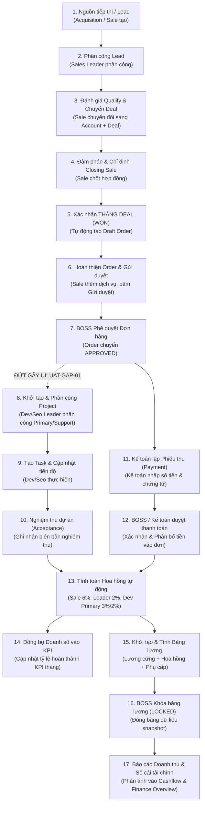
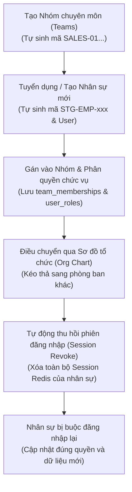
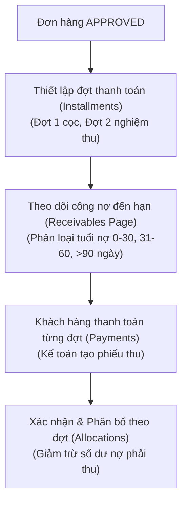
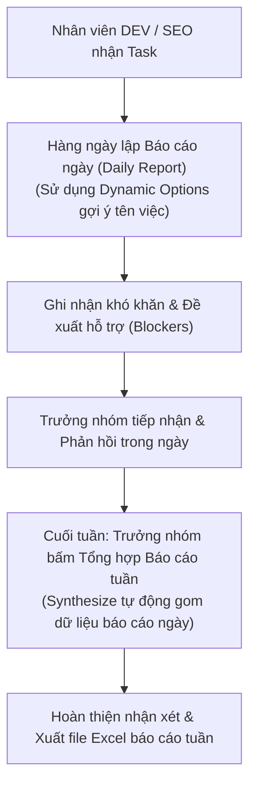
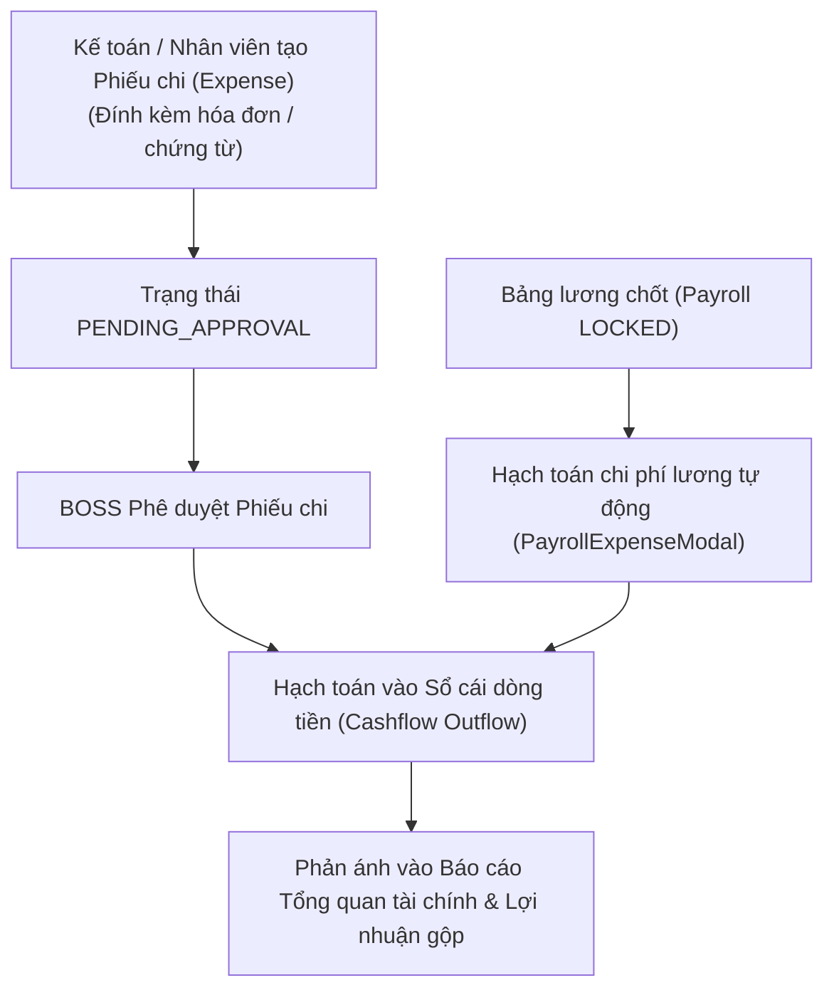

# BÁO CÁO CÁC LUỒNG LIÊN MODULE & CHUYỂN GIAO TÀI KHOẢN (CROSS-MODULE FLOW REPORT) — CRM VMAX

**Môi trường:** Local UAT (`http://localhost:5200` / `http://localhost:3200`)  
**Nhánh:** `feature/audit-16-30` (commit `1fd3a5f`)  
**Chế độ thực hiện:** **READ ONLY**  

---

## I. TỔNG QUAN CÁC LUỒNG NGHIỆP VỤ LIÊN MODULE

Hệ thống CRM VMAX vận hành dựa trên chuỗi liên kết dữ liệu chặt chẽ xuyên suốt 9 vai trò (Canonical Roles). Báo cáo này phân tích chi tiết 7 luồng nghiệp vụ cốt lõi, xác định chính xác các điểm dữ liệu bàn giao (Handshakes), các điểm hoạt động mượt mà và các điểm đứt gãy (Breakpoints / Blockers).

---

## II. LUỒNG 1: CHUỖI DOANH THU & TRIỂN KHAI CỐT LÕI (END-TO-END REVENUE & DELIVERY PIPELINE)

### 1. Sơ đồ tuần tự các bước

### 2. Bảng phân tích chi tiết từng bước chuyển giao

| Bước | Thao tác / Sự kiện | Tài khoản thực hiện | Dữ liệu chuyển giao (Handshake Data) | Tài khoản thụ hưởng / Kiểm tra | Trạng thái kỹ thuật |
|---|---|---|---|---|---|
| **1** | Tạo Lead mới | `staging_sale` | Tên khách, SĐT, Email, Nguồn tiếp thị | `staging_sales_leader` thấy trên Leads Team | `RUNTIME PASS` |
| **2** | Phân công Lead | `staging_sales_leader` | `assigned_employee_id`, thông báo SSE | `staging_sale` nhận Notification & Lead | `RUNTIME PASS` |
| **3** | Qualify & Chuyển Deal | `staging_sale` | Tạo `account_id` (Doanh nghiệp) & `deal_id` | Bảng Deals xuất hiện cơ hội mới | `RUNTIME PASS` |
| **4** | Chỉ định Sale chốt | `staging_sales_leader` | Gán `closing_sale_id` trên Deal (AUD-020) | Cố định Sale nhận hoa hồng 6% | `RUNTIME PASS` |
| **5** | Xác nhận WON | `staging_sale` | Chuyển stage WON, tự động insert `orders` (DRAFT) | Đơn hàng nháp xuất hiện trong Orders | `RUNTIME PASS` |
| **6** | Gửi duyệt đơn | `staging_sale` | Trạng thái Order `DRAFT` → `PENDING_APPROVAL` | `staging_boss` nhận thông báo cần duyệt | `RUNTIME PASS` |
| **7** | BOSS Duyệt đơn | `staging_boss` | Trạng thái Order `PENDING_APPROVAL` → `APPROVED` | Đơn hàng chính thức có hiệu lực | `RUNTIME PASS` |
| **8** | Khởi tạo Project | `staging_dev_leader` | Tạo bản ghi trong `projects` từ `order_items` | `staging_dev` nhận dự án | **BLOCKED (UAT-GAP-01)** |
| **9** | Tạo Task & Thực hiện | `staging_dev` | Task name, % khối lượng, trạng thái TODO → DONE | Tiến độ dự án nhảy % hoàn thành | `RUNTIME PASS` |
| **10** | Nghiệm thu dự án | `staging_dev_leader` | Biên bản nghiệm thu, trạng thái `ACCEPTANCE` | Đủ điều kiện hoa hồng kỹ thuật | `RUNTIME PASS` |
| **11** | Tạo Phiếu thu | `staging_accountant` | Phiếu thu mới `PENDING_CONFIRMATION`, link chứng từ | Chờ BOSS hoặc Kế toán duyệt | `RUNTIME PASS` |
| **12** | Xác nhận thanh toán | `staging_boss` | Phiếu thu `CONFIRMED`, tạo `payment_allocations` | Đơn hàng ghi nhận thực thu | `RUNTIME PASS` |
| **13** | Tính hoa hồng | Tự động Backend | Sinh bản ghi `commissions` (Sale 6%, Dev 3%/2%) | `staging_sale`, `staging_dev` thấy hoa hồng | `RUNTIME PASS` |
| **14** | Đồng bộ KPI | Tự động Backend | Bản ghi `kpi_events` ghi nhận doanh số thực tế | Dashboard KPI nhảy số | `RUNTIME PASS` |
| **15** | Tính bảng lương | `staging_accountant` | Gom lương cơ bản + hoa hồng vào `payroll_items` | Bảng lương chi tiết từng nhân viên | `RUNTIME PASS` |
| **16** | Khóa kỳ lương | `staging_boss` | Chuyển trạng thái `LOCKED`, đóng băng snapshot | Toàn bộ dữ liệu lương bất biến | `RUNTIME PASS` |
| **17** | Phản ánh tài chính | `staging_accountant` | Doanh thu thực thu và chi phí lương vào Sổ cái | Sổ cái dòng tiền & Báo cáo điều hành | `RUNTIME PASS` |

### 3. Phân tích điểm đứt gãy tại Bước 8 (`UAT-GAP-01`)
- **Triệu chứng:** Sau khi `staging_boss` bấm duyệt đơn hàng (Bước 7), trạng thái đơn hàng là `APPROVED`. Tuy nhiên, trên giao diện người dùng không có nút bấm nào để chuyển dòng dịch vụ kỹ thuật thành Project.
- **Bản chất:** Backend API `POST /api/order-items/:id/assign-project` đã có sẵn, nhưng Frontend thiếu button trigger tại `OrderDetailPage.tsx` và thiếu view xử lý tab `?tab=assign` tại `ProjectsListPage.tsx`.
- **Tác động:** Người dùng thử nghiệm không thể hoàn thành chuỗi từ Bước 7 sang Bước 8 trên giao diện thuần túy. Để tiếp tục kiểm thử Bước 9 và Bước 10 trong đợt Human UAT, tester sử dụng các Project mẫu đã tồn tại trong `crm_db`.

---

## III. LUỒNG 2: QUẢN TRỊ NHÂN SỰ, TỔ CHỨC & BẢO MẬT PHIÊN (HR, TEAMS & SECURITY FLOW)

### Đánh giá an ninh và điểm cần lưu ý (`UAT-GAP-03`):
- Khi điều chuyển qua Sơ đồ tổ chức (`OrganizationChartPage`), cơ chế thu hồi session hoạt động xuất sắc (`sessionService.revokeAllUserSessions`).
- Tuy nhiên, nếu BOSS thực hiện "Tăng / Giáng chức" tại trang Chi tiết nhân sự (`/employees/:id`) hoặc Khóa tài khoản tại trang Quản lý tài khoản (`/employee-accounts/:id`), lệnh hủy session chưa được gọi tự động. Phiên đăng nhập cũ của nhân viên vẫn có hiệu lực trong tối đa 15 phút.

---

## IV. LUỒNG 3: ĐỢT THANH TOÁN & QUẢN LÝ CÔNG NỢ (PAYMENT PLANS & RECEIVABLES)

### Đánh giá khoảng trống (`UAT-GAP-02`):
- Hiện tại dữ liệu `payment_installments` và phân đoạn tuổi nợ hoạt động tốt với các gói dịch vụ định kỳ (`Subscriptions`). Đối với đơn hàng hợp đồng thông thường (`Orders`), UI chưa hỗ trợ nút lập đợt thanh toán linh hoạt ngay trên màn hình đơn hàng.

---

## V. LUỒNG 4: BÁO CÁO CÔNG VIỆC TỪ DỰ ÁN ĐẾN BÁO CÁO TUẦN (PROJECT TO REPORTS FLOW)

### Đánh giá thực thi:
- Luồng này **HOẠT ĐỘNG HOÀN HẢO 100% (RUNTIME PASS)**.
- Tích hợp Dynamic Options gợi ý tên công việc mượt mà.
- Chức năng tự động tổng hợp báo cáo tuần từ báo cáo ngày hoạt động chuẩn xác, giảm thiểu 90% thao tác nhập liệu thủ công của Trưởng nhóm.
- File Excel xuất ra có đầy đủ định dạng bảng biểu chuyên nghiệp.

---

## VI. LUỒNG 5: QUẢN LÝ CHI PHÍ & TỔNG QUAN TÀI CHÍNH (EXPENSES TO FINANCE FLOW)

### Đánh giá thực thi:
- Luồng hoạt động **HOÀN TOÀN ỔN ĐỊNH**.
- Tuân thủ Frozen Rule tài chính: Không tự bịa số dư tiền mặt đầu kỳ/cuối kỳ khi chưa có dữ liệu kiểm kê.
- Chi phí lương từ bảng lương được hạch toán sang phân hệ chi phí minh bạch qua modal `PayrollExpenseModal`.

---

## VII. TỔNG KẾT TÌNH TRẠNG CÁC LUỒNG LIÊN MODULE

| Luồng nghiệp vụ | Tính hoàn thiện UI | Tính toàn vẹn Backend | Mức độ gián đoạn | Khuyến nghị cho Human UAT |
|---|---|---|---|---|
| **Luồng 1 (Doanh thu E2E)** | 85% | 100% | **Bị chặn tại Bước 8** (`UAT-GAP-01`) | Sử dụng Project có sẵn để test từ Bước 9 trở đi. |
| **Luồng 2 (HR & Bảo mật)** | 95% | 95% | Không gián đoạn (chỉ lưu ý session timeout) | Thực hiện kiểm thử đúng 12 ca Security RBAC. |
| **Luồng 3 (Công nợ & Đợt)** | 70% | 100% | Gián đoạn với đơn Project thủ công | Kiểm thử luồng công nợ trên dữ liệu Subscription. |
| **Luồng 4 (Dự án & Báo cáo)** | 100% | 100% | **0% (Hoàn hảo)** | Kiểm thử thông suốt từ Daily sang Weekly Report. |
| **Luồng 5 (Chi phí & Tài chính)**| 100% | 100% | **0% (Hoàn hảo)** | Kiểm thử thông suốt với phiếu chi và bảng lương. |
| **Luồng 6 (Dịch vụ định kỳ)** | 95% | 100% | Không gián đoạn | Kiểm thử gia hạn và nghiệm thu kỳ dịch vụ. |
| **Luồng 7 (Thông báo realtime)** | 100% | 100% | **0% (Hoàn hảo)** | Kiểm thử nhận chuông và click deep-link. |
