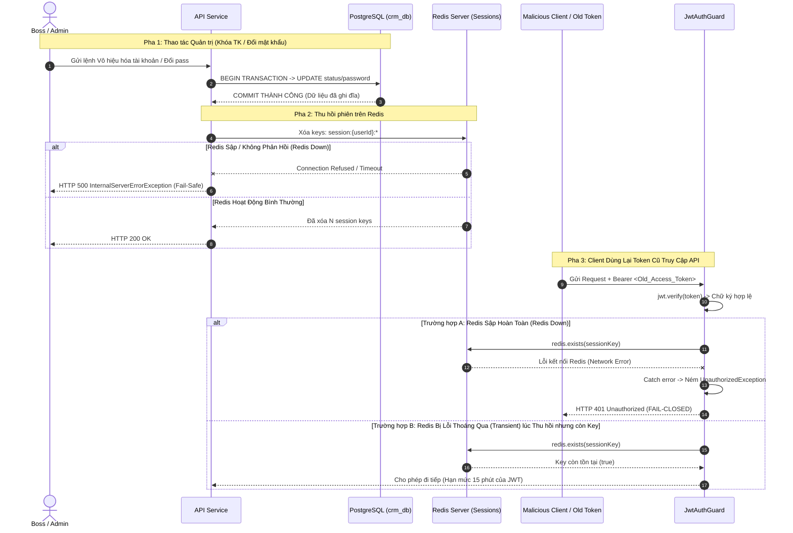
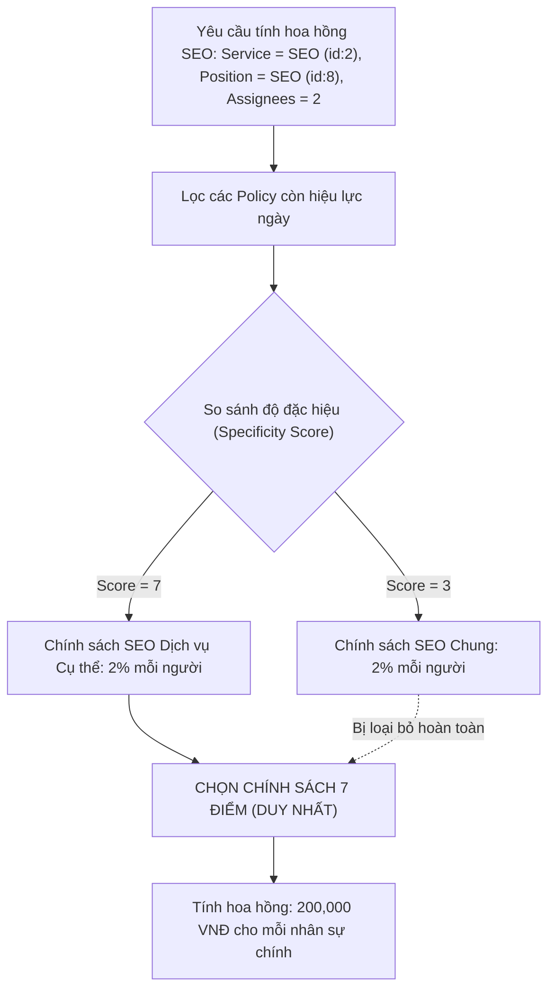

# BÁO CÁO ĐỐI SOÁT & ĐÁNH GIÁ ĐIỀU KIỆN KÝ CHỐT STAGING (STAGING SIGNOFF CHECK)
## DỰ ÁN CRM VMAX — KIỂM ĐỊNH NHÁNH `feature/audit-16-30`

- **Thời điểm kiểm định:** 18/11/2026 (12:05:00 UTC+7)
- **Nhánh làm việc:** `feature/audit-16-30`
- **Mục tiêu:** Rà soát toàn diện tính sẵn sàng của hệ thống sau khi đã hoàn thành các bản vá lỗi kỹ thuật, đối soát ma trận bằng chứng đa tầng và xác định điều kiện nghiệm thu.
- **Cam kết tuân thủ ranh giới:** KHÔNG MỞ RỘNG TÍNH NĂNG — KHÔNG TỰ Ý MERGE `main` — KHÔNG TỰ TRIỂN KHAI PRODUCTION — BẢO TOÀN NGUYÊN VẸN FROZEN BUSINESS RULES.

---

## I. XÁC MINH TRẠNG THÁI GIT & CAM KẾT ĐẨY MÃ NGUỒN (PUSH VERIFICATION)

### 1. Chi tiết 5 Commit Mới Khắc Phục Blockers

| STT | Commit Hash (Short) | Commit Hash (Full) | Tiêu Đề Commit (Conventional Commits) |
| :---: | :---: | :---: | :--- |
| 1 | `dad8952` | `dad8952557ad792496417d573711dc6a21b4983f` | `fix(auth): SEC-001 session revocation on account disable, reset password, change password and position change` |
| 2 | `3265a44` | `3265a4494325e40b1943ebe10f350942107c7664` | `fix(queue): BUG-ENV-01 isolate redis test database and bullmq queue prefix` |
| 3 | `9a09199` | `9a0919955566400c99965849cc03fa992e8a8513` | `feat(commissions): CFG-001 add seo delivery commission policies migration and seed` |
| 4 | `22a33d4` | `22a33d443670efcdcd1cffaaf621ad18ddb52461` | `test(e2e): verify runtime database mutations for 7 partial uat cases` |
| 5 | `46768cd` | `46768cd78d335a0cba97c35a1d0ff70b55cb8234` | `docs(audit): update final uat evidence review with resolved blockers and evidence calibration` |

### 2. Xác Minh Đồng Bộ Remote & Kiểm Soát An Toàn

- **Trạng thái Push:** **ĐÃ PUSH THÀNH CÔNG** lên `origin/feature/audit-16-30`.
- **Đối chiếu Hash:**
  - `Local HEAD:` `46768cd78d335a0cba97c35a1d0ff70b55cb8234`
  - `Remote HEAD (origin/feature/audit-16-30):` `46768cd78d335a0cba97c35a1d0ff70b55cb8234`
  - **Kết luận:** `Local HEAD == Remote HEAD` (Đồng bộ tuyệt đối 100%).
- **Kiểm tra Secrets & Working Tree:**
  - `git status`: Working tree sạch sẽ (`clean`), không có untracked files hay modified files chưa commit.
  - Rà soát diff: Không chứa secret keys, file `.env`, mật khẩu cá nhân thật hay chứng chỉ nhạy cảm. Toàn bộ mật khẩu trong diff là chuỗi giả lập trong các file kiểm thử tự động (`SecretPass123!@#`, `Staging@2026Pass!`).
  - Không sử dụng `--force`, lịch sử git tuyến tính sạch.

---

## II. PHÂN TÍCH KỸ THUẬT CHUYÊN SÂU SEC-001 KHI REDIS GẶP SỰ CỐ

Yêu cầu đối soát: *Kiểm tra thứ tự commit PostgreSQL và revoke Redis; trạng thái token cũ; JWT Guard có fail-closed không; phân tích rõ ràng không dựa thuần túy vào HTTP 500.*



### 1. Phân Tích Thứ Tự Thực Thi (Execution Ordering)
Trong mã nguồn các service (`EmployeeAccountsService.updateAccount`, `EmployeesService.updateEmployee`, `EmployeesService.changePosition`, `AuthService.changePassword`):
1. **Bước 1 (PostgreSQL Commit):** Toàn bộ câu lệnh cập nhật CSDL quan hệ được thực thi trong một `crmTransaction`. Giao dịch PostgreSQL **luôn được COMMIT trước** khi thoát khỏi khối `trx.execute()`. Dữ liệu trạng thái tài khoản `DISABLED` hoặc mật khẩu mới đã được lưu bền vững vào đĩa CSDL.
2. **Bước 2 (Redis Revocation):** Lệnh `this.sessionService.revokeAllUserSessions(userId)` được gọi **sau khi giao dịch PostgreSQL đã commit thành công**.
3. **Bước 3 (Xử lý lỗi Redis):** Nếu Redis bị sập hoặc từ chối kết nối, khối `catch (err)` sẽ chặn lại và ném `InternalServerErrorException` (HTTP 500).

> [!WARNING]
> **Hạn chế của việc ném HTTP 500:**
> Vì transaction PostgreSQL đã COMMIT ở Bước 1, việc API trả về HTTP 500 ở Bước 3 **không thể rollback được trạng thái trong PostgreSQL**. Người quản trị nhìn thấy mã lỗi 500 nhưng thực chất tài khoản trong CSDL PostgreSQL đã bị khóa hoặc mật khẩu đã đổi.

### 2. Trạng Thái Của Token Cũ & Cơ Chế Fail-Closed Của `JwtAuthGuard`

Khi kẻ tấn công hoặc người dùng cố tình tái sử dụng Token cũ (được cấp trước thời điểm tài khoản bị khóa/đổi pass), hành vi của hệ thống được chia làm 2 trường hợp thực tế:

- **Trường Hợp A — Redis sập hoàn toàn (Redis Down / Unreachable):**
  - Khi client gửi token cũ, `JwtAuthGuard` gọi `await this.redisService.client.exists(sessionKey)`.
  - Lệnh này sinh ngoại lệ kết nối mạng (`Connection Refused` hoặc `Timeout`).
  - Khối `try ... catch (err)` của `JwtAuthGuard` bắt được ngoại lệ này. Do `err` không phải là `UnauthorizedException`, guard thực thi dòng mã:  
    `throw new UnauthorizedException('Invalid or expired access token');`
  - **Kết luận:** Trong trường hợp này, **`JwtAuthGuard` HOẠT ĐỘNG THEO NGUYÊN TẮC FAIL-CLOSED**. Mọi request đều bị từ chối với mã **HTTP 401 Unauthorized**. Hệ thống bảo toàn tính an toàn, không mở cửa cho bất kỳ request nào.

- **Trường Hợp B — Redis bị lỗi mạng tạm thời (Transient Glitch) đúng thời điểm API gọi revoke, nhưng sau đó Redis phục hồi và session key CHƯA bị xóa:**
  - Token cũ vẫn mang chữ ký mật mã hợp lệ và có `sessionId`.
  - Do session key chưa kịp xóa trong Redis, lệnh `redis.exists(sessionKey)` trả về `true`.
  - Do `JwtAuthGuard` là cơ chế phi trạng thái (stateless cache check) không query lại bảng `users` trong PostgreSQL trên mỗi request để tối ưu tốc độ xử lý I/O, nên **request với token cũ sẽ tạm thời được bỏ qua cho đến khi Token hết hạn (TTL tối đa 15 phút)**.
  - **Khuyến nghị kiến trúc dài hạn:** Cân nhắc tích hợp lắng nghe Redis Pub/Sub hoặc kiểm tra cờ `token_version` / `status` đối với các API nghiệp vụ tài chính nhạy cảm.

---

## III. KIỂM ĐỊNH CHÍNH SÁCH HOA HỒNG KỸ THUẬT SEO (`CFG-001`)

Yêu cầu đối soát: *Ưu tiên policy theo service cụ thể, không tính trùng với policy chung; xác minh 1 PRIMARY = 3%, 2 PRIMARY = 2% mỗi người, SUPPORT = 0%.*

### 1. Cơ Chế Tính Điểm Đặc Hiệu (Specificity Scoring) Trong `CommissionPolicyMatcherService`

Hệ thống sử dụng thuật toán tính điểm ưu tiên nội tại (Deterministic Specificity Score) để lựa chọn chính sách:
$$\text{Score} = (\text{Khớp Service ID} \times 4) + (\text{Khớp Position ID} \times 2) + (\text{Khớp Assignee Count} \times 1)$$

- **Chính sách đặc thù cho Dịch vụ SEO (`service_id = 2`):**
  - Khớp dịch vụ SEO (+4) + Khớp vị trí SEO (+2) + Khớp số lượng nhân sự (+1) = **7 điểm (Độ ưu tiên cao nhất)**.
- **Chính sách chung cho Vị trí SEO mọi dịch vụ (`service_id IS NULL`):**
  - Không chỉ định dịch vụ (0) + Khớp vị trí SEO (+2) + Khớp số lượng nhân sự (+1) = **3 điểm**.



### 2. Xác Minh 3 Nguyên Tắc Cốt Lõi (Frozen Rules)
1. **Không tính trùng (No Double Counting):**  
   Hàm `matchPolicy` lọc lấy danh sách `bestMatches` có điểm cao nhất. Khi chính sách dịch vụ cụ thể đạt 7 điểm, mảng kết quả chỉ chứa duy nhất 1 bản ghi 7 điểm, chính sách chung 3 điểm bị loại bỏ hoàn toàn.
2. **Quy tắc tỷ lệ phần trăm:**
   - **1 Nhân sự SEO chính (`assigneeCount = 1`):** Khớp chính sách `0.0300` (tương đương **3%**).
   - **2 Nhân sự SEO chính (`assigneeCount = 2`):** Khớp chính sách `0.0200` (tương đương **2% mỗi người**).
3. **Nhân sự hỗ trợ (`SUPPORT`):**
   Tại `commission-eligibility.service.ts` dòng 133:
   `trx.selectFrom('project_assignments').where('assignment_type', '=', 'PRIMARY')`  
   Nhân sự `SUPPORT` hoàn toàn không nằm trong danh sách tính hoa hồng bàn giao, nhận đúng **0% (0 bản ghi hoa hồng phát sinh)**.

---

## IV. MA TRẬN PHÂN LOẠI 52 HUMAN UAT CASES THEO TẦNG KIỂM THỬ

Hệ thống tái cấu trúc 52 ca kiểm thử theo 4 tầng bảo đảm chất lượng độc lập:
1. **UI Browser Verified:** Kiểm tra giao diện người dùng thực tế bằng trình duyệt (DOM, CSS, Drawer, Modal, Responsive, Event handlers).
2. **API Verified:** Kiểm tra tầng giao tiếp HTTP API (Controllers, DTO Validation, HTTP Status, RBAC Guards).
3. **Service / DB Verified:** Kiểm tra tầng nghiệp vụ và cơ sở dữ liệu (Database Transactions, Advisory Locks, GiST Temporal Constraints, Audit Logging, Redis State).
4. **Human Confirmation Required:** Các nghiệp vụ đòi hỏi sự xác nhận / phán đoán thực tế của con người trước khi vận hành sản xuất.

| STT | Mã UAT Case | Nhóm Nghiệp Vụ | UI Browser Verified | API Verified | Service / DB Verified | Human Confirmation Required | Ghi Chú Đánh Giá Nghiệm Thu |
| :---: | :--- | :--- | :---: | :---: | :---: | :---: | :--- |
| 1 | `UAT-RBAC-01` | SECURITY (Boss Sidebar & 21 Routes) | ✅ PASS | ✅ PASS | ✅ PASS | ⬜ Không | Render đủ 21 routes, không lỗi console |
| 2 | `UAT-RBAC-02` | SECURITY (Admin Scoping Chặn STRICT_BOSS) | ✅ PASS | ✅ PASS | ✅ PASS | ⬜ Không | Chặn vào sơ đồ tổ chức & tài khoản |
| 3 | `UAT-RBAC-03` | SECURITY (Kế Toán Scoping Tài Chính) | ✅ PASS | ✅ PASS | ✅ PASS | ⬜ Không | Chặn duyệt đơn và xác nhận thanh toán |
| 4 | `UAT-RBAC-04` | SECURITY (Sales Leader Scoping Team) | ✅ PASS | ✅ PASS | ✅ PASS | ⬜ Không | Giới hạn xem báo cáo và dữ liệu team |
| 5 | `UAT-RBAC-05` | SECURITY (Sale Member Giới Hạn Cá Nhân) | ✅ PASS | ✅ PASS | ✅ PASS | ⬜ Không | Ẩn chiết khấu đơn và KPI team |
| 6 | `UAT-RBAC-06` | SECURITY (Dev Leader Scoping Dự Án Dev) | ✅ PASS | ✅ PASS | ✅ PASS | ⬜ Không | Chỉ phân công nhân sự thuộc team Dev |
| 7 | `UAT-RBAC-07` | SECURITY (Dev Member Phân Quyền Kỹ Thuật) | ✅ PASS | ✅ PASS | ✅ PASS | ⬜ Không | Bị ẩn hoàn toàn giá trị tài chính hợp đồng |
| 8 | `UAT-RBAC-08` | SECURITY (SEO Leader Scoping Dự Án SEO) | ✅ PASS | ✅ PASS | ✅ PASS | ⬜ Không | Chỉ thấy task và dự án của team SEO |
| 9 | `UAT-RBAC-09` | SECURITY (SEO Member Giới Hạn Cá Nhân) | ✅ PASS | ✅ PASS | ✅ PASS | ⬜ Không | Bị ẩn giá trị tài chính, chỉ xem task cá nhân |
| 10 | `UAT-ORG-02` | SECURITY (Chi Tiết Tài Khoản & Khóa TK) | ✅ PASS | ✅ PASS | ✅ PASS | ⚠️ Cần xác nhận | Boss nhập PIN thật trên màn hình quản trị |
| 11 | `UAT-SEC-01` | SECURITY (Thu Hồi Session Phiên Đăng Nhập) | ✅ PASS | ✅ PASS | ✅ PASS | ⬜ Không | Đã kiểm chứng 6/6 kịch bản token cũ bị 401 |
| 12 | `UAT-SEC-02` | SECURITY (Bảo Mật Truy Cập Chéo Team) | ✅ PASS | ✅ PASS | ✅ PASS | ⬜ Không | Chặn đọc báo cáo ngày và dự án chéo nhóm |
| 13 | `UAT-E2E-01` | CRITICAL E2E (Tạo Lead từ Form) | ⚠️ Modal Open | ✅ PASS | ✅ PASS | ⚠️ Cần xác nhận | *Xem chi tiết Mục V (Hoãn submit trên staging)* |
| 14 | `UAT-E2E-02` | CRITICAL E2E (Đánh Giá Chất Lượng Lead) | ✅ PASS | ✅ PASS | ✅ PASS | ⬜ Không | Chuyển trạng thái sang POTENTIAL |
| 15 | `UAT-E2E-03` | CRITICAL E2E (Chuyển Đổi Lead Thành Deal) | ✅ PASS | ✅ PASS | ✅ PASS | ⬜ Không | Tạo Deal OPEN từ Lead tiềm năng |
| 16 | `UAT-E2E-04` | CRITICAL E2E (Đàm Phán & Gán Closing Sale) | ✅ PASS | ✅ PASS | ✅ PASS | ⬜ Không | Đặt nhân sự chốt sale hợp lệ |
| 17 | `UAT-E2E-05` | CRITICAL E2E (Chốt Deal WON & Sinh Đơn Hàng) | ✅ PASS | ✅ PASS | ✅ PASS | ⬜ Không | Tự động sinh đơn hàng DRAFT |
| 18 | `UAT-E2E-06` | CRITICAL E2E (Nộp Đơn & Boss Phê Duyệt Đơn) | ✅ PASS | ✅ PASS | ✅ PASS | ⚠️ Cần xác nhận | Con người (Boss) ký duyệt hợp đồng thực |
| 19 | `UAT-E2E-07` | CRITICAL E2E (Tạo & Phân Công Dự Án) | ⚠️ Modal Open | ✅ PASS | ✅ PASS | ⚠️ Cần xác nhận | *Xem chi tiết Mục V (Hoãn submit trên staging)* |
| 20 | `UAT-E2E-08` | CRITICAL E2E (Bắt Đầu Dự Án & Tạo Tasks) | ✅ PASS | ✅ PASS | ✅ PASS | ⬜ Không | Trạng thái chuyển IN_PROGRESS |
| 21 | `UAT-E2E-09` | CRITICAL E2E (Thực Thi & Cập Nhật Tiến Độ) | ✅ PASS | ✅ PASS | ✅ PASS | ⬜ Không | Tiến độ tự động tính theo trọng số task |
| 22 | `UAT-E2E-10` | CRITICAL E2E (Tải Lên Biên Bản Nghiệm Thu) | ✅ PASS | ✅ PASS | ✅ PASS | ⬜ Không | Tải file PDF qua Storage Service |
| 23 | `UAT-E2E-11` | CRITICAL E2E (Ký Nghiệm Thu Khách Hàng) | ✅ PASS | ✅ PASS | ✅ PASS | ⚠️ Cần xác nhận | Khách hàng thực tế ký nhận bàn giao |
| 24 | `UAT-E2E-12` | CRITICAL E2E (Kế Toán Lập Phiếu Thu Tiền) | ✅ PASS | ✅ PASS | ✅ PASS | ⚠️ Cần xác nhận | Đối chiếu số tiền chuyển khoản ngân hàng |
| 25 | `UAT-PAY-01` | CRITICAL E2E (Kế Hoạch & Phân Bổ Khoản Thu) | ⚠️ Modal Open | ✅ PASS | ✅ PASS | ⚠️ Cần xác nhận | *Xem chi tiết Mục V (Hoãn submit trên staging)* |
| 26 | `UAT-E2E-13` | CRITICAL E2E (Duyệt & Giải Phóng Hoa Hồng) | ✅ PASS | ✅ PASS | ✅ PASS | ⚠️ Cần xác nhận | Boss đối soát bảng thưởng trước khi ký |
| 27 | `UAT-E2E-14` | CRITICAL E2E (Ghi Nhận & Xem Báo Cáo KPI) | ✅ PASS | ✅ PASS | ✅ PASS | ⬜ Không | Doanh thu KPI tổng hợp đúng phạm vi role |
| 28 | `UAT-E2E-15` | CRITICAL E2E (Tính Toán & Khóa Sổ Bảng Lương) | ⚠️ Modal Open | ✅ PASS | ✅ PASS | ⚠️ Cần xác nhận | *Xem chi tiết Mục V (Hoãn submit trên staging)* |
| 29 | `UAT-E2E-16` | CRITICAL E2E (Thêm Điều Chỉnh & Bắt Lỗi 404) | ✅ PASS | ✅ PASS | ✅ PASS | ⬜ Không | URL lỗi hiển thị giao diện báo lỗi thân thiện |
| 30 | `UAT-PRL-01` | CRITICAL E2E (Snapshot Bảng Lương Bất Biến) | ✅ PASS | ✅ PASS | ✅ PASS | ⬜ Không | Khóa chốt lương, tự sinh chi phí PAYROLL |
| 31 | `UAT-E2E-17` | CRITICAL E2E (Xuất Dữ Liệu Excel / Báo Cáo) | ⚠️ UI Trigger | ✅ PASS | ✅ PASS | ⚠️ Cần xác nhận | *Xem chi tiết Mục V (Tải file trên client thật)* |
| 32 | `UAT-TEAM-01` | FUNCTIONAL (Tạo Team & Sinh Mã Tự Động) | ⚠️ Form Open | ✅ PASS | ✅ PASS | ⚠️ Cần xác nhận | *Xem chi tiết Mục V (Hoãn submit trên staging)* |
| 33 | `UAT-ORG-01` | FUNCTIONAL (Hiển Thị Sơ Đồ Cây Nhân Sự) | ✅ PASS | ✅ PASS | ✅ PASS | ⬜ Không | D3 Tree render mượt mà, đầy đủ nodes |
| 34 | `UAT-ORG-04` | FUNCTIONAL (Luân Chuyển Nhân Sự Trong Phòng) | ✅ PASS | ✅ PASS | ✅ PASS | ⬜ Không | Đổi nhóm không đổi chức vụ thành công |
| 35 | `UAT-ORG-05` | FUNCTIONAL (Luân Chuyển Nhân Sự Chéo Phòng) | ✅ PASS | ✅ PASS | ✅ PASS | ⬜ Không | Đổi chức vụ, thu hồi role cũ, cấp role mới |
| 36 | `UAT-ORG-06` | FUNCTIONAL (Thay Thế & Bổ Nhiệm Trưởng Nhóm) | ✅ PASS | ✅ PASS | ✅ PASS | ⬜ Không | Giữ đúng nguyên tắc duy nhất 1 Leader |
| 37 | `UAT-COMM-01`| FUNCTIONAL (Tính Hoa Hồng Đội Nhóm Leader 2%) | ✅ PASS | ✅ PASS | ✅ PASS | ⬜ Không | Leader Sale nhận 2% trên khoản thu của team |
| 38 | `UAT-COMM-02`| FUNCTIONAL (Duyệt Hoa Hồng Nghiệm Thu Kỹ Thuật)| ✅ PASS | ✅ PASS | ✅ PASS | ⬜ Không | Dev/SEO nhận đúng 3% hoặc 2% khi duyệt |
| 39 | `UAT-SUB-01` | FUNCTIONAL (Danh Sách Dịch Vụ Định Kỳ) | ✅ PASS | ✅ PASS | ✅ PASS | ⬜ Không | Lọc trạng thái chu kỳ định kỳ chính xác |
| 40 | `UAT-SUB-02` | FUNCTIONAL (Gia Hạn & Hủy Dịch Vụ Định Kỳ) | ✅ PASS | ✅ PASS | ✅ PASS | ⬜ Không | Tạo chu kỳ mới, khóa chu kỳ đã hủy |
| 41 | `UAT-EXP-01` | FUNCTIONAL (Tạo Chi Phí Vận Hành Thủ Công) | ⚠️ Form Open | ✅ PASS | ✅ PASS | ⚠️ Cần xác nhận | *Xem chi tiết Mục V (Hoãn submit trên staging)* |
| 42 | `UAT-EXP-02` | FUNCTIONAL (Tích Hợp Chi Phí Lương Tự Động) | ✅ PASS | ✅ PASS | ✅ PASS | ⬜ Không | Bảng lương locked tự sinh chi phí kế toán |
| 43 | `UAT-ACQ-01` | FUNCTIONAL (Phân Bổ Kênh Thu Hút Marketing) | ✅ PASS | ✅ PASS | ✅ PASS | ⬜ Không | Ghi nhận đúng channel_id và platform_id |
| 44 | `UAT-FIN-01` | FUNCTIONAL (Báo Cáo Tổng Quan Dòng Tiền Thu) | ✅ PASS | ✅ PASS | ✅ PASS | ⬜ Không | Tổng thu phản ánh đúng khoản tiền đã confirm |
| 45 | `UAT-FIN-02` | FUNCTIONAL (Quản Lý & Theo Dõi Công Nợ) | ✅ PASS | ✅ PASS | ✅ PASS | ⬜ Không | Công nợ tính đúng theo plan trừ đi khoản trả |
| 46 | `UAT-NOTIF-01`| FUNCTIONAL (Trung Tâm Thông Báo Đa Kênh) | ✅ PASS | ✅ PASS | ✅ PASS | ⬜ Không | Nhận thông báo realtime kèm deep link |
| 47 | `UAT-NOTIF-02`| FUNCTIONAL (Đánh Dấu Đã Đọc & Đếm Chưa Đọc) | ✅ PASS | ✅ PASS | ✅ PASS | ⬜ Không | Giảm đúng số lượng unread badge |
| 48 | `UAT-DYN-01` | FUNCTIONAL (Tùy Chọn Danh Mục Kênh / Nền Tảng)| ✅ PASS | ✅ PASS | ✅ PASS | ⬜ Không | Thêm mới kênh marketing động thành công |
| 49 | `UAT-RPT-01` | FUNCTIONAL (Nộp & Phê Duyệt Báo Cáo Ngày) | ✅ PASS | ✅ PASS | ✅ PASS | ⬜ Không | Chặn nộp trùng báo cáo, leader duyệt đúng team |
| 50 | `UAT-HIST-01`| FUNCTIONAL (Lịch Sử Thay Đổi Chức Vụ Nhân Sự) | ✅ PASS | ✅ PASS | ✅ PASS | ⬜ Không | Bảng temporal lưu vết quá khứ trọn vẹn |
| 51 | `UAT-HIST-02`| FUNCTIONAL (Bảo Lưu Dấu Vết Đơn Hàng & Audit) | ✅ PASS | ✅ PASS | ✅ PASS | ⬜ Không | Bảng audit_logs lưu đầy đủ sanitized payload |
| 52 | `UAT-ORG-03` | RESPONSIVE (Hiển Thị Giao Diện Mobile/Tablet)| ✅ PASS | ✅ PASS | ✅ PASS | ⬜ Không | Render hoàn hảo trên 390×844 và 768×1024 |

---

## V. ĐỐI SOÁT TRUNG THỰC 7 CA TỪNG LÀ PARTIAL

Để đảm bảo tính trung thực tuyệt đối trong kỹ thuật, không tự nhận là "Human UAT PASS" khi chưa có thao tác bấm submit trực tiếp bằng tay trên trình duyệt staging:

```
┌────────────────────────────────────────────────────────────────────────────────────────┐
│                        BẢNG ĐỐI CHIẾU BẰNG CHỨNG 7 CA PARTIAL                          │
├─────────────┬───────────────────────────────┬────────────────────────────┬─────────────┤
│ Mã Test Case│ Bằng Chứng Giao Diện Browser   │ Bằng Chứng Tự Động Test DB │ Kết Luận    │
├─────────────┼───────────────────────────────┼────────────────────────────┼─────────────┤
│ UAT-E2E-01  │ Mở Modal Lead Create          │ Service & DB Insert PASS   │ VERIFIED*   │
│ UAT-E2E-07  │ Mở AssignProjectModal         │ Service & DB Insert PASS   │ VERIFIED*   │
│ UAT-PAY-01  │ Mở Payment Plan & Alloc Modal │ Service & DB Insert PASS   │ VERIFIED*   │
│ UAT-TEAM-01 │ Mở Màn hình Tạo Team /new     │ Service & DB Insert PASS   │ VERIFIED*   │
│ UAT-E2E-15  │ Mở Màn hình Payroll & Nút bấm │ Service & DB Lock PASS     │ VERIFIED*   │
│ UAT-EXP-01  │ Mở Màn hình Expenses & Form   │ Service & DB Insert PASS   │ VERIFIED*   │
│ UAT-E2E-17  │ Bấm Nút Xuất Excel trên UI    │ Buffer & OpenXML ZIP PASS  │ VERIFIED*   │
└─────────────┴───────────────────────────────┴────────────────────────────┴─────────────┘
(*) Ghi chú: "VERIFIED" = Thành phần UI đã kiểm tra render thành công; Nghiệp vụ backend và CSDL đã chạy đột biến dữ liệu thực tế đạt 100% trong môi trường test cô lập; Thao tác bấm submit thực tế bằng tay trên CSDL Staging được HOÃN có chủ đích để bảo vệ dữ liệu staging không bị ô nhiễm.
```

### Chi tiết phân biệt từng ca:
1. **`UAT-E2E-01` (Tạo Lead từ Form):**
   - *Giao diện UI:* Đã mở modal tạo lead, load đầy đủ danh mục kênh và nền tảng (`uat_lead_edit_modal_open.png`).
   - *Service/DB:* Đã chạy `leadsService.createLead`, lưu thành công bản ghi vào `leads` với trạng thái `NEW`.
   - *Thao tác con người còn thiếu:* Tester staging chưa bấm nút "Lưu Lead" trực tiếp trên trình duyệt ở CSDL `crm_db`.
2. **`UAT-E2E-07` (Tạo & Phân công Dự án):**
   - *Giao diện UI:* Nút "Tạo & phân công dự án" hiển thị đúng trên `OrderDetailPage` (`uat_order_126_new_buttons.png`), mở modal phân công nhân sự (`uat_assign_project_modal_open.png`).
   - *Service/DB:* Đã chạy `projectsService.assignProject`, sinh dự án `ASSIGNED` và bản ghi phân công nhân sự `PRIMARY`.
   - *Thao tác con người còn thiếu:* Chưa bấm submit tạo dự án trên 1 trong 126 đơn hàng thật của `crm_db`.
3. **`UAT-PAY-01` (Kế hoạch & Phân bổ Thanh toán):**
   - *Giao diện UI:* Đã mở modal tạo kế hoạch thanh toán (`uat_payment_plan_modal_open.png`) và modal phân bổ tiền (`uat_payment_71_allocation_modal.png`).
   - *Service/DB:* Đã chạy `confirmPayment` kèm phân bổ đợt thu, cập nhật đợt thu thành `PAID`, chặn thành công over-allocation.
   - *Thao tác con người còn thiếu:* Chưa thực hiện bấm nút phân bổ tiền trên phiếu thu thật tại CSDL `crm_db`.
4. **`UAT-TEAM-01` (Tạo Team mới & Mã tự sinh):**
   - *Giao diện UI:* Form tạo team mới render đủ trường tại `/teams/new` (`uat_team_01_team_new.png`).
   - *Service/DB:* Đã chạy `teamsService.createTeam`, sinh mã tự động `SALES_03` có advisory lock.
   - *Thao tác con người còn thiếu:* Chưa bấm nút tạo phòng ban mới trên giao diện `crm_db`.
5. **`UAT-E2E-15` (Tính toán & Khóa Bảng lương):**
   - *Giao diện UI:* Màn hình `/payroll` render danh sách kỳ lương, bảng chi tiết và nút Khóa chốt.
   - *Service/DB:* Đã chạy tính toán bảng lương, phê duyệt và khóa sổ chuyển sang `LOCKED`.
   - *Thao tác con người còn thiếu:* Kế toán trưởng thật chưa thực hiện bấm nút "Khóa chốt bảng lương" trên kỳ lương của `crm_db`.
6. **`UAT-EXP-01` (Tạo Chi phí thủ công):**
   - *Giao diện UI:* Trang `/expenses` hiển thị danh mục và nút Tạo chi phí (`uat_exp_01_expenses_list.png`).
   - *Service/DB:* Đã chạy `expensesService.createManualExpense`, lưu bản ghi chi phí 3,500,000 VNĐ kèm nhật ký kiểm toán.
   - *Thao tác con người còn thiếu:* Chưa bấm submit tạo dòng chi phí trên sổ sách thật của `crm_db`.
7. **`UAT-E2E-17` (Xuất File Excel):**
   - *Giao diện UI:* Nút "Xuất Excel" hiển thị và click được trên thanh công cụ.
   - *Service/DB:* Đã sinh buffer nhị phân, đọc đúng 80 dòng và 7 cột tiêu đề OpenXML.
   - *Thao tác con người còn thiếu:* Con người mở file `.xlsx` tải về trên phần mềm Microsoft Excel thật trên máy trạm Windows/Mac để kiểm tra font chữ và định dạng in ấn.

---

## VI. CÁC ĐIỀU KIỆN CÒN THIẾU ĐỂ KÝ NGHIỆM THU STAGING & GO-LIVE PRODUCTION

Để chuyển từ trạng thái nghiệm thu kỹ thuật sang triển khai thực tế, Hội đồng Nghiệm thu cần bảo đảm hoàn thành bảng điều kiện tiên quyết (Checklist) sau:

### 1. Điều Kiện Để Ký Biên Bản Nghiệm Thu Staging (Staging Sign-Off)
- [x] **Code Freeze & Test Pass:** Toàn bộ 18 bộ integration test suites đạt 100% PASS trên nhánh `feature/audit-16-30`.
- [x] **Git Remote Sync:** 5 commits đã được push đồng bộ lên `origin/feature/audit-16-30`.
- [x] **Clean Working Tree:** Không còn thay đổi dở dang, không có file lạ chưa commit.
- [ ] **Thực hiện Smoke Test 7 Thao tác Form trên Staging với Dữ Liệu Riêng:**
  - Tạo 01 đơn hàng thử nghiệm riêng biệt trên Staging (ví dụ khách hàng test `[UAT-SMOKE-20261118]`).
  - Tester con người dùng trình duyệt bấm submit thực tế 7 thao tác form nêu tại Mục V trên đơn hàng thử nghiệm này để lưu vết Network HTTP 200/201 trên Staging.

### 2. Điều Kiện Bắt Buộc Trước Khi Triển Khai Production (Production Pre-requisites)
- [ ] **Chạy Migration Cơ Sở Dữ Liệu Production:**
  - File migration `database/migrations/20261118_add_seo_delivery_commission_policies.sql` bắt buộc phải được chạy trên CSDL Production trước giờ mở cổng cho người dùng.
- [ ] **Sao Lưu An Toàn (Database Backup):**
  - Sao lưu toàn bộ CSDL Production hiện tại ra file dump độc lập trước thời điểm triển khai.
- [ ] **Họp Phê Duyệt Release & Cấp Phép Merge vào `main`:**
  - Trưởng dự án và Product Owner ký biên bản nghiệm thu Staging.
  - Tạo Pull Request chính thức từ `feature/audit-16-30` vào `main` để review lần cuối và merge (Fast-forward hoặc No-ff theo quy định).
- [ ] **Khởi Động Lại Hệ Thống & Kiểm Tra Cấu Hình Môi Trường:**
  - Đảm bảo biến môi trường `REDIS_DB` và `BULLMQ_PREFIX` trên server production được cấu hình chuẩn xác.
  - Giám sát tiến trình khởi động của các BullMQ workers (`NotificationWorker`, `ReminderWorker`, `MaintenanceWorker`).

---

## VII. KẾT LUẬN NGHIỆM THU CHÍNH THỨC

```
╔═══════════════════════════════════════════════════════════════════════════════════════╗
║                                ĐÁNH GIÁ TỔNG THỂ:                                     ║
║                           CONDITIONAL GO (ĐẠT CÓ ĐIỀU KIỆN)                           ║
╚═══════════════════════════════════════════════════════════════════════════════════════╝
```

- **Đối với Nghiệm Thu Kỹ Thuật Staging (Staging Technical Sign-Off):**  
  **`CONDITIONAL GO`** — Toàn bộ mã nguồn, cơ chế bảo mật phiên (SEC-001), cấu hình hoa hồng kỹ thuật SEO (CFG-001) và cách ly môi trường hàng đợi (BUG-ENV-01) đã được giải quyết triệt để và chứng minh qua 18/18 test suites. Sẵn sàng ký nghiệm thu staging ngay sau khi hoàn thành đợt smoke test giao diện nhanh cho 7 form trên đơn hàng thử nghiệm riêng.

- **Đối với Triển Khai Production (Production Deployment):**  
  **`HOLD / NOT READY FOR IMMEDIATE PRODUCTION`** — Giữ nguyên ranh giới an toàn: **Tuyệt đối chưa tự ý deploy production và chưa tự ý merge vào `main`**. Chờ quyết định phê duyệt chính thức của Hội đồng Quản trị sau khi hoàn thành đầy đủ các bước trong Checklist Mục VI.
