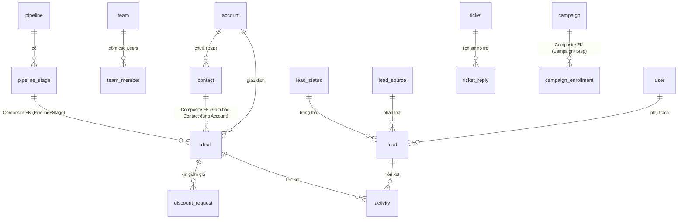

# Thiết Kế Kiến Trúc Cơ Sở Dữ Liệu - CRM Web App (Bản Số Ít)

Tài liệu này trình bày chi tiết kiến trúc cơ sở dữ liệu cho hệ thống Customer Relationship Management (CRM), bảo đảm tính toàn vẹn dữ liệu, hiệu suất hệ thống cao và cấu trúc chuẩn chuyên nghiệp.

---

## 1. Phân tích nghiệp vụ

Hệ thống quản lý vòng đời khách hàng qua nhiều giai đoạn:
1. **Lead Generation**: Tiếp nhận Lead từ nhiều nguồn (Facebook, Website). Lead được tự động gán cho Sales thông qua `lead_assignment_rule` và phân vào các nhóm theo danh sách Sale (`lead_assignment_rule_member`).
2. **Lead Nurturing & Email Marketing**: Nuôi dưỡng Lead qua các Drip Campaign và Activity. Enrollment scheduler quét và gửi email động dựa trên `next_run_at`.
3. **Conversion (Chuyển đổi)**: Khi Lead đạt yêu cầu, sẽ được chuyển đổi (`converted_at`). Thông tin chuyển đổi tham chiếu sang `account` và `contact` mới sinh ra.
4. **Deal & Pipeline**: Tạo Cơ hội bán hàng đẩy vào Pipeline Kanban. Trạng thái Đóng/Mở của Deal được suy ra trực tiếp từ Pipeline Stage (Won/Lost) để chuẩn hóa tuyệt đối. Sales xin duyệt Discount qua nhiều cấp với lý do (`reason`).
5. **Customer Support**: Quản lý chăm sóc sau bán qua Ticket (SLA).

---

## 2. Danh sách bảng và Data Dictionary (Các Module chính)

| Module | Tên Bảng | Mục đích / Data Dictionary (Các trường chính) |
|--------|----------|-----------------------------------------------|
| **Core** | `role`, `permission`, `role_permission`, `"user"`, `user_role`, `team`, `team_member` | Hệ thống quản trị viên, phân quyền RBAC và phân bổ đội nhóm kinh doanh. |
| **Lead** | `lead` | Lưu Lead thô, theo dõi `converted_at`. **Soft Delete**: `deleted_at`. |
| | `lead_assignment_history` | Lưu vết chi tiết từ Sales nào chuyển sang Sales nào, do ai chuyển (`from_owner_id`, `assigned_by`). |
| **Customer**| `account` | Khách hàng Doanh nghiệp. **Soft Delete**: `deleted_at`. |
| | `contact` | Người liên hệ đại diện Doanh nghiệp. **FK**: account_id. |
| **Sales** | `deal` | Giao dịch bán hàng. Cột: amount, expected_close_date. |
| | `pipeline_stage` | Các cột Kanban. Cột: code (NOT NULL), order_index, default_probability. |
| | `discount_request` | Quy trình xin duyệt giảm giá cho Deal nhiều cấp (kèm `reason`). |
| **Care** | `activity` | Theo dõi hành động chăm sóc (Call, Note). Cột: due_date. |
| **Marketing**| `campaign`, `campaign_step` | Thiết lập chuỗi Drip Email Marketing. |
| **System** | `audit_log` | Lưu trữ truy vết thay đổi dữ liệu (**PK**: BIGINT). |

---

## 3. Quan hệ dữ liệu (Relations)

- **1-1**: Hiện không sử dụng quan hệ 1-1 vật lý vì các extension data được dùng JSONB hoặc gộp vào bảng chính.
- **1-N (One-to-Many)**:
  - `account` 1 --- N `contact`: Trong phạm vi đồ án, hệ thống được xác định là CRM B2B. Vì vậy mỗi Contact đại diện cho một cá nhân thuộc một Account doanh nghiệp và `account_id` được đặt `NOT NULL`.
  - `pipeline` 1 --- N `pipeline_stage`: Một Pipeline chứa nhiều Stage. 
- **N-N (Many-to-Many)**:
  - `"user"` N --- N `role` / `team`: Qua bảng trung gian.

---

## 4. Sơ đồ ERD (Entity Relationship Diagram)



---

## 5. Giải thích Chuẩn hóa 1NF, 2NF, 3NF và Chuẩn Hóa Logic Dẫn Xuất

- **1NF & 2NF**: Các cột chứa giá trị nguyên tử, cấu trúc Khóa Chính đảm bảo không có phụ thuộc một phần.
- **3NF & Loại bỏ dữ liệu lặp**: 
  - **Deal Status vs Stage Logic**: Database đã chủ động **bỏ đi cột `status` trong bảng `deal`**. Việc Deal đó đang Mở (Open), Thắng (Won) hay Thua (Lost) được suy luận hoàn toàn từ cấu hình `is_closed_won` và `is_closed_lost` của bảng `pipeline_stage`. Việc loại bỏ này ngăn chặn triệt để mâu thuẫn dữ liệu kiểu "Stage là Lost nhưng Status của Deal vẫn ghi Open".
  - **Stage Logic Validation**: Bổ sung `CHECK (NOT (is_closed_won = TRUE AND is_closed_lost = TRUE))` để triệt tiêu việc setup Stage vô nghĩa.

---

## 6. Lịch sử Dữ liệu và Constraints Bảo vệ (Data Integrity)

1. **Bảo vệ Lịch sử (ON DELETE RESTRICT)**:
   - Các bảng mang tính truy vết lịch sử (`deal_stage_history`, `lead_assignment_history`, `ticket_reply`, `discount_request`) và bảng tác nghiệp chăm sóc (`activity`) đều thiết lập `ON DELETE RESTRICT` ngược về bảng chính (Deal, Lead, Ticket). 
   - Không được phép xóa cứng (Hard Delete) để làm mất dấu vết tác nghiệp. Mọi entity lớn (lead, account, contact, deal, ticket) đều sử dụng Soft Delete qua `deleted_at`.
2. **Composite Foreign Key (Ràng buộc kép)**:
   - **Bảo vệ Pipeline/Stage**: Ở bảng `deal`, khóa ngoại `FOREIGN KEY (pipeline_id, stage_id) REFERENCES pipeline_stage(pipeline_id, id)`. Ngăn chặn hoàn toàn lỗi tạo Deal thuộc Pipeline A nhưng lại gắn Stage của Pipeline B.
   - **Bảo vệ Account/Contact**: Khóa ngoại `FOREIGN KEY (account_id, contact_id) REFERENCES contact(account_id, id)`. Nếu một Deal tạo ra có Contact thì Contact đó BẮT BUỘC phải thuộc đúng Doanh Nghiệp (Account) đó. Chặn đứng lỗi "Bán hàng cho Công ty A nhưng gắn nhầm Contact của Công ty B".
   - **Bảo vệ Drip Campaign**: Khóa ngoại `FOREIGN KEY (campaign_id, current_step_id) REFERENCES campaign_step(campaign_id, id) ON DELETE RESTRICT`. Step đã được Campaign Enrollment sử dụng sẽ không cho xóa cứng, tránh vỡ tiến trình Automation.
3. **Activity Single Entity (num_nonnulls)**:
   - Sử dụng `CHECK (num_nonnulls(lead_id, account_id, contact_id, deal_id, ticket_id) = 1)` trên bảng `activity`. Ép buộc Data Tier từ chối mọi Activity mập mờ.

---

## 7. Index tối ưu

Index được tạo sát với các Query thực tế, chú trọng Filter dữ liệu Soft-delete:
- `idx_deal_pipeline_stage`: Composite Index cho Load Kanban nhanh (`WHERE deleted_at IS NULL`).
- `idx_activity_due_date`: Sử dụng **Partial Index** (`WHERE status = 'pending'`) giúp Table Scan cực nhỏ khi Cronjob quét lịch nhắc Follow-up.
- `idx_campaign_enrollment_next_run`: Partial Index cho Scheduler Worker (`WHERE status = 'active'`) truy vấn cực nhanh các Email cần chạy tới hạn `next_run_at`.

---

## 8. Query mẫu

**1. Query Logic Trạng Thái Deal (Thay vì dùng cột status):**
```sql
SELECT 
    d.name, 
    d.amount, 
    CASE 
        WHEN s.is_closed_won THEN 'won'
        WHEN s.is_closed_lost THEN 'lost'
        ELSE 'open'
    END AS deal_status
FROM deal d
JOIN pipeline_stage s ON s.id = d.stage_id
WHERE d.deleted_at IS NULL;
```

**2. Forecast (Dự báo doanh thu tháng này) thông qua View:**
```sql
SELECT owner_name, pipeline_name, total_amount, weighted_value
FROM view_forecast_pipeline
WHERE forecast_month = DATE_TRUNC('month', CURRENT_DATE);
```

---

## 9. Các quyết định thiết kế quan trọng khác

1. **Forecast bằng SQL View với xử lý COALESCE**: 
   - Thay vì lưu vật lý gây Over-engineering, hệ thống tính Forecast qua `view_forecast_pipeline`. Logic sử dụng `COALESCE(d.probability, s.default_probability, 0)` để đảm bảo Deals không nhập xác suất riêng sẽ tự động dùng tỉ lệ mặc định của Stage. Sử dụng `LEFT JOIN` Users để không bỏ sót các Deal chưa gán Sales (owner_id = NULL).
2. **Audit Log bằng BIGINT thay vì UUID**: 
   - BIGINT tuần tự được lựa chọn nhằm giảm tính ngẫu nhiên của khóa chính và phù hợp với đặc điểm ghi nối tiếp liên tục (Append-heavy) của Log Truy vết. UUID vẫn là một phương án hợp lệ nếu hệ thống cần sinh ID phân tán, nhưng BIGINT giúp tối ưu I/O ghi trên cây B-Tree.
3. **Trigger cập nhật Auto Timestamp**:
   - Sử dụng Function PostgreSQL `trigger_set_timestamp()` để tự thay đổi `updated_at` ở mọi thao tác `UPDATE`. Tầng Database tự làm nhiệm vụ bảo đảm tính chân thực của log thời gian.
